# Almost every apparent behaviour in this register turns out to be structure

**Status: proven** · method 1.0.0 · computed 2026-09-22 from the ClinicalTrials.gov API v2
(`clinicaltrials.gov/api/v2`, API version 2.0.5) — **603,730 registered studies, walked in
full three times**. Retrieved by
[`artifacts/scripts/fetch.py`](artifacts/scripts/fetch.py): no key, no account, standard
library only, no data committed.

This is the first register in this repo where a **statute** creates the record and puts a
**date** on it. FDAAA 801 and its Final Rule, 42 CFR Part 11, require summary results within
**12 months of the primary completion date**. Both dates sit in every record, so the gap is
measured rather than estimated and the deadline is a line you can draw on a chart.

**The thread through all twelve figures.** Every headline that looks like behaviour — a flat
reporting rate, a twenty-five-fold sponsor gap, trials getting faster, big trials reporting
more — survives only until it is conditioned on something. Underneath is scope, composition
and censoring. **One finding is genuinely behavioural**, and it turns out to be narrower and
older than the rule that supposedly created it.

## Contents

| | | |
| --- | --- | --- |
| **I** | [The deadline is a wall, not a slope](#i-the-deadline-is-a-wall-not-a-slope) | 20x hazard in the deadline month, 1.25x the month after, never recovers |
| **II** | [Older than the rule, one day wide](#ii-the-wall-is-older-than-the-rule-and-one-day-wide) | 2008–2012 already spikes 22.1x; a 7.4-fold drop across one week |
| **III** | [Reporting sped up, it did not spread](#iii-reporting-sped-up-it-did-not-spread) | one-year tripled, three-year flat for fifteen years |
| **IV** | [The flat quarter is two fields](#iv-the-flat-quarter-is-an-average-of-groups-that-barely-overlap) | NIH 83.1% against other government 3.3%; the pooled line is composition |
| **V** | [A status that is not a status](#v-a-sixth-of-the-register-has-a-status-that-is-not-a-status) | UNKNOWN is 0.0% for 2026 registrations because it is a timer |
| **VI** | [Two duties, one failure](#vi-two-duties-one-failure) | a fifth registered after finishing, and they report 3–5x less |
| **VII** | [Stopped trials report more](#vii-trials-that-stop-early-are-reported-more-often-than-trials-that-finish) | 37.9% against 24.3% — the opposite of the hypothesis |
| **VIII** | [Lead time, and a scale threshold](#viii-two-things-predict-reporting-they-multiply-one-group-is-immune) | flat to 100 trials a sponsor, then 30.9% and 50.0% |
| **IX** | [Sample size reverses by class](#ix-bigger-trials-get-reported-only-if-industry-runs-them) | industry 36.7→68.6%, universities 29.6→16.1% |
| **X** | [The missing results are outside the law](#x-the-missing-results-are-mostly-outside-the-law) | **67.1% in scope against 3.4% out** — the correction to everything above |
| **XI** | [Trials got slower, not faster](#xi-trials-look-three-times-faster-than-in-2008-they-are-slower) | the obvious measurement is inverted by survivorship |
| **XII** | [Phases stop being a sequence](#xii-a-drugs-phases-stop-being-a-sequence-as-soon-as-the-drug-works) | a drug that works re-enters phase 1 |

**Every number below is recomputed by
[`artifacts/scripts/verify.py`](artifacts/scripts/verify.py)** — about a hundred checks. If it
disagrees with this page, the script is right and the prose is a bug.

## Screens, run before anything was built

| screen | result |
| --- | --- |
| the same query twice | 603,730 both times |
| a nonsense **filter** | HTTP 400, `` `filter.banana` is unknown parameter `` |
| a nonsense **value** | HTTP 400, naming the parameter |
| a nonsense **page token** | HTTP 400, `Incorrect pageToken format` |
| a nonsense **field path** | **silently empty** — the one failure mode that is quiet |
| date precision | **39% of primary completion dates carry no day of month** |
| `hasResults` vs a results date | agree exactly, zero disagreements either way |

**The quiet one matters.** A bad filter fails loudly; a bad *field path* returns empty strings
for every row, indistinguishable from a column that happens to be blank. Both walks check every
column against the first page for exactly this reason, and the check caught two dead columns
before 600,000 rows were written.

## What it cost to read, which decided the design

The host charges about **134 seconds to open a connection** and **0.3 seconds per request
after that**. Measured through `urllib`, which opens a fresh connection per call, every request
looked like it cost 135 s — and an 818-byte response cost the same as a 10 KB one, which is the
tell. A server doing work does not behave like that.

Designing around the wrong reading would have meant no paging, no per-study values, and the
central question dropped as unaffordable. Holding one connection open makes the full register
**604 requests in about nine minutes**. Recorded in
[`fetch-constraint.md`](artifacts/research-questions/fetch-constraint.md) with both readings,
because the wrong one is the instructive part.

## I. The deadline is a wall, not a slope

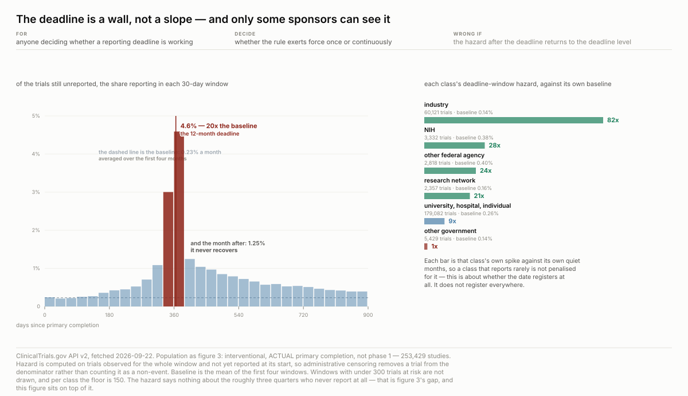

Of the trials still unreported entering each 30-day window, the share reporting during it:
**0.23% a month** for the first four months, **3.0%** the month before the deadline, **4.6%**
the month it falls — **twenty times baseline** — and **1.25%** the month after.

**It never recovers.** A sponsor who misses the date does not catch up later at a higher rate;
they join a slow tail. The register exerts force once, on one day.

**And the wall is not visible to everyone.** Each class measured against *its own* baseline, so
an infrequent reporter is not penalised for being infrequent: industry **82x**, NIH 28x, other
federal 24x, network 21x, university and hospital 9x, **other government 1.4x**.

## II. The wall is older than the rule, and one day wide

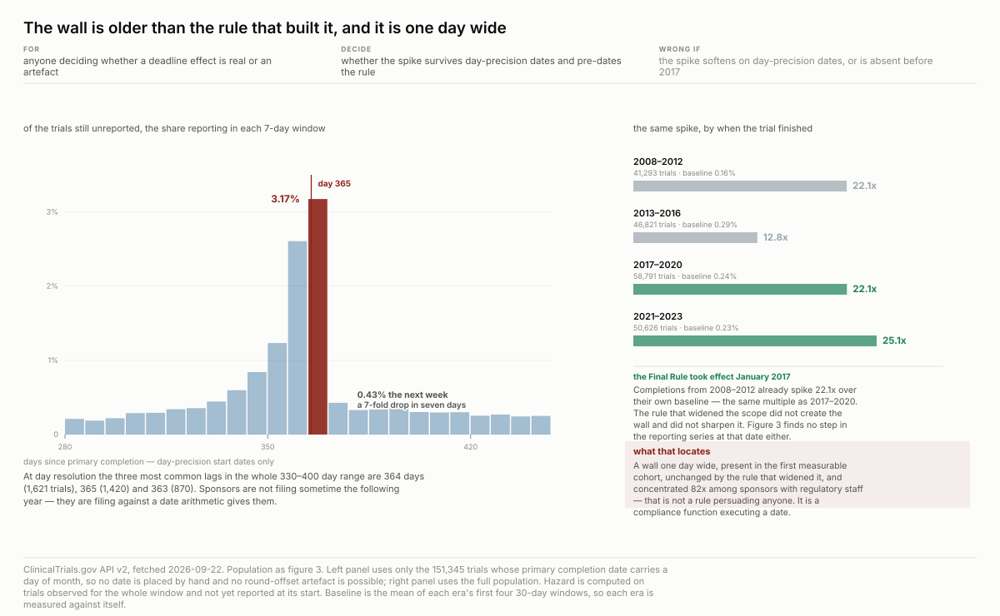

Two things could have made section I less than it looks. Both were tested and both failed.

**It is not date handling.** 39% of completion dates carry no day and are placed mid-month,
which can manufacture a pile-up at a round offset. Restricted to the **151,345 trials with a
day-precision completion date** and binned at seven days, the wall gets *sharper*: **3.17%** in
the week containing day 365, **0.43%** the week after — a **7.4-fold drop in seven days**. The
three most common exact lags in the whole 330–400 day range are **364 days (1,621 trials), 365
(1,420) and 363 (870)**. Sponsors are filing against a date arithmetic gives them, not
sometime the following year.

**And the 2017 Final Rule did not build it.** Each era measured against its own baseline:

| completions | trials | baseline | deadline window | ratio |
| --- | --- | --- | --- | --- |
| 2008–2012 | 41,293 | 0.16% | 3.55% | **22.1x** |
| 2013–2016 | 46,821 | 0.29% | 3.69% | 12.8x |
| 2017–2020 | 58,791 | 0.24% | 5.24% | **22.1x** |
| 2021–2023 | 50,626 | 0.23% | 5.86% | 25.1x |

**2008–2012 already spikes 22.1x — the same multiple as 2017–2020.** The rule that widened the
scope neither created the wall nor sharpened it, which is consistent with section III finding no
step in the reporting series at that date.

**Which locates the mechanism.** A wall one day wide, present in the first measurable cohort,
unchanged by the rule that widened it, and concentrated **82x** among sponsors with regulatory
staff — that is not a rule persuading anybody. It is a compliance function executing a date.

## III. Reporting sped up. It did not spread.

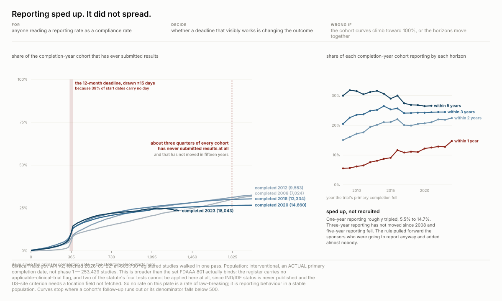

With non-reporters kept in the denominator — a trial that never reports stays in it forever and
never enters the numerator — three-year reporting rose from **20.5%** for 2008 completions to
about **25% by 2012** and has not moved since: 25.7% for 2016, 24.2% for 2020, 24.5% for 2023.
One-year reporting roughly tripled over the same span, 5.5% to 14.7%. Five-year reporting
*fell*.

**The rule pulled forward the sponsors who were going to report anyway and added almost
nobody.** Neither the 2017 rule taking effect nor the first Notices of Noncompliance in 2021
leaves a step in the series.

*A filter tried and discarded:* restricting to self-reported FDA-regulated studies turns this
flat picture into a rise from 9.4% to 28.3% on time. That field's coverage runs **3.4% in 2010
to 98.5% in 2024** — it is a chart of a form field being rolled out.

## IV. The flat quarter is an average of groups that barely overlap

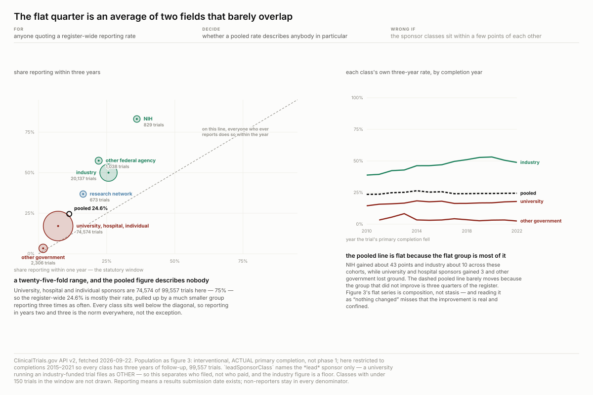

Three-year reporting, completions 2015–2021: NIH **83.1%**, other federal 57.4%, industry
50.0%, network 36.8%, **university and hospital 17.1%**, **other government 3.3%**. A
twenty-five-fold range, and the group that reports least is **75% of the register**.

**And the pooled flatness is composition, not stasis.** Each class's own three-year rate,
2010 against 2022: NIH **+43 points**, industry **+10**, university +3, other government **−2**.
The improvement is real, large, and confined to the sponsors who were already best.

## V. A sixth of the register has a status that is not a status

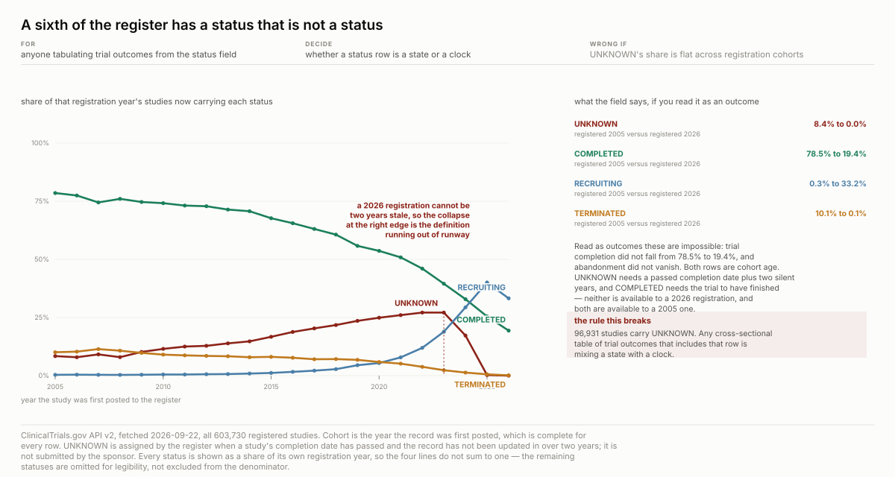

`UNKNOWN` is the second most common status — **96,931 studies**. It is assigned by the register
when a completion date has passed and nobody has updated the record for two years.

Share of each registration year now marked `UNKNOWN`: 8.4% (2005) rising to 27.1% (2022–23),
then 17.2% (2024), **0.3% (2025), 0.0% (2026)**. A 2026 registration cannot be two years stale.
`COMPLETED` falls 78.5% to 19.4% over the same cohorts for the mirror-image reason. **Both rows
are cohort age wearing a status field's clothes.**

## VI. Two duties, one failure

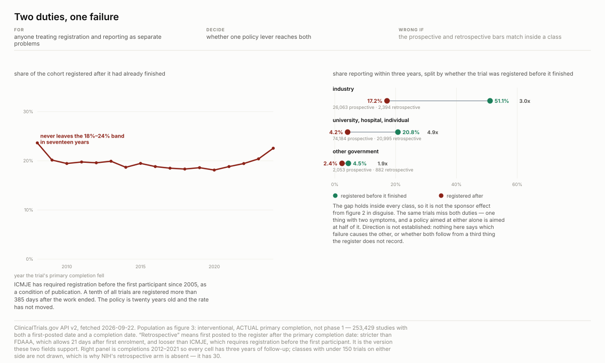

**A fifth of trials are registered after they have already finished** — 18.1% to 23.6% of every
completion cohort since 2008, never leaving that band. A tenth are registered more than **385
days** after the work ended. ICMJE has required prospective registration since 2005.

**And it predicts the other failure inside every class:** industry 51.1% against 17.2%,
university 20.8% against 4.2%, other government 4.5% against 2.4%. Holding sponsor class fixed
rules out the class effect — the same trials miss both duties.

## VII. Trials that stop early are reported more often than trials that finish

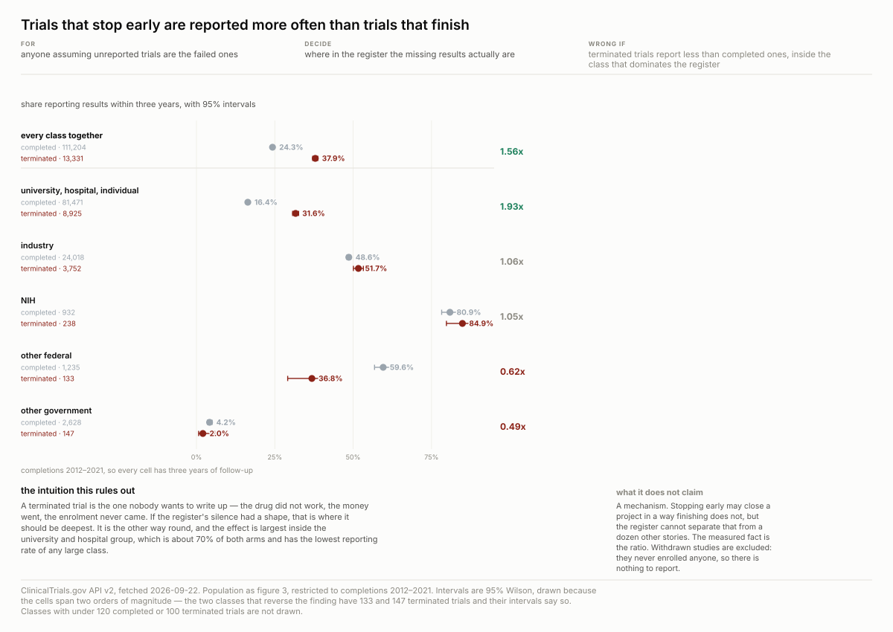

The expectation was the opposite: a terminated trial is the one nobody wants to write up.
Instead, **37.9% against 24.3%**. Not composition — inside university and hospital sponsors it
is **31.6% against 16.4%**, nearly double, and that is the class with the lowest rate.

Two small classes reverse it, on 133 and 147 terminated trials; the Wilson intervals say so on
the plate rather than in a footnote. **What this rules out** is the intuition it started with:
the register's silence is not concentrated on the failures.

## VIII. Two things predict reporting, they multiply, one group is immune

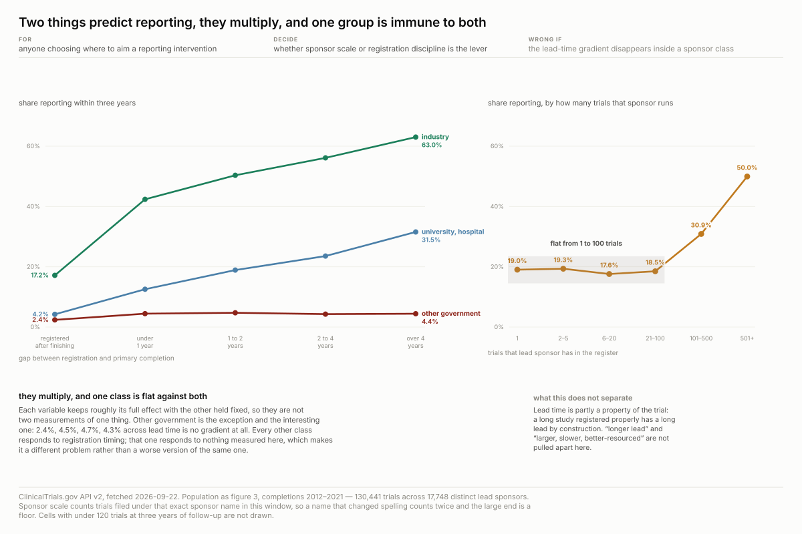

**Lead time** — the gap between registration and completion — runs from **5.6%** (registered
after finishing) to **39.9%** (over four years). **Sponsor scale is a threshold, not a
gradient**: flat at 17.6–19.3% for sponsors running 1 to 100 trials, then **30.9%** at 101–500
and **50.0%** at 501+. Running ten trials instead of one buys nothing.

Crossed, they multiply: industry 17.2% to 63.0% across lead-time bands, university 4.2% to
31.5%. **Other government is flat against both** — 2.4%, 4.5%, 4.7%, 4.4% — which makes it a
different problem rather than a worse version of the same one.

## IX. Bigger trials get reported. Only if industry runs them.

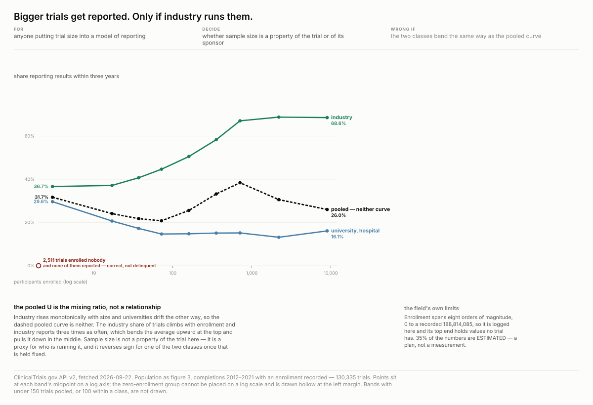

Pooled, enrollment against reporting makes a U: 31.7% at 1–10 enrolled, 20.8% at 51–100, 38.4%
at 501–1,000, 26.0% above 5,000. **There is no U.** Industry rises monotonically **36.7% to
68.6%**; university and hospital sponsors drift **29.6% down to 16.1%**.

Sample size is **not a property of the trial here** — it is a proxy for who is running it, and
it reverses sign for one of the two classes once that is held fixed.

## X. The missing results are mostly outside the law

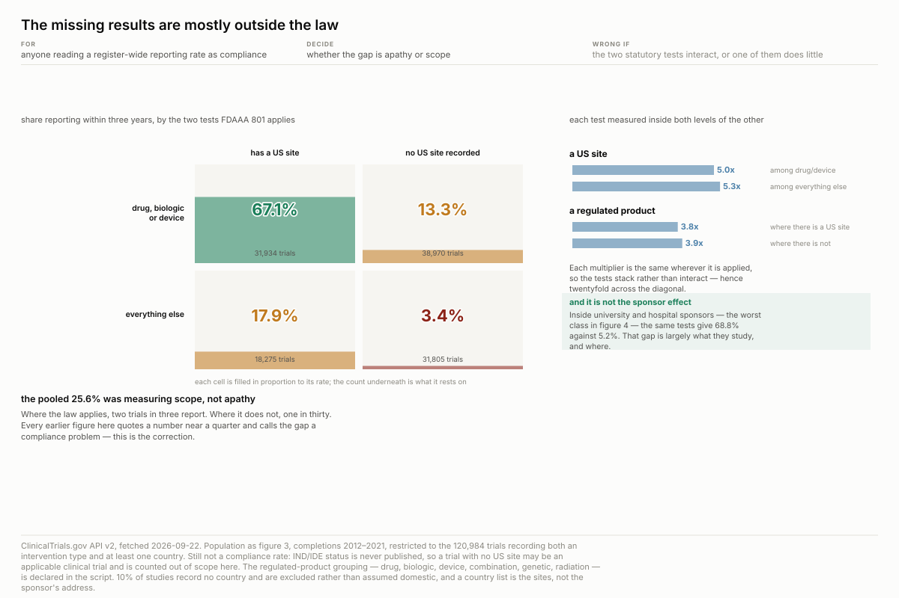

**This is the correction to every figure above it.** FDAAA 801 applies two tests the register
can answer — a drug, biologic or device, and a US site:

| | US site | no US site |
| --- | --- | --- |
| drug, biologic or device | **67.1%** (31,934) | 13.3% (38,970) |
| everything else | 17.9% (18,275) | **3.4%** (31,805) |

**The tests do not interact.** US-site effect **5.0x** among regulated products and **5.3x**
among everything else; regulated-product effect **3.8x** with a US site and **3.9x** without.
Two independent multipliers, twentyfold across the diagonal.

**So the pooled quarter was measuring scope, not apathy.** Where the law applies, two trials in
three report. Where it does not, one in thirty. And inside university and hospital sponsors
alone the same tests give **68.8% against 5.2%** — a university running a drug trial with a US
site reports about as often as industry. Section IV's twentyfold class gap is substantially a
gap in *what those sponsors study and where*.

## XI. Trials look three times faster than in 2008. They are slower.

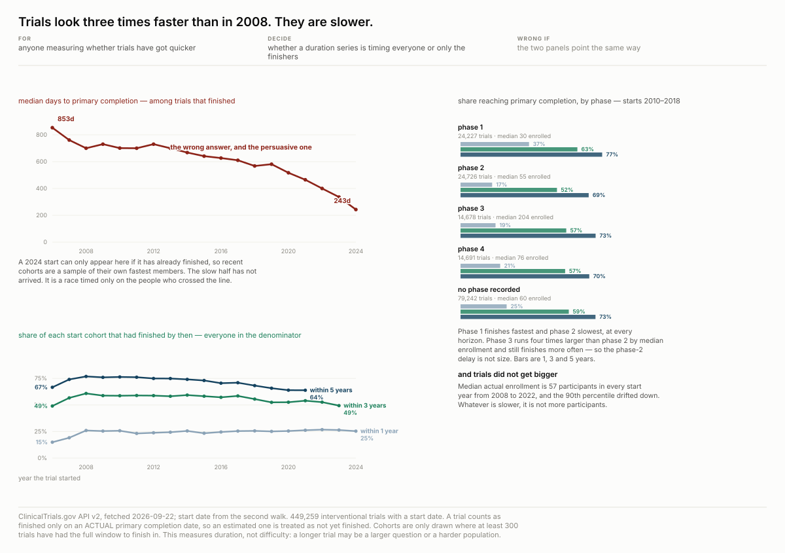

Median days to primary completion among trials that finished: **853 (2006) to 243 (2024)**. It
is survivorship — a 2024 start only enters that median if it has already finished.

Keeping every trial in the denominator: five-year completion **77% to 64%**, three-year 61% to
54%, and **one-year unmoved at 26%**. The slowdown is entirely in the tail. It is not size:
median enrollment is 57–60 participants in every start year since 2008.

**Phase 2 is the bottleneck** at every horizon — 17% complete within a year against phase 1's
37% — despite phase 3 running four times larger by median enrollment.

## XII. A drug's phases stop being a sequence as soon as the drug works

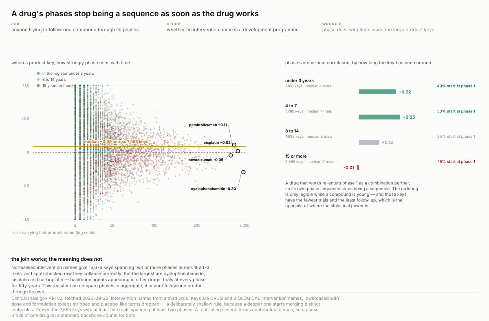

There is no compound identifier here — no NDC, no UNII, no ChEMBL — so the only product key is
the free-text intervention name. Normalised, it gives **16,676 keys spanning two or more phases
across 162,173 trials**, and spot-checked raw the groups collapse correctly.

**The join works and the meaning does not.** The largest keys are cyclophosphamide (2,887
trials since 1976), cisplatin, carboplatin — backbone agents appearing in *other* drugs' trials
at every phase for fifty years. Median within-key correlation between phase and time across
7,553 keys: **+0.09**. Cyclophosphamide is **−0.30**.

Split by how long a key has been in the register: **+0.22** under three years, +0.25 at four to
seven, **−0.01** past fifteen; the share starting at phase 1 falls **49% to 19%**. **A drug
that works re-enters phase 1 as a combination partner.**

## What this cannot support

**Not a compliance rate.** IND/IDE status is never published, so a trial with no US site may
still be an applicable clinical trial and is counted out of scope. No rate on any plate is a
rate of law-breaking.

**Not profitability.** Checked rather than assumed: no cost, price, revenue or funding-amount
field exists. Any profit figure from this source would be manufactured.

**Not time-to-market.** No approval date, no NDC. That needs a Drugs@FDA join.

**Not a plan against its outcome.** The register carries one enrollment number and a type flag;
the actual **overwrites** the estimate. Recovering the plan means diffing version history.

**Not one product's development.** Section XII.

## The arbitrage question

Per [`webprobes/doctrine/arbitrage-policy.md`](../../../webprobes/doctrine/arbitrage-policy.md):
*is there any opportunity someone exposed to this can exploit for profit, and when does it
saturate?*

**Two exits, because the finding splits.** The unconditional version is **exit 2 — already
priced**. The residual is **exit 4 — survives disclosure**, because what it needs cannot be
bought, only waited for. This is the first recipe in the fleet whose subject has a liquid
instrument at all.

### The part that is already sold

**There is a free forward calendar.** 60,485 interventional trials carry an **estimated**
primary completion date in the future. **11,667 are industry**; 4,990 of those are phase 2 or 3
and **2,736 of those have a US site** — the cell where section X puts reporting at 67.1% and
section I puts the hazard spike at twentyfold. A dated, per-sponsor, forward-looking event list
from a public API with no key.

**And catalyst calendars are a product** — BioPharmaCatalyst, Evaluate, Bloomberg. Anything
with tradable value is being sold; that is what tradable means. The unconditional edge was
priced years before this recipe existed.

### The part that is not, and why it cannot be bought

A date is only a calendar **if it does not move**, and this register does not tell you whether
it moves: the actual **overwrites** the estimate. 370,668 trials now carry an `ACTUAL` primary
completion date and the estimate that preceded it is gone from the record.

**Retrospective recovery is closed, and that was tested rather than assumed:**

| endpoint | result | reading |
| --- | --- | --- |
| `/api/v2/studies/{nct}/history` | **404** | v2 has no history endpoint |
| `/api/v2/studies/{nct}/versions` | **404** | nor under that name |
| `/api/int/studies/{nct}/history` | **403**, HTML body | the internal endpoint the website uses, deliberately closed |
| a known-good v2 query | **200** | the session and the UA are fine |

A 404 and a 403 are different answers. The first says the public API never had this; the second
says the publisher has one and is declining to serve it. **An honest bot user-agent does not
get to argue with the second**, so the route is recorded as closed rather than worked around.

**But slip is perishable state, which is the one thing this project is built to capture.** The
estimated date is overwritten on update, so nobody can reconstruct it later — which is exactly
the `wss-*` filing rule. Capturing it forward costs one handshake and 604 paged requests, about
**twelve minutes and 26 MB a month**; twelve monthly snapshots is **two and a half hours of
fetching and roughly 310 MB**.

And it resolves fast enough to be worth it: **51% of the watchlist has its estimated date fall
within a year** (31.4% within six months, 19.9% in six to twelve).

| when the estimated date falls | trials | share |
| --- | --- | --- |
| within 6 months | 19,008 | 31.4% |
| 6–12 months | 12,062 | 19.9% |
| 1–2 years | 15,708 | 26.0% |
| over 2 years | 13,707 | 22.7% |

**So the residual is exit 4 and the constraint is elapsed time.** Publishing this page does not
transfer the asset, because the asset is twelve months of snapshots nobody else started. That
is the fleet's stated moat, arrived at from the other direction — and it is the first time a
recipe here has produced a `wss-*` candidate rather than the reverse.

*One alternative not costed, and it is the one that decides this:* AACT, the CTTI mirror,
keeps its own dated snapshots and may carry the history retrospectively. **If it does, there is
nothing to capture and this is a join, not an archive.** That test is cheap and has not been
run.

**Handed off:**
[`webprobes/screening/ctgov-slip-2026-09-22.md`](../../../webprobes/screening/ctgov-slip-2026-09-22.md)
writes this up for a wss session, leading with the disqualifier rather than the build — the
publisher shows a version history to a human, so `destroys_own_history` is probably **false**
and the casing screen should reject it. The fleet over-calls wss 13 times in 21, and always on
that question.

### Saturation

| clock | state |
| --- | --- |
| **vendor packaging** | already fired on the unconditional calendar, years ago |
| **disclosure** | does not bite on the residual: knowing the method does not give anyone the snapshots |
| **reflexivity** | **live** — section X says enforcement scope explains the gap, and that stops being true if enforcement changes |
| **exhaustion** | unknown until slip is measured |

### Everything else is exit 1

**Sections III through IX, XI and XII** — everything except the wall and the scope quadrant —
are findings for a regulator, a journal editor or a research administrator. The register's
dominant population is universities and hospitals, **75% of trials**, with no ticker between
them. Worth nothing to anybody with a trading account, which is the honest answer and the
normal one for this fleet.

## What is open

[`questions.md`](artifacts/research-questions/questions.md) holds thirty-one questions and which
died. Still open:

**Q16 — does the hazard spike predate the rule?** If 2008–2012 completions already spike at 365
days, the wall is a convention the statute later wrote down. One line of code.

**Q17 — is the spike at 365 days or at 12 months?** Month-precision starts are placed mid-month.
The day-precision subset binned at 7 days would separate a daily deadline from a monthly grid.

**Q26 — `whyStopped` is 47,089 sentences, not a column.** A declared keyword rule leaves **37%
unmatched** and 8.3% matching two families. Recorded as a candidate for `assay/` rather than
forced into a codebook.

**Q30 — the young-compound subset.** 2,524 keys have phase-time correlation above +0.3. They
are where the progression question is actually posed, and whether they carry enough trials each
is untested.

## Reproducing

    cd recipes/clinical-trial-reporting
    python3 artifacts/scripts/fetch.py        # all four walks, then the drift report
    for f in artifacts/scripts/chart-*.py; do python3 "$f"; done
    python3 artifacts/scripts/verify.py       # ~100 checks against this page

Standard library only, **no key and no account**, nothing committed — 56 MB of gzipped CSV
stays local. Every walk checkpoints its page token, so an interrupted run resumes on one
handshake rather than starting over.

| phase | what it adds |
| --- | --- |
| `ctg.py` | totals, twelve marginals in **one** request, and the four screens |
| `ctg2.py` | the register — 604 pages, 21 columns |
| `ctg3.py` | study start date, intervention type, conditions, location country |
| `ctg4.py` | intervention names, for the product key |

`joincheck.py` measures the name join before figure XII uses it, and `explore.py` prints what
is populated and what the dates mean. Both are diagnostics, not figure code.

**Time it on the connection, not the request.** This host charges about **134 seconds to open a
connection** and under a second per request after. Measured through `urllib`, which opens a
fresh connection per call, every request reads as 135 s and the job looks impossible — that
misreading nearly cost this recipe its central question. The toll is host-pair specific;
`search.rcsb.org` answered in 0.3 s from the same machine, so a reproducer elsewhere may see
none of it.

**Expect drift.** The register is updated daily. `fetch.py` prints the SHA-256 comparison
against `provenance.json` and `verify.py` then says which sentences no longer hold.

Two tools from the wider project, which do not live in this repo, also pass:
`plateaudit.py` (twelve figures, clean) and `determinism.py` (byte-identical across two
builds).
