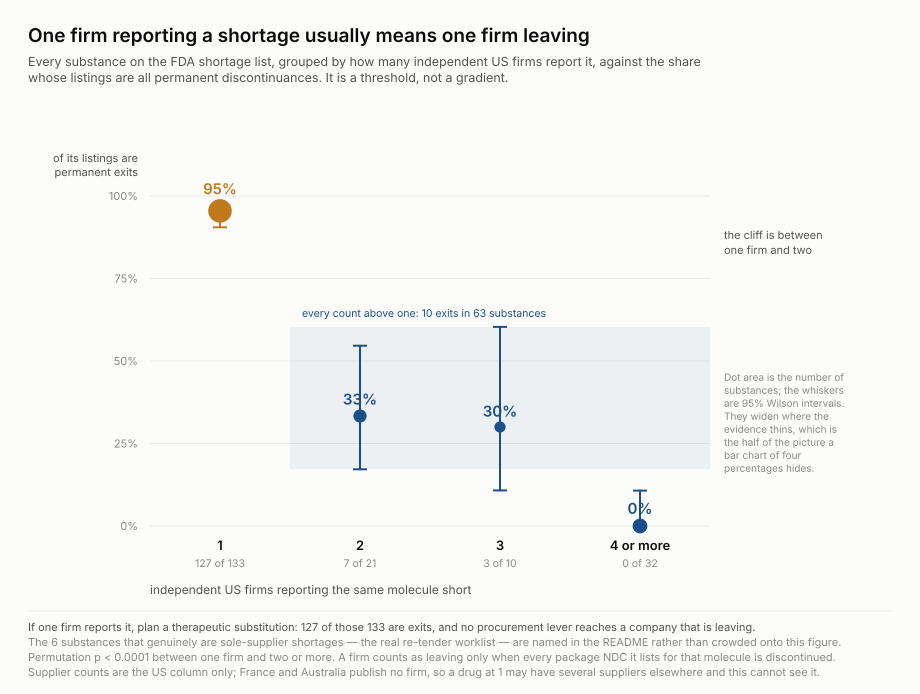
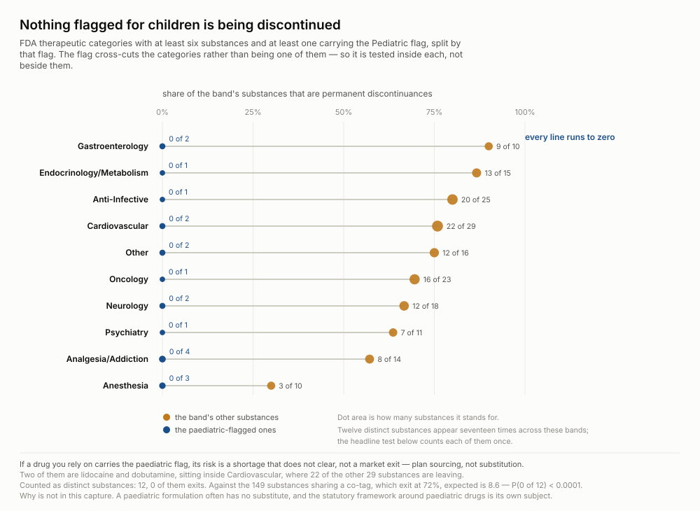
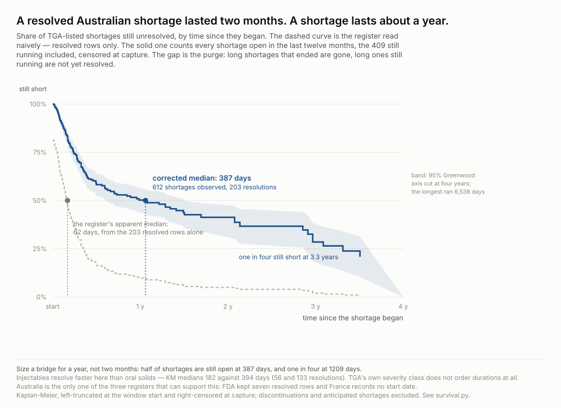
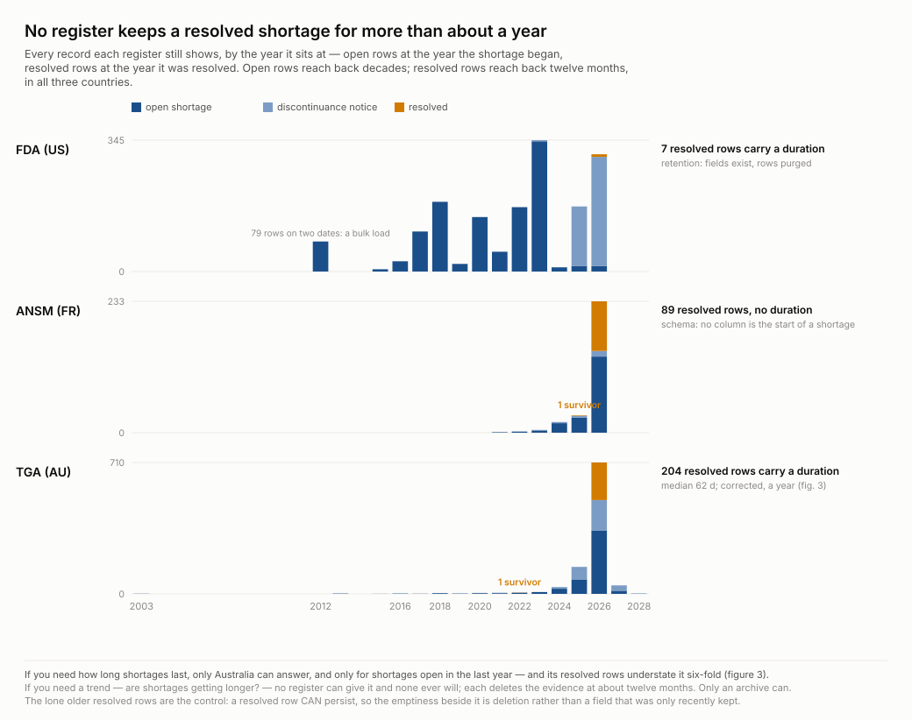

# Most of the FDA shortage list is not a shortage

**Published 2026-09-15** · four figures, five kept as worked failures · sources: the US,
French and Australian medicine-shortage registers read from a public archive of dated
captures, plus FDA's inspection, warning-letter, recall and import-alert feeds and a
Drugs@FDA cohort · RxNav for the join · no key, no account · every number re-derived by
`artifacts/scripts/verify.py`, every signal that failed by `artifacts/scripts/sweep.py`

Two findings a buyer can act on, one correction to a number anyone would compute from
these registers, and a record of everything else the archive was asked and could not
say.

## What these sources are

**The FDA drug shortage database is a compliance register, not a clinical one.** Since
FDASIA (2012) amended §506C of the Food, Drug and Cosmetic Act, a manufacturer must
notify FDA of *either* a permanent discontinuance *or* an interruption of supply likely
to cause a shortage. openFDA publishes what those notifications produce: two legal
duties, one table, one row per package, and no column naming which duty a row
discharges. France's ANSM and Australia's TGA publish their own equivalents,
independently, in incompatible formats.

None of the three publishes its own history. A shortage that resolves leaves the page.
So the corpus here is not the registers but
[`wss-drug-scarcity`](https://github.com/q3dresearch/wss-drug-scarcity), a public
archive that captures all three weekly and keeps every capture, alongside FDA's
enforcement feeds. This recipe reads the newest capture of each register, all from
**2026-09-10**, and every FDA capture held.

*Who has a stake, and what they decide:* a **hospital or national procurement officer**
choosing between stockpiling, re-tendering and substituting, and sizing a bridge; a
**formulary pharmacist** deciding whether to start a therapeutic substitution pathway,
which has a clinical lead time a purchase order does not; a **researcher** about to
compute a shortage duration from a register; and the **registers' own publishers**, for
whom what they keep is a statement about what the statute collects.

## Finding 1 — one reporting firm means one firm leaving

The register's own `status` field says **137 of the 196 substances on the US list are
products being discontinued, not products in short supply** — and the two want
opposite responses.



**It is a threshold, not a gradient.** At one reporting firm, 127 of 133 listings are
exits. At two or more, 10 of 63. Permutation p < 0.0001; the Wilson intervals do not
touch. Nothing decays across the axis — the rate falls off a cliff between one firm
and two and never comes back.

| | substances | what to do |
| --- | --- | --- |
| **one reporting firm** | 133, of which **127 are exits** | start a therapeutic substitution pathway — a clinical decision with a lead time, not a purchase order |
| **the 6 exceptions** | sole firm, genuinely short | the real re-tender worklist: bacitracin, conivaptan, ecothiopate, isocarboxazid, pentostatin, riluzole |
| **short in all three countries, several firms** | 13, none of them exits | **inventory only.** Several independent firms in three jurisdictions cannot make the same molecule: clindamycin, desmopressin, dexamethasone, hydroxocobalamin, ifosfamide, methotrexate, methylphenidate, methylprednisolone, midazolam, penicillin G, propranolol, rifampin, valproate |
| **one or two countries, several firms** | 50, of which 40 real | **look at the policy.** A shortage several firms share and other countries do not is usually a national constraint — a quota, a rule, a price — and re-tendering cannot fix it |

**The reader's own situation changes which problem they have**, three ways, all from
the same records:

| segment | real shortages | exits |
| --- | --- | --- |
| injectables (96 substances) | **44%** | 56% |
| oral solids (71) | 13% | **87%** |
| listed under Anesthesia (13) | **77%** | 23% |
| listed under Cardiovascular (31) | 29% | **71%** |
| carrying the Pediatric flag (12) | **100%** | 0% |

A tablet on the FDA shortage list is a discontinuance notice seven times in eight; an
anaesthesia injectable is a shortage three times in four. Methylphenidate sits in the
inventory-only row with six US firms, and it is DEA-quota bound at home: inventory is
the lever there too, for a different reason.

**And those thirteen three-country substances do not share a plant — at least not one this
archive can see.** For each of them, the FDA establishments of every reporting firm
were intersected: **zero** have an establishment common to all their firms. A
manufacturing tier does exist in the capture, in the free-text `related_info` field
nobody parses: 30 distinct registrant-to-distributor pairs, **Jiangsu Hengrui, in
China, behind five separate US distributors**. It does not break the figure — across
the 63 substances with two or more reporting firms, one has a reporting firm that is
also named as another's distributor.

## Finding 2 — nothing flagged for children is being discontinued



**All twelve `Pediatric` substances also carry another category**, so `Pediatric` is a
patient-population overlay, not a specialty, and it is tested *within* each category
rather than beside them. The answer is the same in all ten large enough to split:
gastroenterology 90% of its other substances leaving, endocrinology 87%, cardiovascular
76%, down to anaesthesia at 30% — and **zero paediatric-flagged exits in every one**.
Two of the cardiovascular ones are **lidocaine and dobutamine**, sitting in one of the
most exit-heavy bands on the list, and neither is leaving.

Against the 149 substances sharing at least one of their co-tags, which exit at 72%,
the expected number of exits among twelve is **8.6**; the observed number is **0**, at
P < 0.0001. What it does not say is why. A paediatric formulation often has no
substitute, and the statutory framework around paediatric drugs is its own subject.
Neither is in this capture.

## Finding 3 — a shortage lasts about a year, not two months

Only one of the three registers can say how long a shortage lasts, and it says the
wrong number first.



TGA carries 204 resolved shortages with both a start and an end. Their median is **62
days**, and anyone pulling the register would report it. But TGA deletes resolved rows
after about twelve months (finding 4), so those 204 are the shortages that *ended
recently* — the short ones — while the 409 still running, median age far longer, are
not resolved and not counted.

The purge window makes the correction possible rather than impossible: every shortage
open at any moment in the last twelve months is on the page. Kaplan-Meier over all
612, entering each at the later of its start and the window's start and censoring the
running ones at capture, puts the median at **387 days** and one shortage in four past
**1,209**. The register's own number understates the typical shortage six-fold.

**Size a bridge for a year.** Injectables resolve faster in Australia than oral solids
(KM medians 182 against 394 days, on 56 and 133 resolutions), which is the opposite of
the US pattern and stated rather than drawn. TGA's own severity class does not order
durations at all: 544, 128 and 387 days for Low, Medium and Critical.

## Finding 4 — no register keeps a resolved shortage for more than about a year



Every record each register still shows, by the year it sits at: open rows at the year
the shortage began, resolved rows at the year it was resolved. Open rows reach back two
decades. Resolved rows reach back twelve months, everywhere.

| register | rows | unresolved | resolved | usable for a duration | why not |
| --- | --- | --- | --- | --- | --- |
| **TGA** (AU) | 984 | 780 | 204 | **204** | — |
| **FDA** (US) | 1,619 | 1,612 | 7 | **7** | **retention** — the fields exist, the rows were purged |
| **ANSM** (FR) | 291 | 202 | 89 | **0** | **schema** — no column is the start of a shortage |

FDA's seven survivors are four drugs (albuterol solution from three companies,
peginterferon in two package sizes, triamcinolone, rifapentine), all resolved this year,
with a median duration of 1,402 days: whatever kept them kept old shortages. ANSM keeps
eighty-nine resolved rows and could keep eight thousand without it helping; its two
dates, `Mise à jour` and `Remise à disposition`, are both dates of *restoration* —
median separation one day, 44 of 89 identical, 66 within a week.

**The control is the lone survivor.** A register whose resolved rows are all recent
might simply have started recording resolutions recently. TGA carries exactly one
resolved shortage that ended in 2022 and ANSM exactly one from 2025. A resolved row
*can* sit on that shelf for years, so the shelf is not new; its near-emptiness is
sweeping. FDA has no survivor, so for FDA the claim rests on the asymmetry alone.

**And the oldest FDA bubble is not events.** Its 79 unresolved rows from 2012 sit on
two posting dates, with nothing else before 2015: a bulk load at the database's
creation. It is drawn because the rows exist and labelled because a mark that says
"2012" without saying so would be false. The register's real reach is 2015.

**If you need a trend — are shortages getting longer? — no register can give it and
none ever will.** Each deletes the evidence at about twelve months. That is the
argument for the archive, now measured across three countries rather than asserted
about one.

## What was asked and did not survive

[`artifacts/research-questions/questions.md`](artifacts/research-questions/questions.md)
carries the full ledger: what a figure answers, what was answered *against* us and recorded
so nobody repeats the day, what is still open and what each one is blocked on, and the order
in which this recipe was wrong. The summary below is the part that changed the write-up.

The archive holds more than the three registers, and every join it supports was tried.
`sweep.py` re-derives each of these every run, so a failure stays a measurement.

**Concentration.** Dilute injectables looked like the ones that never come back — 8.4
years listed against 3.5, p = 0.0025, with a mechanism, a control and a censoring
caveat drawn on the figure. That was computed on half the register (below). On all
1,619 rows it is 7.6 against 4.1 years at p = 0.037, and p = 0.079 without four
bulk-load dates. Kept as [`negative/5-dilute`](artifacts/charts/negative/), because a
persuasive wrong chart is the only kind worth keeping.

**Supplier depth.** The archive follows a 304-molecule Drugs@FDA cohort, 131 of them
top injectable generics chosen on product count and not on being short — a control
group. The share on the shortage list runs 36%, 23%, 37%, 46% across 1-5, 6-10, 11-20
and 21+ marketed products. More approved products means more chances for one firm to
file a notice, not more risk. Attrition — the share of a molecule's approvals already
discontinued — separates nothing: 35% against 39%.

**Enforcement.** Warning letters: 8 of 520 lettered firms are on the list against 0.5%
of other inspected firms, and 11 of the 13 letters came *after* the firm's first
listing. Import alert 66-40: three shortage firms among 446. Recalls: 34% of shortage
firms recalled something in 2026 against 0.5% of other inspected firms — a relative
risk of 63 that is almost entirely size, since shortage firms have a median 12
inspections on record against 1. Within the most-inspected stratum it is still 56%
against 12%; inspection count is a weak size proxy and a product count per firm, which
the archive does not hold, would settle it. Not drawn. And shortage firms are inspected
no worse than anyone else: OAI rate 6% against 7% on 39,988 inspections.

**Australia's forward calendar.** TGA publishes 93 shortages before they begin, a
median 50 days ahead — the only register that publishes the future. They are not the
drugs already short elsewhere: 1 of the 60 coded ones is a real US shortage now, no
more than current Australian shortages are. The US list does not lead the Australian
one.

**Reason codes, availability, age.** FDA's fixed taxonomy of reasons clusters on chronic
substances at median ages of 3.6 to 6.4 years whatever the reason. Of the 59 real
shortages, 4 have every package marked `Available`. Age separates exits from shortages
almost perfectly — 1 of 137 exits is older than two years, 53 of 59 shortages are —
but that is retention (notices are purged after a year), not prediction.

**Approval pathway.** Substances with both an ANDA and an NDA exit at 8%, against 77%
and 91% for one or the other. A substance with both has a brand maker *and* a generic
maker by construction, so it is multi-firm by definition and this is the cliff restated.

**Price.** CMS NADAC joins 18% of injectable NDCs because it prices retail pharmacy, not
hospital contracts. Real, reachable, archived, and it does not cover the population.

**The recovery date.** 152 of 196 substances carry no forward-looking statement at all,
and 12 of the 33 dated estimates had already lapsed at capture. Do not plan on it.

## Is this a pattern, or is it the policy?

**It is the policy, and mostly the unintentional part.** The register does not hide the
two streams — it never separates them, and three independent signatures line up:

| | interruption / shortage | permanent discontinuance |
| --- | --- | --- |
| rows | 1,166 | 446 |
| carries a `shortage_reason` from FDA's fixed taxonomy | 423 | **0 of 446** |
| revisited after filing | every one, within months | **never** |
| first listed 2025 or later | a minority | **136 of 137 substances** |

A shortage notification is reverified because the shortage is ongoing; a discontinuance
notification is a one-time statement of fact with nothing to reverify and no reason
code because the statute does not ask for one. **The reporting duty produced the
structure, and the publication merged it.** Anyone reading "196 current drug shortages"
off this feed is reading a compliance artifact.

**One package can carry both.** 26 package NDCs appear twice in a single capture, one
`Current` row beside one `To Be Discontinued` row, on ten substances — every one a
multi-firm shortage in which one firm is leaving. That structure matters for anyone
differencing this feed (below).

## The feed does not rewrite its past — and two ways to conclude that it does

Holding five capture runs across eight days and differencing them: **3 of 842
substantive changes moved no `update_date`**, and all three are cosmetic (a note on
peginterferon, a presentation string on ifosfamide). The fields that move — the
register's own claims, `update_type` 176 times, `related_info` 75, `availability` 44,
`shortage_reason` 43 — were every one announced. A reader watching `update_date` sees
essentially everything, so a capture archive of this feed is a faithful record of
transitions.

A draft of this recipe said the opposite: 12 silent revisions, `initial_posting_date`
rewritten 55 times, a record re-dated three years inside 13.7 hours. Two traps produced
it. **Sort the lists**: the `openfda` block holds lists in no stable order, and a raw
diff counts 626 silent changes where there are 3. **Check the key is unique within one
capture before diffing two**: keyed on (drug, company, package NDC) without the
statutory stream, the twin rows above are one key, whichever twin the API returned last
wins, and the diff sees the package flip between captures with its timestamp frozen.
Nine of the twelve, and every dramatic one, were twins compared to each other.

## What predicts, what prescribes, and what merely describes

| | |
| --- | --- |
| **Prescribes** | *A procurement officer:* for a single-reporting-firm listing, start a substitution pathway rather than a tender — 95% are exits. The genuine re-tender worklist is 6 named substances, not 133. For the 13 three-country multi-firm shortages, inventory is the only lever. |
| **Prescribes** | *A formulary pharmacist:* a drug carrying the paediatric flag is a shortage that does not clear, not a market exit — plan sourcing, not substitution. 0 of 12 exits where 8.6 were expected. |
| **Prescribes** | *Anyone sizing a bridge:* a year, not two months. Half of Australian shortages are still open at 387 days and one in four at 1,209; the register's resolved rows say 62 because they are the survivors. |
| **Prescribes** | *Anyone computing a duration from a register:* only TGA can support one; FDA kept seven rows and ANSM records no start. And do not plan on FDA's recovery date — 152 of 196 have none. |
| **Predicts** | A listing past two years is chronic, not an exit: 53 of 54. Falsified by exit notices appearing on old listings at a materially higher rate in a later capture. |
| **Predicts, weakly** | A dilute injectable stays short longer: p = 0.037 on 39, 0.079 on 35. A prior at best. |
| **Describes** | Twenty-three substances short in the US, France and Australia at once — old, cheap, fifteen of them injectable, ten of them single-firm US exits. Where this started; no action turns on the count. |
| **Describes** | The register's `update_date` is reliable. Inert on its own; it earns its place by licensing the archive. |

## What has to be read together

**Everything on the US side depends on the exit flag.** A firm counts as leaving a
molecule only when *every* package NDC it lists for that molecule carries `To Be
Discontinued`. Change that rule and figures 1 and 2 move together.

* **Figure 2 is invalid without figure 1.** Its y-variable is the exit rate; a reader
  who has not seen that most single-firm listings are exits has no baseline for zero.
* **Figure 3 is invalid without figure 4.** The correction it draws exists *because*
  resolved rows are purged; without the retention finding the naive median looks like
  the answer.
* **Figure 1 stands alone**, and was re-derived to check it: on raw `generic_name`
  strings with no RxNorm coding the cliff is 93% against 9%.

## The join underneath the overlap

Joined on **RxNorm ingredient sets**, not on names — the United States writes `Rifampin`
where France writes `rifampicine`, one word `insulin` covers three molecules, and a
first version keyed on the first ingredient merged `acetaminophen oxycodone` into
`acetaminophen`.

| | distinct ingredients |
| --- | --- |
| FDA (United States) | 196 |
| ANSM (France) | 163 |
| TGA (Australia) | 382 |
| US ∩ FR | 36 |
| US ∩ AU | 79 |
| FR ∩ AU | 76 |
| **all three** | **23** |

Aprepitant, bendamustine, clindamycin, desmopressin, dexamethasone, diltiazem,
gemcitabine, hydroxocobalamin, ifosfamide, lamotrigine, medroxyprogesterone,
mesalamine, methotrexate, methylphenidate, methylprednisolone, metoprolol, midazolam,
penicillin G, phenobarbital, propranolol, rifampin, tobramycin, valproate. Almost every one is old, off-patent and injectable —
the signature of a supply chain, not of three health systems failing separately. RxNav
places 80% of distinct cleaned names; the rest are unresolved, not absent.

## What this cannot say

**The totals are not comparable.** FDA records one row per package NDC, ANSM and TGA
per product. Only the overlap is comparable.

**One capture each of ANSM and TGA, both 2026-09-10.** They entered the archive five
days before this was written; a single malformed fetch would not have been visible.

**One capture cannot show whether the horizon rolls.** A twelve-month window and a
one-off purge look identical in a snapshot. The survivors prove rows *were* removed,
not that removal recurs. A second capture a season later settles it.

**The 387-day median is Australian.** It describes shortages open in the last year in
one country; the US pattern of exits and injectables suggests it is not transferable
without measurement, and no other register can measure it.

**A "shortage" here is a listing, not a clinical event.** A drug can be listed and on
the shelf; it can be unobtainable without anyone filing. Everything above measures the
registers.

**The supply-chain reading reaches the firm and stops there.** A reporting company is a
marketing company, not a plant. Getting to the plant needs `fda.decrs.registrations`,
which has captured nothing.

## The five figures these replaced

They are in [`artifacts/charts/negative/`](artifacts/charts/negative/) with their own
README. Two were pretty tables, two were single axes, and one was a real result on half
the data — the most instructive of the five, because nothing about it looked wrong.

## How this recipe was wrong, and how it was caught

**Every FDA number was first computed on page two of a two-page feed.** openFDA serves
this register as `?limit=1000&skip=0` then `skip=1000`; the archive writes two files
28 seconds apart, and the lexically newest is page two. A first version read that file
as the register: 619 of 1,619 rows, 148 of 206 substances, and a cliff of 88% against
4% where the full register says 95% against 16%. The row count was plausible, every
downstream number was internally consistent, and the verifier passed because it
re-derived from the same half. It was caught because a sibling draft, absorbed into this
recipe, had documented exactly that trap the day before — on the same feed. The reader
of the archive's registry entry, which states the true total in its first paragraph,
would have caught it in a minute.

**That sibling's own headline** — the register silently rewriting its dates — was a
non-unique business key comparing twin rows to each other. **Its duration prescription**
— "use TGA, median 62 days" — was the median of survivors.

## Running this yourself

```sh
cd artifacts/scripts
python3 fetch.py             # clone the public archive, hash-check it, derive the tables
python3 rxnorm.py            # resolve names to RxNorm ingredient sets (~40 min, resumable)
python3 verify.py            # re-derives every number above; exits non-zero on drift
python3 sweep.py             # every signal that was tried, with its verdict
python3 chart-1-what-to-do.py; python3 chart-2-paediatric.py
python3 chart-3-duration.py;  python3 chart-4-memory.py
( cd negative && for f in chart-*.py; do python3 "$f"; done )
```

Python 3.12 and the standard library, plus PyYAML for `sweep.py`'s cohort file. RxNav
needs no key; set `WSS_CONTACT` to identify yourself politely. **Do not run `verify.py`
while `rxnorm.py` is still going** — every number is keyed on the cache it writes, and
it refuses in that state rather than reporting drift that is not a regression. Because
the archive keeps growing, a fresh clone reads a later capture than 2026-09-10 and the
verifier will report the drift; that comparison is the point.
