# What FDA's GRAS inventories say about ingredients that do not make it

**Status: proven** · method 1.0.0 · computed 2026-09-11 from two FDA inventories — the **GRAS
Notices** list and the **Food Substances** list — retrieved by
[`artifacts/scripts/capture.py`](artifacts/scripts/capture.py). No key, no account, standard
library only. Everything re-derives from one capture with no network access afterwards.

"Generally Recognized As Safe" is how most new food and feed ingredients reach the market: a
company files a notice, FDA responds, and the ingredient is used. **The interesting population
is the filings that stop** — pulled by the filer, refused, or simply never answered — because
that is where the programme's real thresholds are visible.

Eleven figures, one dataset, two questions. The first asks what happens to a filing and what
withdrawal has come to mean. The second asks the same of the **animal-food** side, which runs
on the same inventory and behaves like a different programme.

## Contents

| | | |
| --- | --- | --- |
| **I** | [What happens to a filing](#i-what-happens-to-a-filing) | one in six is pulled by the company; the rate is flat for 28 years but what it means changed |
| **II** | [The animal-food side is a different programme](#ii-the-animal-food-side-is-a-different-programme) | 51% clear against human food's 79%, and the same eight firms clear 84% / 57% |

## The short version

**I — what happens to a filing**

- **One filing in six is pulled by the company**, not refused by FDA. Outright refusal is
  eleven times rarer.
- **Withdrawal is not getting more common** — 10–21% a year for 28 years, no trend.
- **But what it means changed.** Before 2010, 51% of pulled filings came back. From 2010, 29%.
  The fall survives every control run against it.
- **The kinds that get abandoned are the novel ones.** Synthetic chemicals fail at 38% against
  an 11.6% base.
- **A firm that just pulled a filing is 3.2× more likely to pull the next.**
- **At least 16 of the 155 "never seen again" are still permitted in food today**, three of them
  through the food-additive petition route instead.

**II — the animal-food side**

- **The programme changed subject and audience**: it opened as a corn-ethanol processing-aid
  channel for livestock and is now an alternative-protein channel for pets.
- **Animal notices clear 51% against human food's 79%** — every failure mode is elevated, not
  just one.
- **It is the programme, not the companies.** Eight firms file on both sides and clear 84%
  human, 57% animal.
- **Companies do come back** at exactly the human rate, 31%. FDA just does not publish the link
  on this side.
- **FDA increasingly clears on safety while saying nothing about whether the ingredient works.**

*Who acts on this:* anyone filing a GRAS notice and choosing a route or a claim shape; anyone
reading a withdrawal as a safety signal; anyone counting cleared ingredients as a measure of
what is in the food supply.

---

# I. What happens to a filing

### What happens to a filing

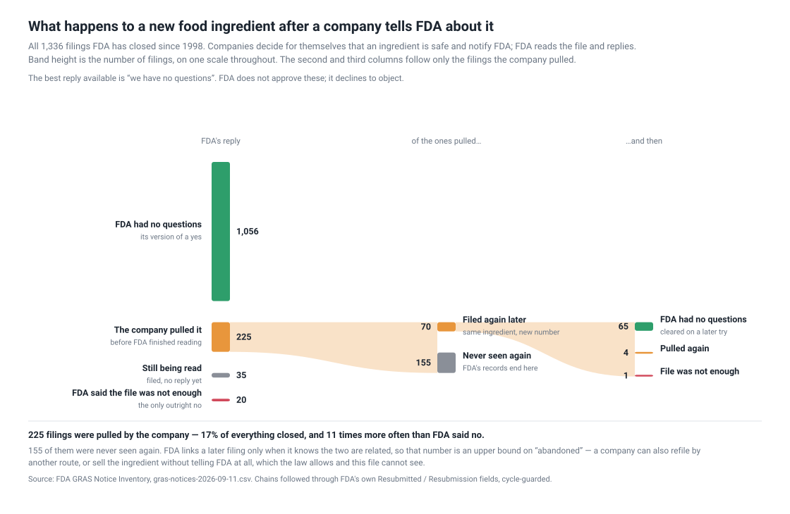

| FDA's response | notices | share |
| --- | --- | --- |
| FDA has no questions | 1,056 | 79.0% |
| **Pulled at the notifier's request** | **225** | **16.8%** |
| Pending | 35 | 2.6% |
| No basis for a GRAS determination | 20 | 1.5% |

**The friction in this system is not FDA saying no.** It is companies not waiting
for the answer.

Year by year, with the volume behind it — the programme has roughly tripled in
throughput since the 2000s, and the outcome mix has barely moved:

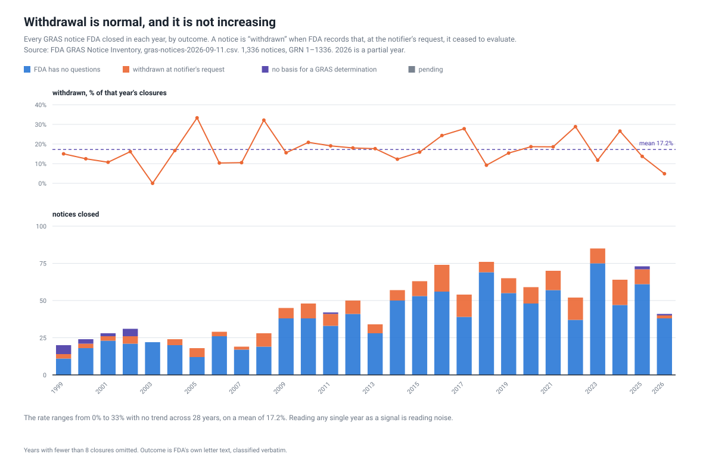

The top panel here is the same series as the orange line in the next chart, drawn
annually rather than in four-year groups. It is kept for the panel underneath it:
how many notices FDA actually closes each year, split by how they ended.

### The rate is flat. The meaning is not.

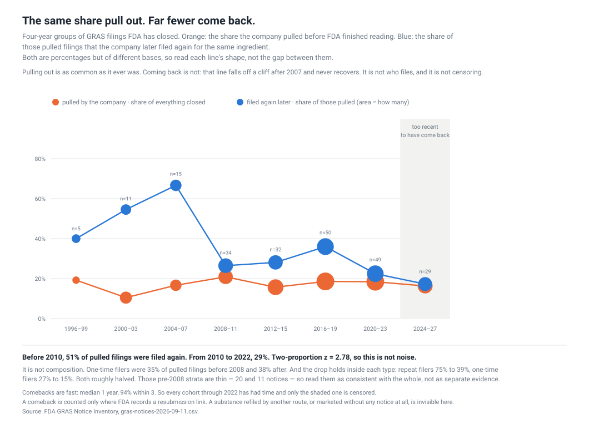

The withdrawal rate holds at 10–21% across 28 years. The share of pulled filings
that come back does not: **40–67% through 2007, then 22–36%.** A break, not a
trend — it lands between the 2004–07 and 2008–11 cohorts.

Two-proportion z on the censoring-free split (51% before 2010, 29% for 2010–2022)
is **2.78**. Four explanations were tested and all failed:

| tested | result |
| --- | --- |
| censoring | **No.** Comebacks take a median 1 year, 94% within 3 |
| who files | **No.** One-time filers were 35% of withdrawals before 2008, 38% after |
| a mix of filer types | **No.** Repeat filers 75%→39%, one-time 27%→15%. Both halved |
| FDA got slower | **No.** Median days to close: 177, 181, 178 across the break |

And it is not one category: **5 of 6 kinds with enough data fell**. Broad,
simultaneous, and at a moment FDA's own throughput did not move — which is the
signature of something exogenous. *What* is not in this file. See
[question 9](artifacts/research-questions/questions.md).

### Which ingredients get abandoned

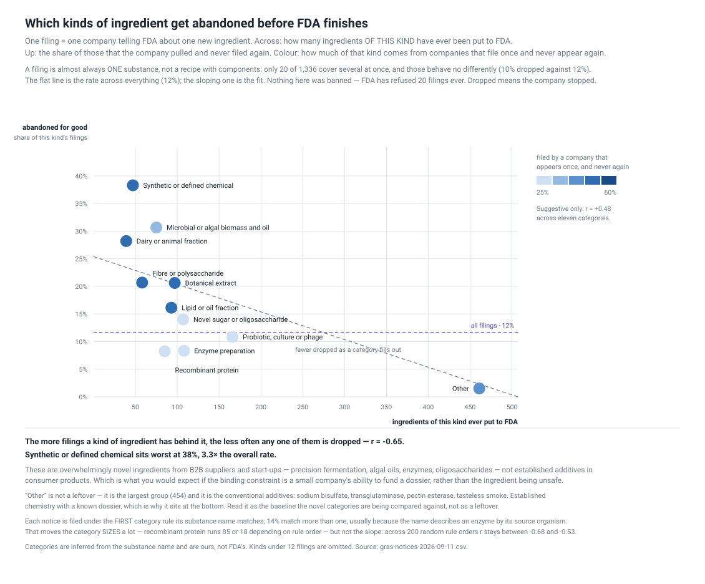

Novel ones. **Synthetic or defined chemicals are dropped for good 38% of the
time against an 11.6% base.** More usefully, the whole picture is a slope: the
more filings a kind of ingredient has behind it, the less often any one is
dropped, **r = −0.65** — and that holds across 200 random orderings of the
classifier's rules (−0.68 to −0.53).

These are overwhelmingly novel ingredients from B2B suppliers and start-ups —
precision fermentation, algal oils, enzymes, oligosaccharides — not established
additives in consumer products. Which is what you would expect if the binding
constraint is a small company's ability to fund a dossier rather than the
ingredient being unsafe.

### Who files matters, but less than what

Eight firms have filed ten or more times. **They clear 92%.** One-and-done firms
clear 78%. Overall, experienced filers clear 86% against 76%, z = +3.94.

**The control cuts it down.** Experienced firms file in the easier categories, so
part of that gap is the ingredient, not the filer. Within a single category the
gap falls to 5–9 points — and for microbial biomass it reverses (54% experienced
against 59% first-timers).

What does survive cleanly is **stickiness**: after a firm pulls a filing, 29% of
its next filings are also pulled; after a clearance, 9%. **3.2×.** Consistent with
the constraint being the firm's ability to fund and defend a dossier.

### Where the vanished ones went

155 pulled filings have no recorded resubmission. Three fates, only one benign:
abandoned, refiled by another route, or **marketed anyway** — which the law allows
with no notice to anyone. NRDC's 2014 report [*Generally Recognized as
Secret*](https://www.nrdc.org/resources/generally-recognized-secret-chemicals-added-food-united-states)
identified 275 chemicals from 56 companies apparently sold on undisclosed
self-determinations.

Testing the second branch against FDA's *Substances Added to Food* inventory
(3,971 permitted substances, each tagged with the CFR section that allows it):

| route | n | examples |
| --- | --- | --- |
| listed, no CFR section | 8 | theobromine, L-carnitine, trehalose, L-arabinose |
| GRAS by regulation | 5 | caffeine, menhaden oil, gum arabic |
| **food-additive petition (172.x)** | 3 | **polydextrose, allyl isothiocyanate, 1,3-butanediol** |

**At least 16 of the 155 did not vanish.** Those last three are the other door
working exactly as FDA has described it: pulled from the GRAS route, admitted
through the petition route instead.

The third branch stays invisible by construction, and **it is growing** — the
share of withdrawals that leave no trace went from 49% to 71%.

### What to do with it

**Stop reading "withdrawn" as a resolved status. Date it.**

- A withdrawal from **before 2010** probably came back and cleared. It is usually
  a stale record of something since settled.
- A withdrawal from **2010 onward** is an open question. Seven in ten never
  reappear, and one of the possible answers is *"on sale under a
  self-determination nobody filed"*.

Then check the filer's history, not just the ingredient — a firm with a prior pull
is three times more likely to pull again. But the category control says that is
the second question to ask, not the first.

### What not to trust

**Counting notices double-counts substances.** A company that withdraws and
refiles appears two or three times. Collapsing each retry chain to the substance
it concerns:

| | notices | substances |
| --- | --- | --- |
| total | 1,336 | **1,261** |
| ended "no questions" | 79.0% | **83.8%** |
| abandoned, never returned | 16.8% | **12.3%** |

**Roughly one substance in eight is abandoned, not one in six.** Which number you
quote depends on whether you are counting paperwork or ingredients, and the two
support different stories.

- **A comeback is counted only where FDA records a resubmission link**, so every
  comeback rate here is a floor.
- **The pre-2008 cohorts are thin** — 5, 11 and 15 withdrawals. The pooled
  pre-2010 figure (n=47) is the evidence; the early chart points are shape.
- **The other-door join is 59% precise before hand-checking.** Both sides are
  free-text chemical names; *White mulberry leaf extract* matched *MUSTARD,
  YELLOW, EXTRACT*. Every candidate was read and the rejections are recorded in
  `other_door.py`. 16 is a floor.
- **Substance categories are ours**, inferred from the notice's own name. `Other`
  is the largest group at 454 and is not a residue — it is the conventional
  additives, which is why it sits at the bottom of the risk chart.
- **The animal-food programme is a different animal**: 55.8% of animal notices
  clear against 81.2% of human ones, and the industry files for a different
  reason. Written up separately in `animal-feed-ingredients`.

*Every question this recipe asks — with its status, what would settle it, and
which answers describe, predict or prescribe — is the working document at
[`artifacts/research-questions/questions.md`](artifacts/research-questions/questions.md).*

### Why hasn't anyone

They largely have. **NRDC** and **CSPI** have worked this ground since at least
2014, and the withdraw-then-market pattern is their finding, not one waiting to be
made. Anyone writing about GRAS withdrawal should start there.

What I could not find published is the narrower mechanical cut: following FDA's
own `Resubmitted` / `Resubmission` fields to compute a retry-and-clear rate,
collapsing notices into substance chains to fix the denominator, and splitting the
comeback rate by era. That is a small contribution sitting inside a well-worked
story, and it is worth being honest that it is small.

### Run it

Two downloads, no key, no account. The derive is instant.

```sh
export GRAS_WORK=./work
python artifacts/scripts/capture.py            # GRAS inventory + animal companion
python artifacts/scripts/chart_flow.py
python artifacts/scripts/chart_years.py
python artifacts/scripts/chart_meaning.py
python artifacts/scripts/chart_kinds.py
python artifacts/scripts/other_door.py         # the food-additive petition join
```

**Three parse traps**, all silent:

- The CSV is **cp1252**, not UTF-8, and throws `UnicodeDecodeError` on a plain open.
- The real header is on **row 3** — rows 1–2 are a provenance banner and a blank.
- The GRN column is wrapped in an Excel formula: `=T("1")`, not `1`.

---

# II. The animal-food side is a different programme

### What the programme is for, and how that changed

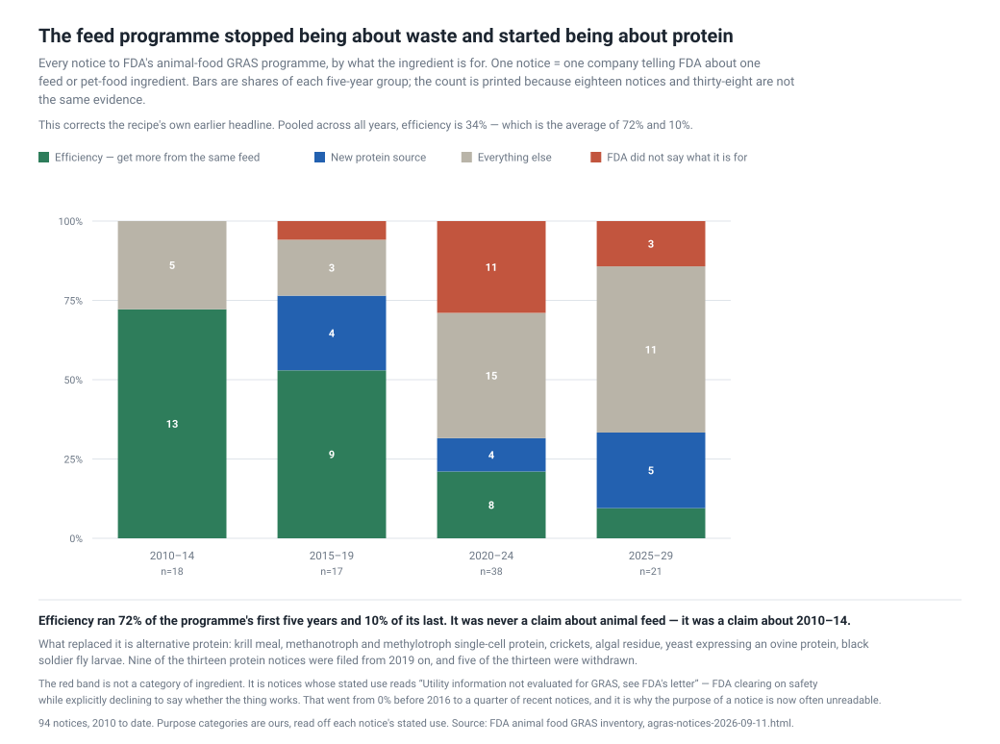

This recipe used to be headlined *"animal feed innovation is mostly about wasting
less"* — phytase releasing bound phosphorus, synthetic amino acids hitting the
target on less crude protein, ethanol co-products. Pooled across all years that
is 34% of notices.

**It was a claim about 2010–14.** By era, efficiency runs **72% → 53% → 21% →
10%.** The same failure as any pooled rate: an average of two regimes.

What replaced it is **alternative protein** — krill meal, methanotroph and
methylotroph single-cell protein, crickets, algal residue, yeast expressing an
ovine protein, black soldier fly larvae. Nine of the thirteen protein notices
were filed from 2019 on.

### Who it is for

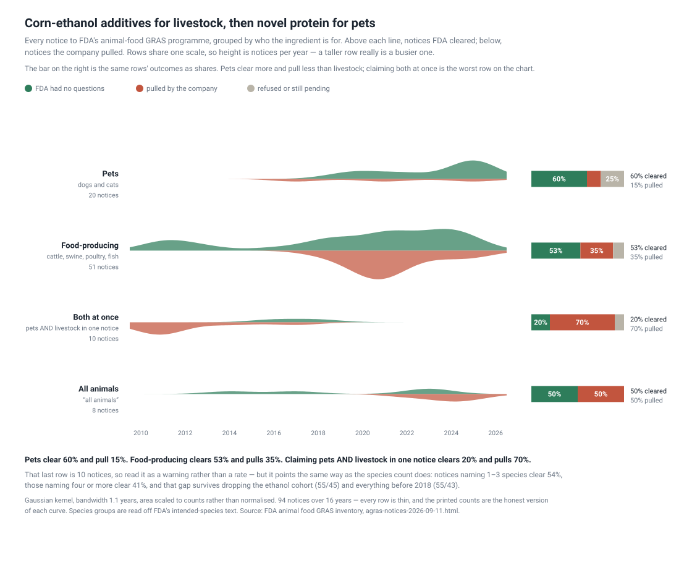

**2025 is the first year pet food outnumbers livestock**, 11 notices to 8, up
from 1 of 18 in 2010–14. And **four of the six protein notices filed since 2024
are for dogs and cats**, not livestock.

Pet food is also the easier door: **60% cleared and 15% pulled, against 53% and
35% for food-producing animals.** Which is a plausible reason it is being used as
one — a pet-food ingredient never enters the human food chain.

### Every way a notice can fail is more likely here

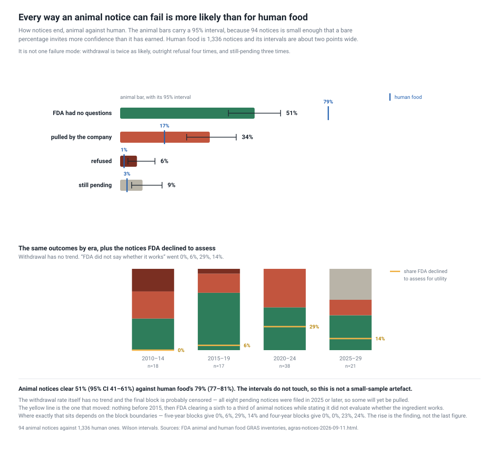

| outcome | animal | human |
| --- | --- | --- |
| FDA had no questions | **51%** (95% CI 41–61) | **79%** (77–81) |
| pulled by the company | 34% | 16.8% |
| refused outright | 6.4% | 1.5% |
| still pending | 8.5% | 2.6% |

The intervals do not touch, so the headline gap is not a small-sample artefact.
And it is not one failure mode — withdrawal is twice as likely, refusal four
times, still-pending three times.

The yellow line is the one that moved: **FDA now clears a substantial share of
animal notices while stating it did not evaluate whether the ingredient works.**
Nothing before 2015; a sixth to a third since 2020, depending where you cut the
blocks.

### It is the programme, not the companies

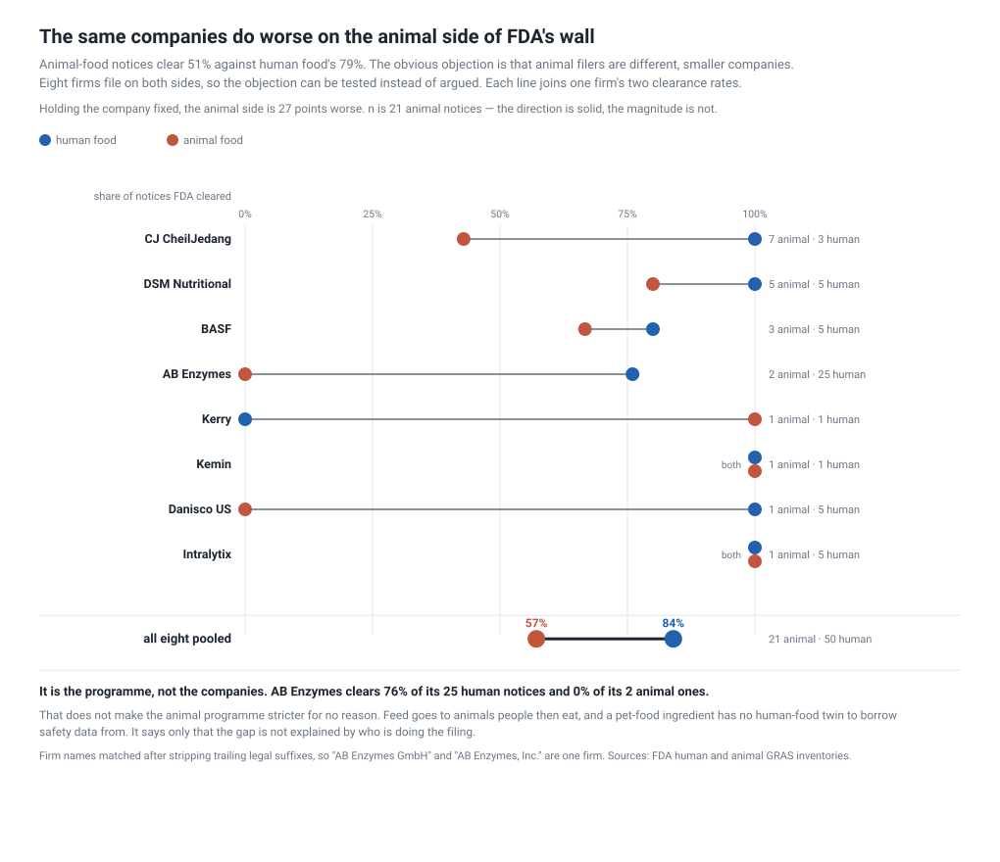

The obvious objection to the 51%-against-79% gap is that animal filers are
different, smaller companies. **Eight firms file on both sides**, so it can be
tested rather than argued:

**84% clear on human food. 57% on animal.** AB Enzymes clears 76% of its 25
human notices and 0% of its 2 animal ones.

n is 21 animal notices, so the magnitude is soft and the direction is not. That
does not make the animal programme stricter for no reason — feed goes to animals
people then eat, and a pet-food ingredient has no human-food twin to borrow
safety data from. It says only that the gap is not explained by who is filing.

### Companies come back — FDA just does not say so

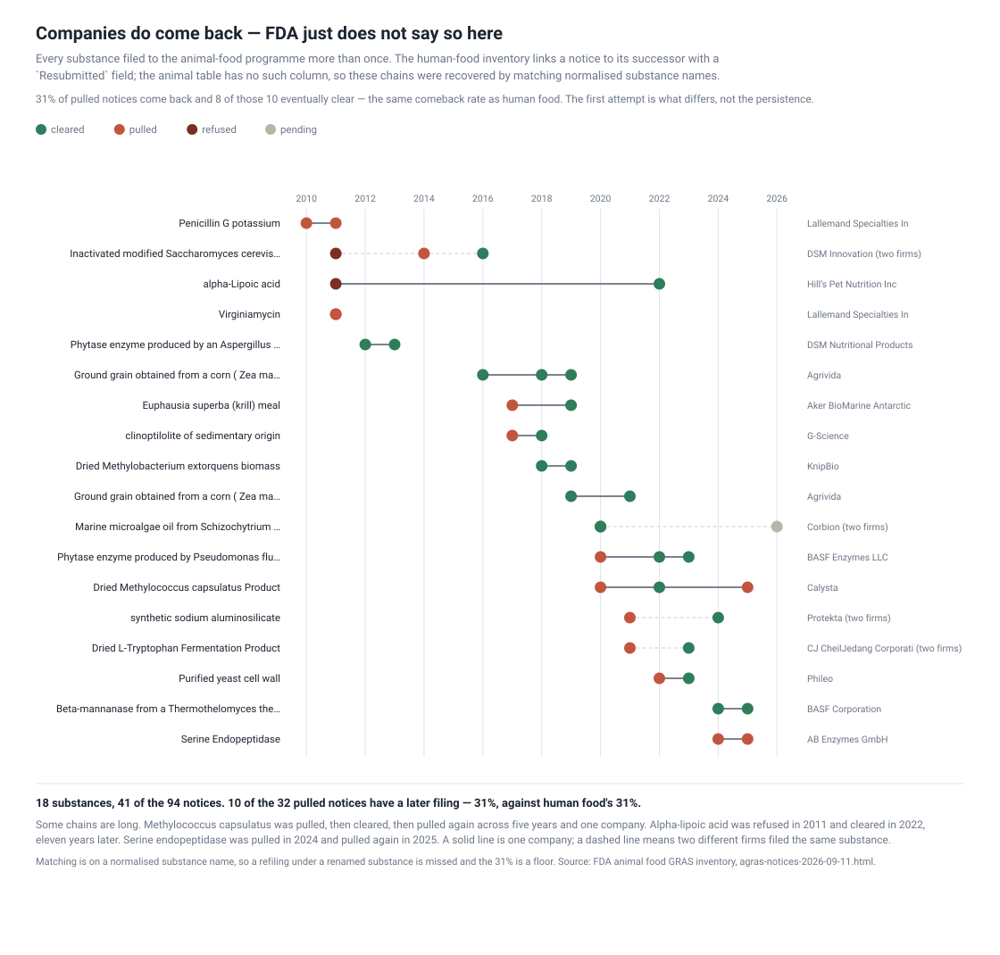

The human inventory links a notice to its successor with a `Resubmitted` field.
**The animal table has no such column.** Normalising substance names recovers the
links anyway: **18 substances filed more than once, 41 of the 94 notices.**

The rate that falls out is **31% of pulled notices come back, and 8 of those 10
eventually clear** — the same comeback rate as human food's 31%. So the animal
programme's *first attempt* fails far more often while the *retry* behaviour is
identical. What differs is the first pass, not the persistence.

Some chains are long. Alpha-lipoic acid was refused in 2011 and cleared in
**2022**. *Methylococcus capsulatus* was pulled, cleared, then pulled again
across five years and one company.

### What a notifier actually controls

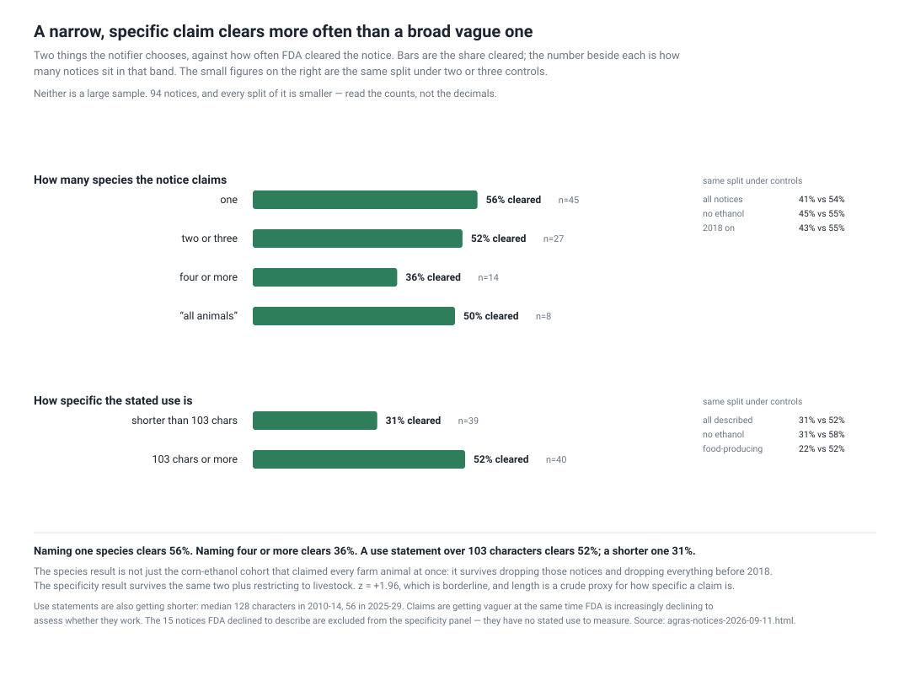

- **Naming one species clears 56%. Naming four or more clears 36%.** The gap
  survives dropping the corn-ethanol cohort (55/45) and dropping everything
  before 2018 (55/43).
- **A use statement over 103 characters clears 52%; a shorter one 31%.** Survives
  the same two controls plus restricting to livestock (22/52). z = +1.96, which
  is borderline, and length is a crude proxy for specificity.

Both point the same way. And use statements are getting *shorter*: median 128
characters in 2010–14, 56 in 2025–29 — claims getting vaguer at the same time FDA
is increasingly declining to assess them.

### Who files

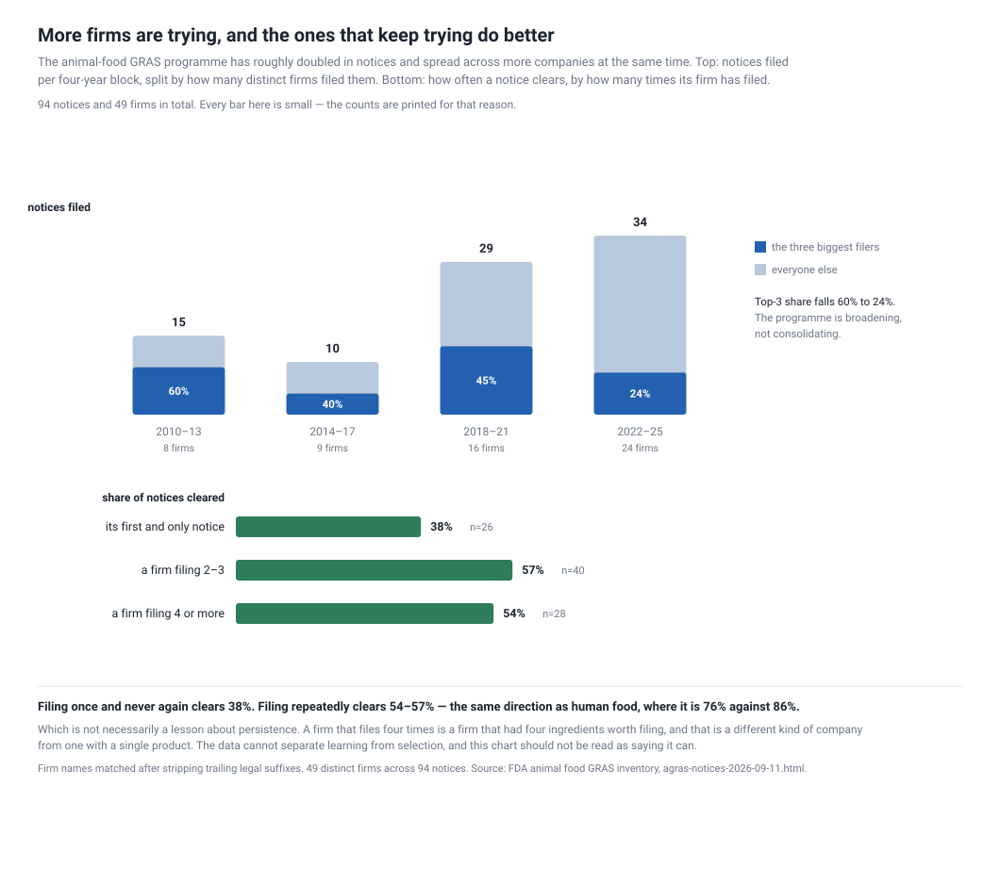

The programme **roughly doubled** (15 → 10 → 29 → 34 notices per four-year block)
and **deconcentrated** at the same time: the top three firms fell from 60% of
filings to 24%, while distinct firms per block went 8 → 9 → 16 → 24.

Firms that file repeatedly clear more — 38% for a first-and-only notice against
54–57%. But a firm that files four times is a firm that had four ingredients
worth filing, and **this data cannot separate learning from selection.**

### What to do with it

**Do not price an animal-food notice off human-food base rates.** The same
company faces roughly half the clearance odds on this side of FDA's wall.

**Do not read the programme's history as its present.** The sector it serves
changed underneath the description: efficiency for livestock became protein for
pets, and a recipe written about the first says nothing useful about the second.

**If you are filing:** name fewer species and say what the thing does. Both are
under your control and both correlate with clearing, on small samples that point
the same way under every control we could run.

**If you are reading a clearance:** check whether FDA assessed utility. On a
growing share of recent notices it explicitly did not.

### What not to trust

- **94 notices, and every split of it is smaller.** Read the counts, not the
  decimals. The paired control is 21 animal notices; the breadth result's widest
  band is 14.
- **No closure date.** The table records when a notice was filed and not when FDA
  answered, so lead time is not computable here — unlike the human side, where it
  runs 177–181 days. Getting it would mean fetching and parsing 94 letter PDFs.
- **Refiling chains are matched on normalised substance names**, so a refiling
  under a renamed substance is missed and the 31% is a floor.
- **Purpose and species categories are ours**, read off each notice's stated use
  and intended species. A quarter of recent notices have no stated use at all
  because FDA declined to evaluate it, which makes them unclassifiable.
- **No bulk export.** The source is a rendered HTML table, so the parse is
  structural and will break when FDA restyles the page.

*Every question this recipe asks — 28 of them, with statuses and which answers
describe, predict or prescribe — is the working document at
[`artifacts/research-questions/questions.md`](artifacts/research-questions/questions.md).*

### Why hasn't anyone

The animal programme is small and gets read as a footnote to the human one. What
that misses is that it is the **control**: same agency, same mechanism, a
different population, and eight companies filing into both. Most questions about
whether a regulatory gap is the regulator or the applicant cannot be tested at
all. Here it can.

### Run it

```sh
export GRAS_WORK=./work
python artifacts/scripts/capture.py           # both inventories
python artifacts/scripts/chart_shift.py
python artifacts/scripts/chart_audience.py
python artifacts/scripts/chart_outcomes.py
python artifacts/scripts/chart_wall.py
python artifacts/scripts/chart_chains.py
python artifacts/scripts/chart_breadth.py
python artifacts/scripts/chart_filers.py
```

The animal inventory has **no bulk export**, so `capture.py` stores the rendered
page and the parse reads the table out of it. The human CSV it is compared
against is **cp1252**, has its real header on row 3, and wraps the GRN column in
an Excel formula.

---

## Reproducing

    cd recipes/fda-gras-notices
    python3 artifacts/scripts/capture.py      # downloads both FDA inventories
    python3 artifacts/scripts/chart_flow.py   # or any of the eleven figure scripts

Standard library only. Scripts read `./work` or `$GRAS_WORK`; nothing reaches outside the
recipe except that directory.

*This folder replaces two.* `gras-withdrawals` and `animal-feed-ingredients` read the same two
FDA inventories and carried two copies of the same `graslib.py`, one of them headed **"VENDORED
COPY … if you change the classifier in one, change it in both"**. One dataset is one folder;
the two stories are the two parts above, and the divergence hazard is gone.

[`artifacts/research-questions/questions.md`](artifacts/research-questions/questions.md) records
what was asked, what died and why, and what is still open.
