# Twenty-one papers in the whole of Hugging Face are adopted by someone who did not write them

**Finding:** the top 1,000 models on Hugging Face name **430 arXiv papers** on their
cards. Count the *organisations* behind those citations rather than the models, drop
the re-uploads that inherit someone else's card, and **21 papers remain**. Narrow it to
papers curated on Hugging Face's own daily feed — the ones anyone could have spotted
in advance — and it is **two**, both of which turn out to be undeclared redistribution
when you read them.

The measurement everyone reaches for is a model-card citation count. It cannot tell
adoption from redistribution, and it is blind to exactly the ideas the field rests on.

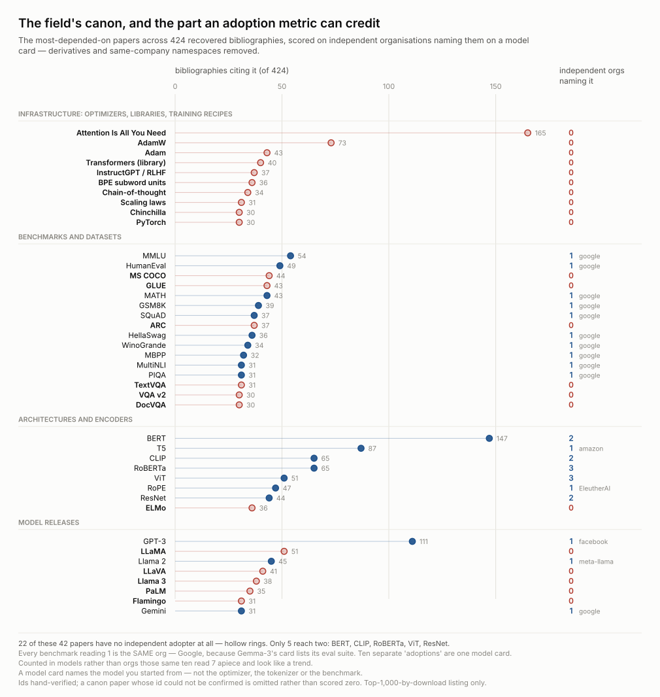

**Twenty-two of the forty-two most-depended-on papers in the corpus have no independent
adopter at all.** Attention Is All You Need is cited by 165 of 424 recovered
bibliographies and named by zero model cards. So are Adam, AdamW, PyTorch, the
Transformers library, BPE, chain-of-thought, the scaling laws and Chinchilla. A model
card names the model you started from — not the optimizer, the tokenizer or the
benchmark you used.

Where the metric *does* see a benchmark, it is one lab's eval list: MMLU, MATH, GSM8K,
HellaSwag, WinoGrande, PIQA, MBPP, SQuAD, MultiNLI and HumanEval each read exactly one
organisation, and it is **the same organisation every time** — Google, because Gemma-3's
card lists its evaluation suite. Ten separate "adoptions" are one model card. Counted in
models rather than organisations they read 7 apiece and look like a trend.

Only five papers clear two independent organisations: **BERT, CLIP, RoBERTa, ViT,
ResNet** — encoders and vision backbones, all of them old.

## Why the raw count is off by a factor of twenty

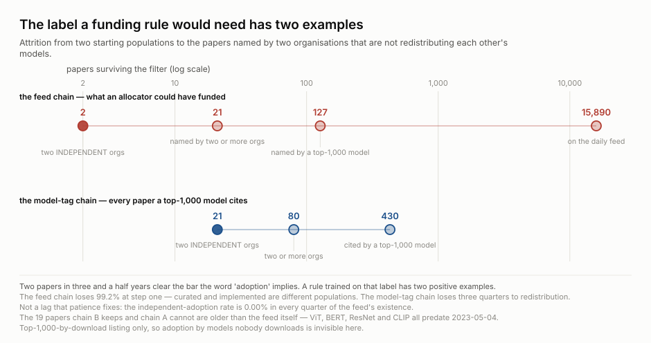

Two filters do almost all the work.

**Counting models counts release cadence.** YaRN reads 34 models, of which 32 are Qwen —
one decision counted thirty-two times. Across the listing, counting models instead of
publishers inflates every rate by **2.1x** and silently reorders the middle of any
ranking.

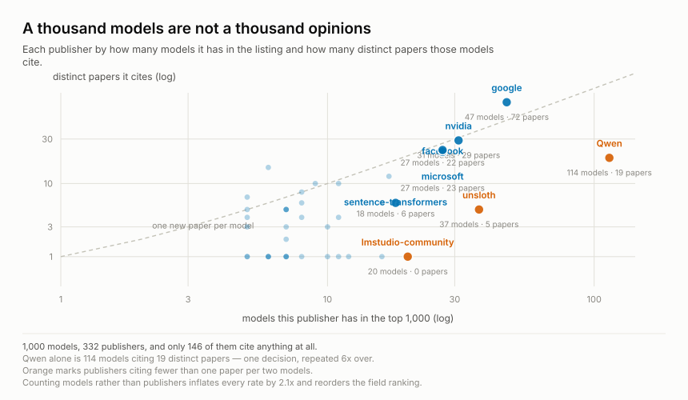

**A quantized re-upload inherits the original's whole card.** 251 of the 1,000 models
declare a `base_model:` pointing at another organisation's model, and they carry that
model's arxiv tags with them. One account republishing Google's Gemma models brings
Google's entire benchmark citation list along.

The chain, with its conventions stated because two of these steps get quoted
inconsistently: **87** papers sit at two or more raw organisation strings, **80** once
same-company namespaces are merged (`google-bert` → `google`), and **21** once declared
derivatives are dropped.

That last number is an upper bound, not a count. **611 models declare no `base_model:`
at all**, so the filter removes the derivatives that say they are derivatives and keeps
any that stay quiet. Both of the two papers that survive inside the curated feed are
exactly that: Gemma 3's second organisation is `Infomaniak-AI/vllm-translategemma-4b-it`,
and DINOv3's is timm hosting facebook's weights.

## What the measurement can never see

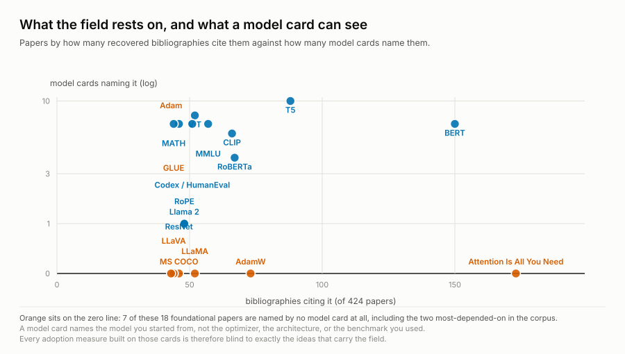

**LoRA sits at one organisation and one model.** `2106.09685` is plausibly the most
widely used technique in the ecosystem and it registers once, for two structural
reasons: LoRA adapters are small and long-tail so they are not in the download head,
and a model finetuned with LoRA does not usually cite the LoRA paper.

So the honest scope line is narrower than "which research ideas ship". **This measures
which papers the uploaders of already-popular models chose to name.** A technique can be
universal and invisible here, and LoRA is the example anyone can check.

### Walking backwards sees what a card cannot — for a closed era

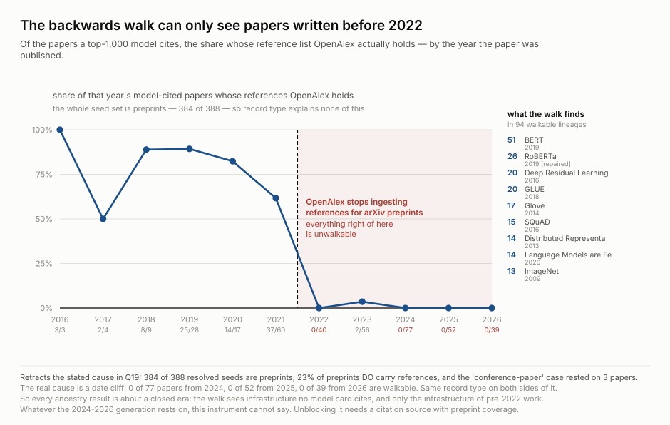

Start at a shipped model, take the papers it cites, then the papers *those* cite, and
the picture changes completely. Across 94 walkable lineages the shared ancestors are
BERT (51), RoBERTa (26), ResNet (20), GLUE (20), GloVe (17), word2vec (14), ImageNet
(13) — and **Adam**, which no model card has ever cited, because no model card cites an
optimizer. Infrastructure is invisible to tagging and visible to ancestry.

**But only 21% of papers are walkable at all, and the reason is a cliff.** 89% of 2019
papers have their reference list in OpenAlex, 82% of 2020, 61% of 2021 — then **0 of 40
in 2022, 0 of 77 in 2024, 0 of 52 in 2025.** OpenAlex stopped ingesting references for
arXiv preprints after 2021, and the record type is identical on both sides of the line.

So the ancestor list above is old *by construction*. A 2024 paper has no reachable
ancestry here at all. Whatever the current generation rests on, this instrument cannot
say — and that needs a citation source with preprint coverage, not more patience.

## What you can still do with it

Nothing available at publication predicts adoption for an individual paper. The base
rate is 0.8% and the best feature reaches 7%, so 93 of every 100 papers with a large
popular repo are still never used.

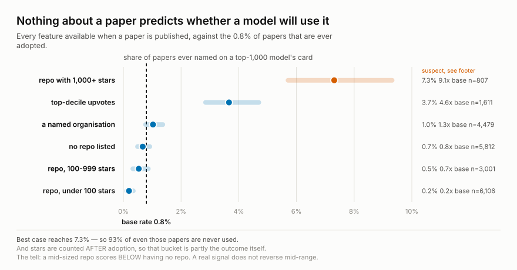

That is a *picking* claim, and it is often read as "the signals are worthless". The
*portfolio* claim points the other way.

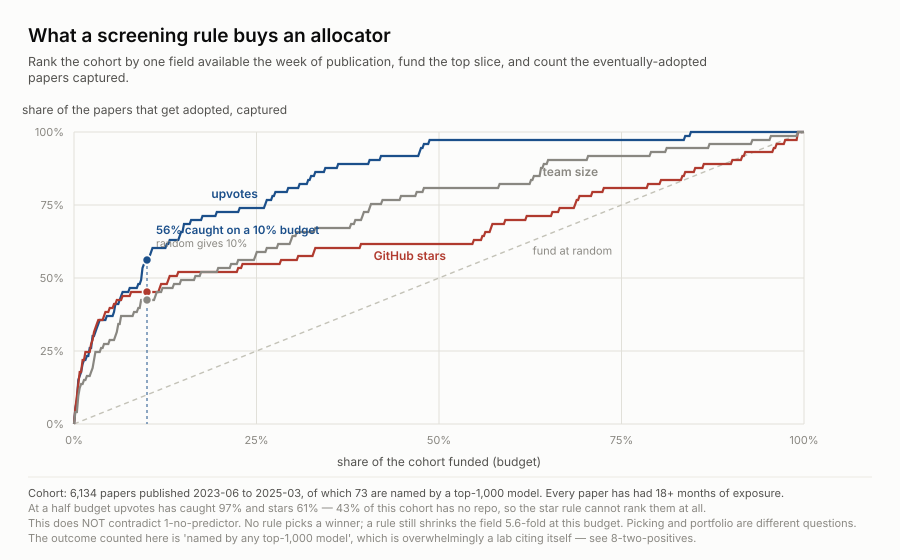

**Fund the top 10% by upvotes and you capture 56% of the papers that go on to be
adopted**, against the 10% a random draw gives — a 5.6-fold smaller haystack from a
free, same-week field. Both statements are true at once: no rule picks the winner, and a
cheap rule still shrinks the field. Funders make portfolio decisions.

### The signal that looks strongest is the one that is not there

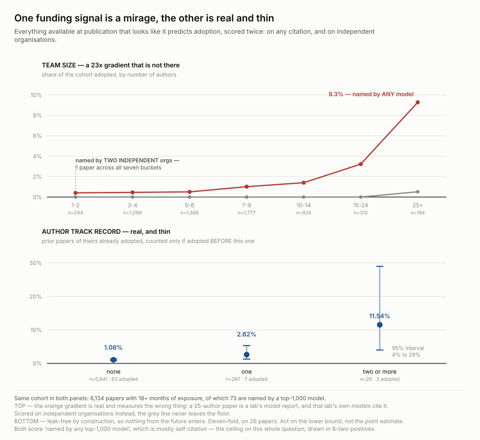

**Team size looks like the best predictor in the recipe.** Papers with 25+ authors are
adopted at 9.28% against 0.41% for one or two — a 23x gradient, known the week of
publication, beating everything in the chart above. Score it on two *independent*
organisations instead and it vanishes: **0 of 1,343 at one to four authors, 1 of 194 at
twenty-five or more.** A 25-author paper is an industry lab's model report, and that
lab's own models cite it. Team size predicts self-citation.

**An author track record is the only thing that survives the same test.** Leak-free —
an author's earlier paper counts only if a model citing it existed *before* the new
paper appeared — the rate runs 1.08% with no prior adopted paper, 2.62% with one,
**11.54% with two or more.** Eleven-fold, and available at publication. The catch is
that the top bucket is twenty-six papers and its interval runs 4% to 29%, so it is a
real effect and a thin one.

Two more things survive as advice.

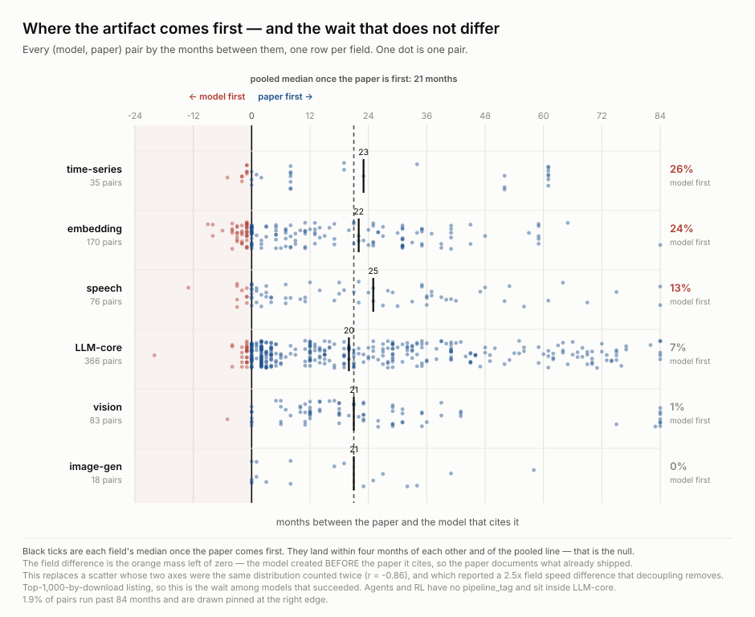

**Paper-watching only works where papers precede products.** 26% of time-series and 24%
of embedding adoptions have the model created *before* the paper it cites — a lab ships
the artifact and posts the report later. Vision runs 1.2%. And the wait is the null
beside it: once the paper genuinely comes first, every field waits **20–25 months**.

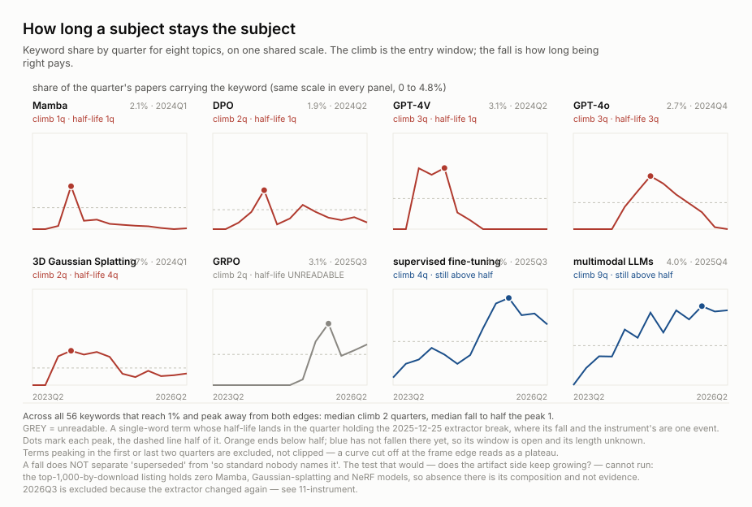

**A topic's median climb is two quarters and its median fall to half-peak is one.**
Mamba, DPO and GPT-4V were each halved within a quarter of peaking. 3D Gaussian
Splatting climbed as fast and then held for four. Nothing about the rise predicts the
fall.

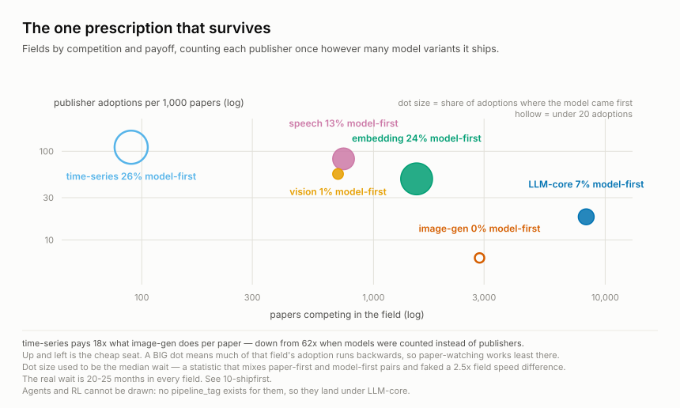

## How a new idea actually arrives

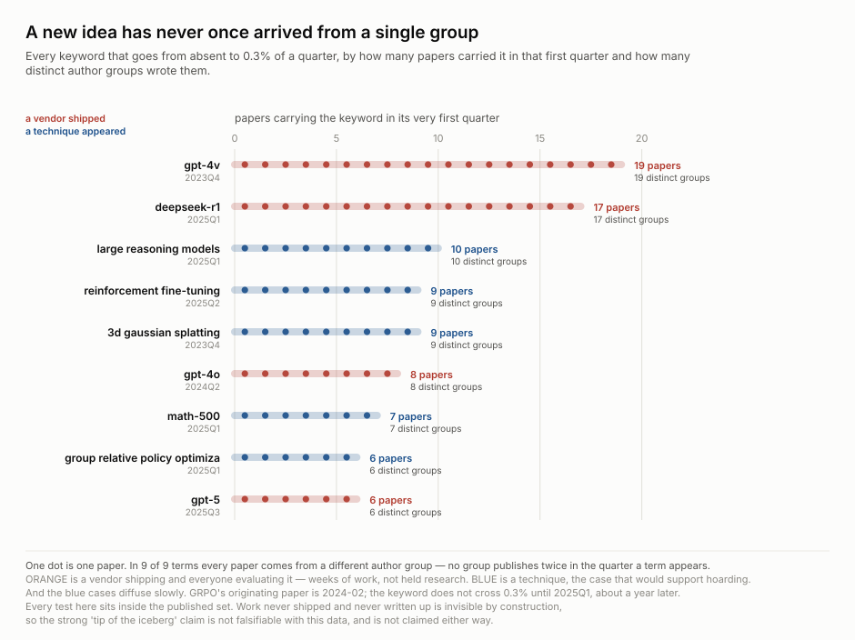

Take every keyword that goes from absent to 0.3% of a quarter — genuinely new
vocabulary — and count the papers carrying it in that first quarter, and the distinct
author lists among them. Nine terms qualify, and **in nine of nine every paper comes
from a different group.** Not one group publishes twice. New ideas never arrive alone.

The mechanism splits, though, and only one half is interesting. `gpt-4v` arrives with
nineteen groups and `deepseek-r1` with seventeen — a vendor shipped something and
everyone pointed an existing benchmark at it, which is weeks of work. The technique
cases are the ones that would suggest labs sitting on results, and their timing argues
against it: GRPO's originating paper is 2024-02 and the keyword does not cross 0.3%
until **2025Q1**, about a year later. That is diffusion, not a coordinated release.

Two related numbers bound the "capabilities are the tip of the iceberg" reading. When a
model does predate its own paper, the gap is a median of **two months** and 74% are
within three — release coordination, not hoarding. And the shipped-but-unpublished
population is not labs: the publishers with no paper at all are redistributors and
tooling (`lmstudio-community`, `Comfy-Org`, `unsloth` at 84% untagged), while
deepseek-ai leaves 19% untagged and meta-llama 20%.

The strong form of the claim is not falsifiable here, and this recipe does not claim it
either way: work that was never shipped and never written up is invisible by
construction, and every test above runs inside the published set.

## What this cannot say

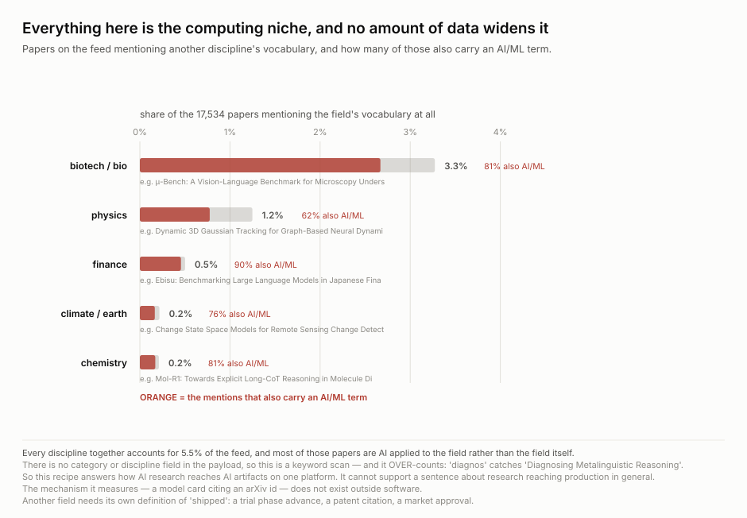

**The feed is curated AI/ML and nothing else.** Every other discipline together is 5.5%
of the feed, and 62–90% of those papers also carry an AI/ML term — *μ-Bench: A
Vision-Language Benchmark for Microscopy*, *Mol-R1: Long-CoT Reasoning in Molecule
Discovery*. They are AI-applied-to-biology, not biology. There is no category field in
the payload, so this is a keyword scan, and it over-counts: "diagnos" catches
*Diagnosing Metalinguistic Reasoning*.

The mechanism measured here — a model card citing an arXiv id — **does not exist outside
software**, so none of this supports a sentence about research reaching production in
general. The analogue in another field needs a different definition of "shipped": a
trial phase advance, a patent citation, a market approval.

Everything is measured on the **top 1,000 models by download**, which is a popularity
filter. This is adoption among models that already succeeded.

## Two traps, drawn rather than deleted

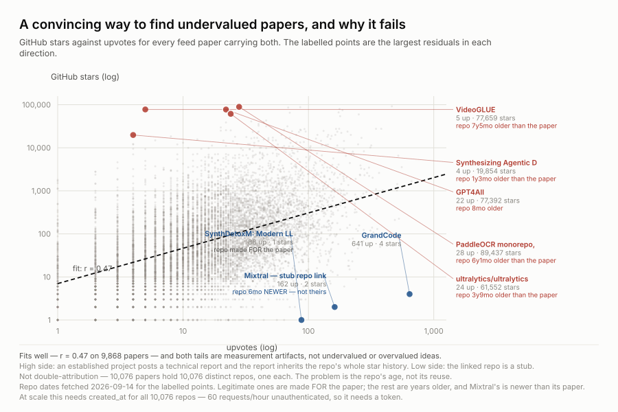

The obvious undervalued-paper detector — regress uptake on attention, read the residuals
— fits at r = 0.47 and **both of its tails are artifacts**. The high side is established
projects posting a technical report that inherits the repository's entire star history
(PaddleOCR at 89,437 stars credited to one 2026 paper). The low side is stub repository
links. It is not double-attribution: 10,076 papers hold 10,076 distinct repositories.
Fixing it needs the repository's `created_at`, which is enrichment and re-fetchable.

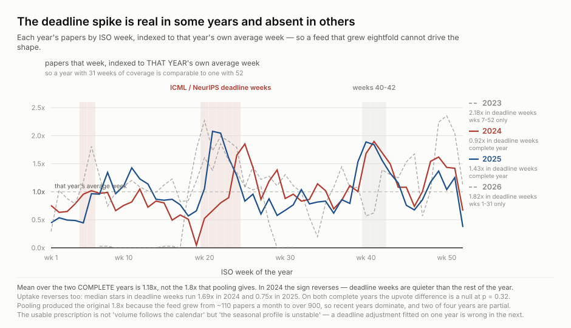

Paper volume is widely assumed to follow the conference calendar. Pooled across this
archive it appears to: deadline weeks carry 1.8x the papers. **Indexed within each year
it falls apart** — 0.92x in 2024, where deadline weeks are *quieter*, and 1.43x in 2025.
The pooled figure is an artifact of a feed that grew from about 110 papers a month to
over 900, so recent years dominate. The usable prescription is not "volume follows the
calendar" but "the seasonal profile is unstable": an adjustment fitted on one year is
wrong in the next.

## The measurement's own limits, drawn

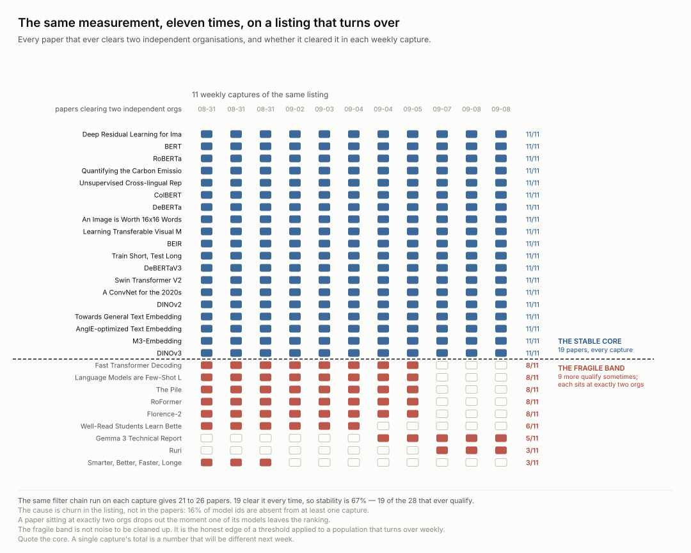

**A number computed from one capture should not be quoted.** Run the same filter chain
on each of the eleven weekly captures and the total reads 21 to 26; nineteen papers
clear it every time. The cause is churn in the listing, not in the papers — 16% of model
ids are absent from at least one capture, and a paper sitting at exactly two
organisations drops out the moment one of its models leaves the ranking.

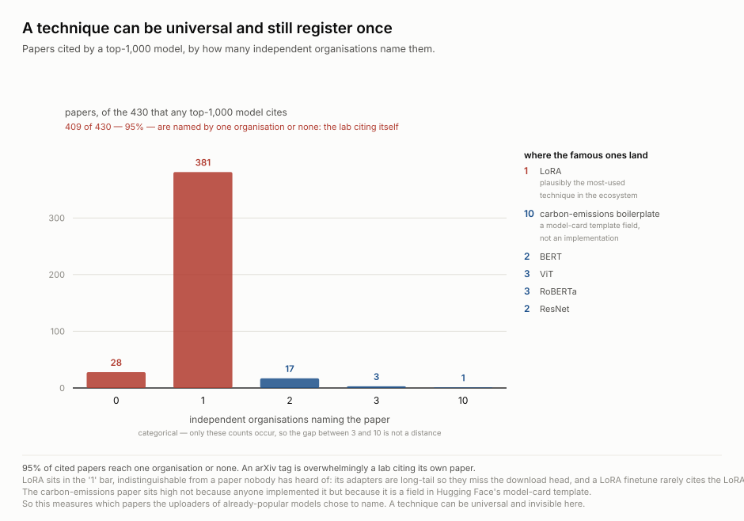

**95% of cited papers reach one organisation or none**, and LoRA sits in that first bar
— indistinguishable from a paper nobody has heard of.

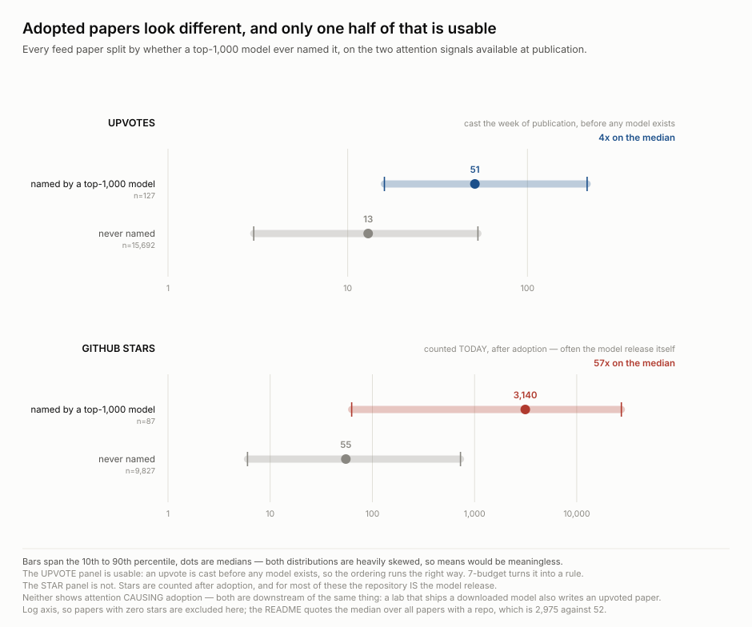

Adopted papers carry a median 51 upvotes against 13, and 3,140 stars against 55. Only
the upvote half is usable: an upvote is cast the week of publication, before any model
exists, while stars are counted today and for most of these the repository *is* the
model release.

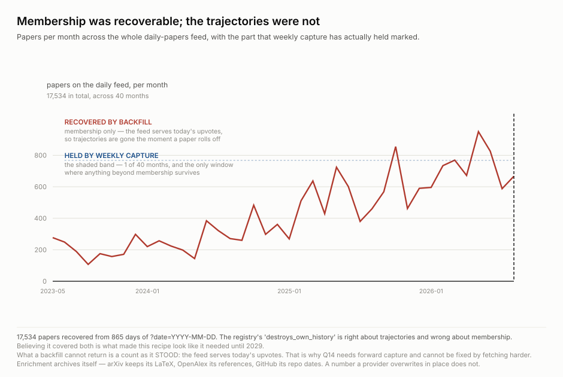

And the reason the archive exists: **17,534 papers came back from 865 days of
`?date=YYYY-MM-DD`**, but a backfill returns today's upvote count, never the count as it
stood. Membership is recoverable; trajectories are not.

## Running this yourself

    export WSS_HUGGING_FACE=/path/to/wss-hugging-face    # the capture, see below
    export WSS_CONTACT="mailto:you@example.org"          # for the polite API pools
    cd artifacts/scripts
    python3 bibliographies.py      # arXiv LaTeX source -> bibliographies.json (resumable)
    python3 ancestry.py            # OpenAlex -> openalex.json, ancestry.json
    python3 chart-6-credit-gap.py  # any chart-*.py writes its own SVG
    python3 verify.py              # re-derives every number in this README

Python 3.12 and **numpy** — that is the whole dependency list, and numpy is used by one
module (`gmmlib.py`, which fits the regime model by hand rather than pulling in
scikit-learn). Everything else is the standard library. Each script is runnable on its
own from this folder; the shared modules here (`paperlib`, `gmmlib`, `adoption`,
`ancestors`) are local to this recipe by design and nothing reaches outside it.

`verify.py` is the one to run first. It recomputes each headline figure from the archive
and prints OK or MISMATCH, so drift becomes visible rather than silent. The archive
grows, so some numbers will move; that is correct behaviour, and the point is that a
move announces itself.

**The capture is not vendored here and cannot be regenerated.** Hugging Face's
daily-papers feed overwrites itself: membership is recoverable through
`?date=YYYY-MM-DD` back to 2023-05-04, but upvote trajectories are gone the moment they
roll off. Everything else this recipe uses — arXiv LaTeX source, OpenAlex reference
lists — is **enrichment**: those sources archive their own history, so a fetch is always
repeatable and no window closes. `provenance.json` records which captures the published
figures came from.

## What was retracted, and the pattern

Four answers published in earlier passes were withdrawn during the promotion audit. The
first three failed the same way — **a property of the measurement read as a property of the
subject.**

| retracted | what it claimed | what it was |
| --- | --- | --- |
| diffusion speed by field | embeddings ship in 8 months, vision in 18 | a median over a mixture of paper-first and model-first pairs. Separated, every field waits 20–25 months |
| deadline-paper quality | off-cycle papers beat deadline papers on every measure | pooled across a feed that grew eightfold. On complete years the upvote gap is a null at p = 0.32 and the star gap reverses sign |
| dead topics | `llms`, `gpt-4` and `NeRF` faded or became ambient | all one word, and an undeclared extractor change on 2025-12-25 nearly halved single-word keyword emission |
| why ancestry is unreachable | `type=preprint` returns no references, `type=conference-paper` returns 38 | 384 of 388 resolved seeds ARE preprints and 23% of them carry references; the comparison rested on three papers. The real cause is a date cliff at 2022 |

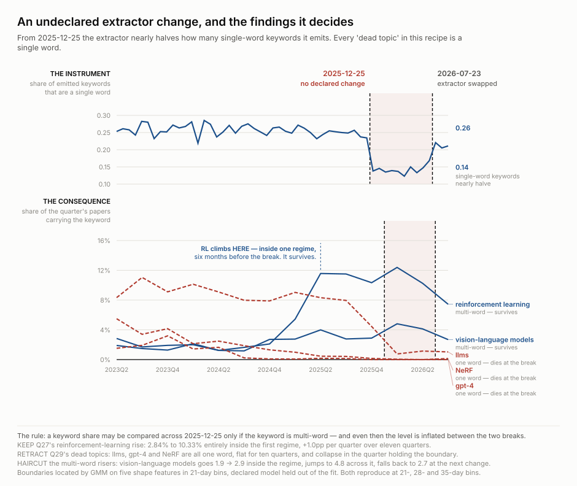

The third is the one worth keeping in view, because it also tells you which findings
survive. `ai_keywords` is generated by a model, and the declared `ai_summary_model` field
records the model but not the prompt. Clustering the *output* finds two regime
boundaries: the declared extractor swap in July 2026, and an undeclared one on
2025-12-25 that moves the field further. **A keyword share may be compared across that
date only if the keyword is multi-word.** Reinforcement learning's rise survives — 2.84%
to 10.33% entirely inside one regime — and the dead topics do not.

`artifacts/research-questions/questions.md` carries all thirty-eight questions with their
status, the open ones with what would close them, and the retractions with their dates.
