# America is not running out of landfill room. Eight states are.

**Status: proven** · method 1.0.1 · computed 2026-09-18 from the EPA Landfill Methane
Outreach Program database, 2,641 sites across 42 fields, two editions three years apart.
**Both workbooks are committed**, against this repo's usual rule, because one of them can no
longer be obtained from anywhere — see *What makes this recipe unusual* below.

Nationally there is **more** permitted room than there was, on every basis you can measure
it: **14.9 billion tons in 2021 against 15.2 billion in 2024** across all open sites, or
**13.9 against 14.1** across the 811 sites that can be matched between the two editions. On
that matched basket a billion tons was buried and **1.5 billion tons of new capacity was
permitted** — and it was permitted where the clock was short.

**Seven states have a median landfill with under twenty years left** — counting only states
with at least eight measurable sites, the threshold `measure.py` uses. Lower it to five and it
is eight; Tennessee sits just outside at 20.2 years. The threshold decides the headline, so it
is stated rather than assumed. Half the country's remaining room belongs to two companies. Both are true at once and neither is visible from a
national total.

**Revision 1.0.1.** Four numbers in this write-up were corrected on 2026-09-18. The figures
were never wrong — all eleven rebuild byte-identically from the committed workbooks — but the
prose had drifted from the code: the national room figures were a hardcoded string no basket
reproduced, the eight-states headline depended on an unstated threshold, the rebrand count was
248 rather than 250, and figure 5 drew 69%/38% while the text beside it said 68%/39%. The
1.0.0 row stays in `history.csv` beside the correction. `artifacts/scripts/verify.py` now
recomputes all of it from the workbooks.

## The decision it changes

**If you are a municipality signing a disposal contract, you are not negotiating in a
national market and probably not in a competitive one.** Half of America's remaining
permitted room sits with two firms; the 510 single-site owners hold 33% between them at a
median of 3.3M tons each. Your alternative is capacity you do not own and cannot build
quickly — new capacity takes a permit, and the permits are going to the states that are
already short.

*Who acts on this:* a county or municipal authority pricing a disposal contract; a state
regulator deciding where to grant capacity; a hauler or investor assessing where room runs
out first.

## What makes this recipe unusual

**Half its evidence no longer exists at source.** EPA publishes the database at a dated path
and overwrites the listing. Only the current edition resolves — September 2021 returns 404
and no web archive holds it. The three-year interval this recipe is built on exists *by
accident*, because a copy was taken before the overwrite.

That is why both workbooks are committed here at 756 KB each. The repo's rule is that data is
never committed and the fetcher ships instead; its stated exception is a snapshot that cannot
be reconstructed, and this is one. Without the 2021 edition there is one edition, no interval,
and the central finding cannot be computed at all.

## The countdown, and why "remaining tons" is the wrong axis

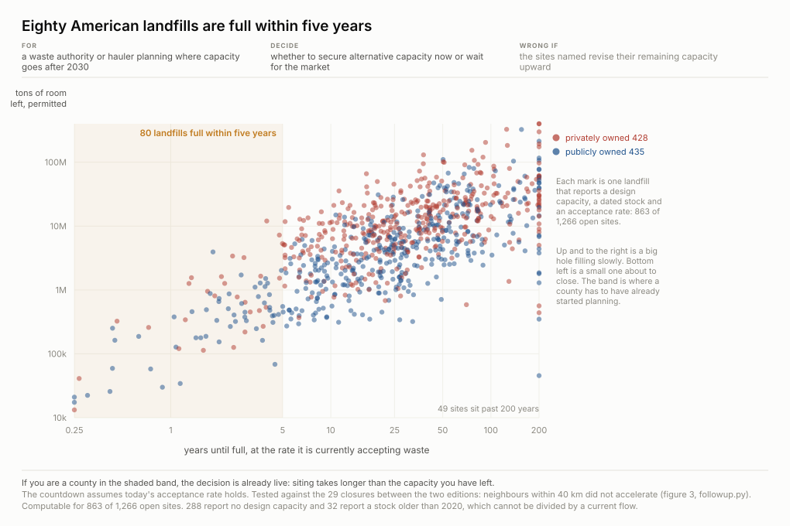

One mark per landfill, position on both axes so distances are compared rather than digits
read, coloured by who owns the hole — because a county that owns its own capacity is in a
different position from one buying it from a firm that holds a quarter of the country's.
Both axes are logarithmic and say so: remaining capacity spans five orders of magnitude and
years-to-full four, so a linear axis would put nine tenths of the register in one corner.

**Eighty are full within five years.** But remaining tons confounds two different things — a
small hole nearly empty and a huge one nearly full show the same remaining room, and the
reader cannot tell which they are looking at.

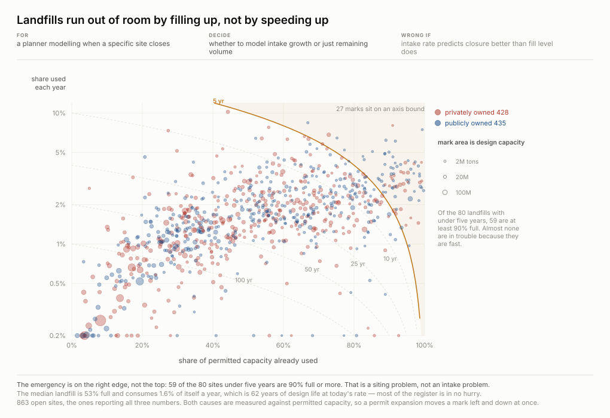

The countdown decomposes exactly, with no residual:

    years left = (1 − fraction full) / (fraction of capacity consumed per year)

So the two causes of a short countdown are separable, and they are the two axes here. Right
is nearly full; up is consuming itself fast. **Sites run out by filling up, not by
accelerating** — which is why the countdown is a statement about today's rate and not a
forecast. Mark area is design capacity, the size question figure 1 could not answer.

## What the countdown cannot see, and what that costs

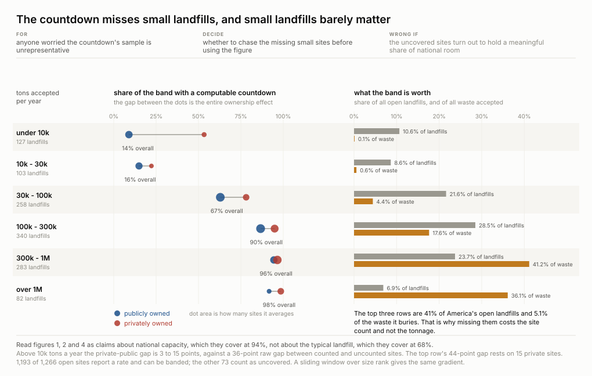

The three figures above are computed on the **863 open sites** that report a design capacity,
a dated stock and an acceptance rate. **403 do not**, and this figure bounds what that costs
rather than leaving the reader to assume it is nothing.

Two earlier versions were wrong in instructive ways. The first plotted tons accepted per year
against tons already in the ground, coloured by whether a countdown was computable — but
those axes are 60% the same variable in logs (**r = 0.78**), so the scatter was a fat diagonal
that spent its second dimension on nothing.

## The room has owners, and they are two populations

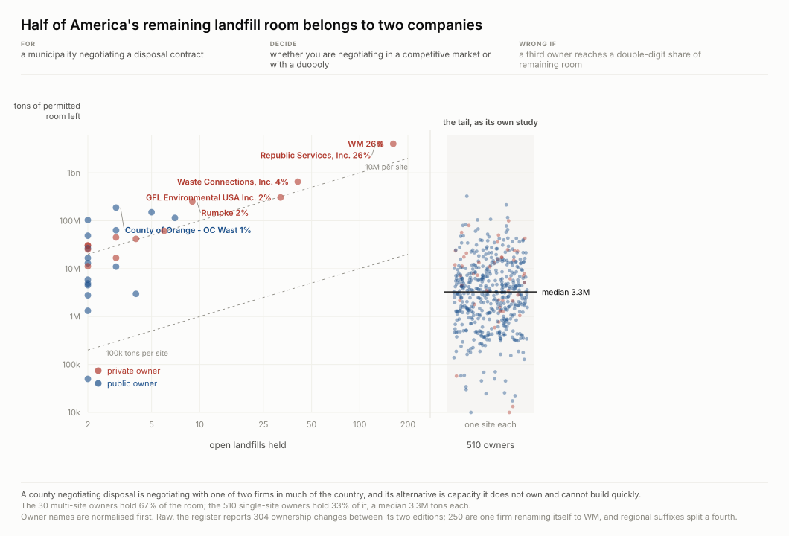

A first version put every owner on one scatter of sites held against room held. Of the 540
owners whose sites report both a capacity and a stock, **510 hold exactly one**, so they
stacked into a single column at x=1 and the figure was a wall with five dots beside it. Worse
than ugly: it mixed two categories and invited the reader to read a trend across the join.

They are genuinely different populations. **Single-site owners are 9% private. Multi-site
owners are 43% private, and the five owners of twenty sites or more are 93% private.** So the
tail is drawn as its own study. Half the country's remaining permitted room belongs to two
companies; the 510 single-site owners hold 33% between them, at a median of 3.3M tons each.

## Where it runs out

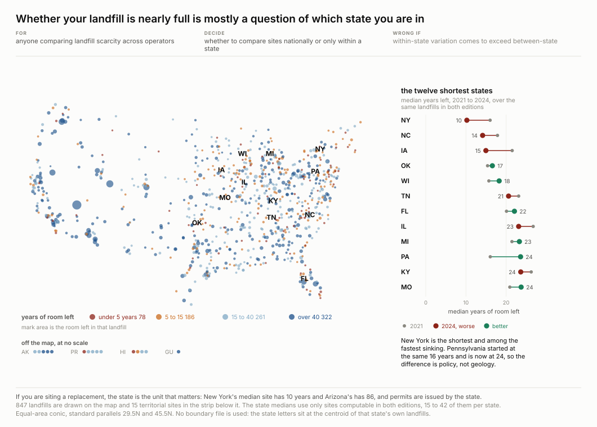

Every open landfill that reports a countdown, placed by its own coordinates on an Albers
equal-area conic — equal-area because a projection that inflates the north would inflate
Minnesota's share of the country's remaining room by eye. Puerto Rico's 22 open landfills are
drawn as a labelled strip on the same colour scale rather than an inset at a made-up scale,
which would assert a geography that is not there.

**New York is both the shortest and among the fastest sinking: a median of 16 years in 2021
and 10 in 2024.** Pennsylvania started at the same 16 and is now at 24, so the difference is
not geology. Arizona went from 55 to 80.

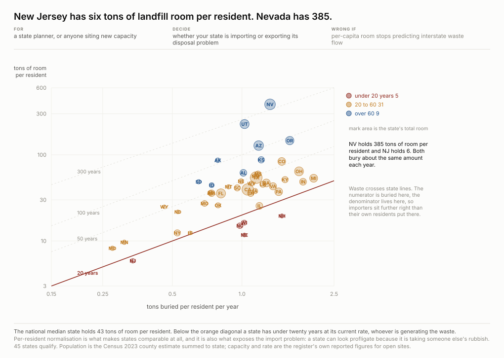

A state's total capacity says nothing on its own: Nevada's 1.2 billion tons and New Jersey's
55 million are not comparable until both are divided by the people who fill them. Per resident
the gap is **385 tons against 6, a factor of sixty-four** — the largest spread of any measure
in this recipe. The second axis is how fast each state buries, also per resident, so the
straight diagonals are years of room left at the current rate.

## The only interval that exists, and what it shows

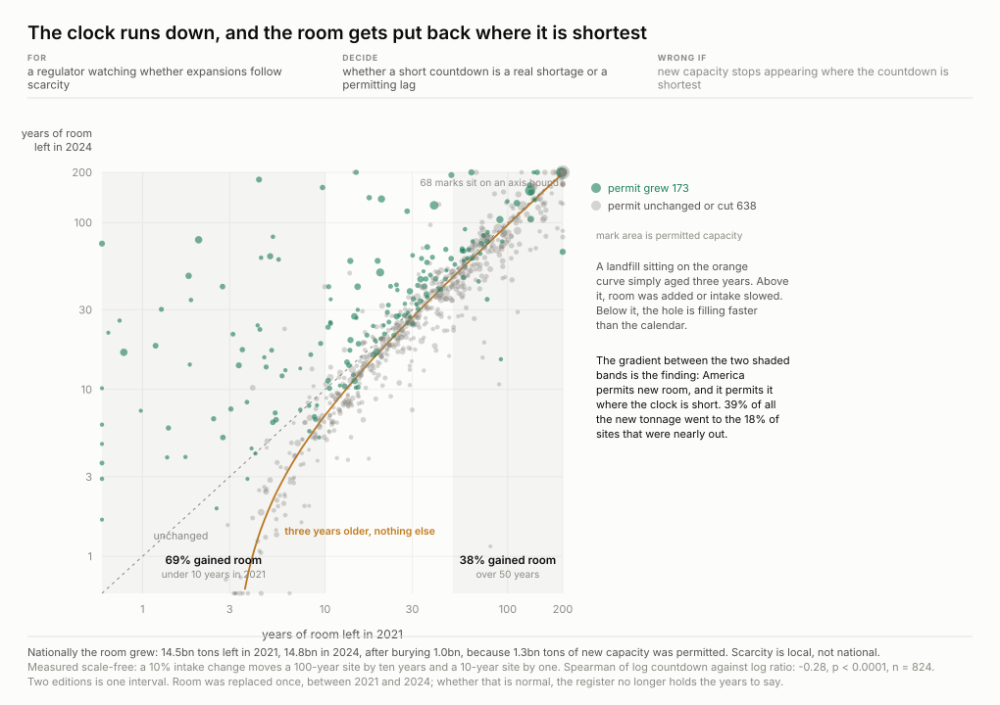

Every other figure here is a snapshot. This is the one that uses the fact that two editions
survived: each landfill's countdown in 2021 against its countdown in 2024, restricted to the
**811 sites whose reported stock advanced by exactly three years**, so one reference curve is
correct for every mark. The lower curve is what three years looks like if nothing else happens.
Above it, somebody added room or slowed the intake. Below it, the hole is filling faster than
the calendar.

**69% of the landfills that had under ten years left in 2021 are above the curve; only 38% of
those with over fifty years are.** Permitted capacity grew on 40% of the short ones against
15% of the long ones, and **39% of all new permitted tonnage in the country went to the 18% of
sites that were nearly out of time**. A scale-free rank test puts the gradient at rho = −0.28,
p < 0.0001, n = 824.

That is the whole national story: the total went up because the room was put back where the
clock was short.

## Which ones to act on first

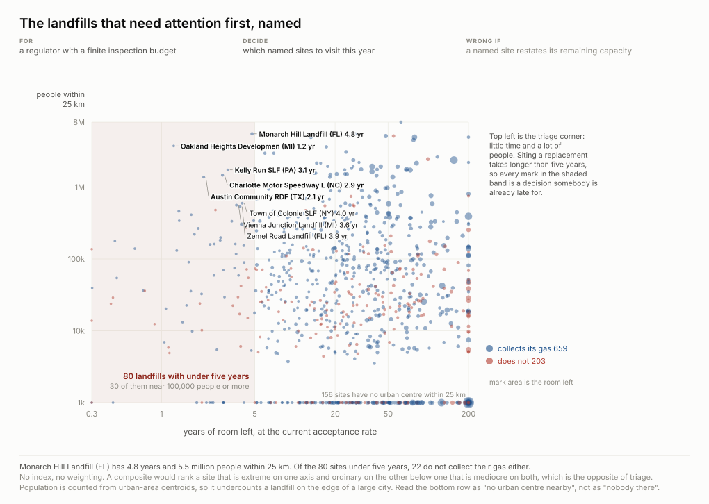

Figures 1 and 4 say how many landfills are nearly full. Neither says which ones matter,
because a hole with three years left in an empty county is a different problem from one with
three years left beside a city. Time against people, and the corner is named.

**No composite score.** Two measured quantities on two axes, and the reader picks their own
threshold — multiply two signals together and you have built an AND, which buries the sites
that are extreme on one axis and ordinary on the other. **The population measure undercounts
and it is worth knowing how:** Census urban areas are polygons but the gazetteer publishes one
interior point each, so this counts the population of every urban area whose *centre* is
within 25 km.

## What happens to what is already buried

Gas collection is the only field in this register that records somebody deciding a pile of
rubbish was worth something. It is a thin signal — it says the methane was worth capturing,
not the metals or the plastics — but it is the only one.

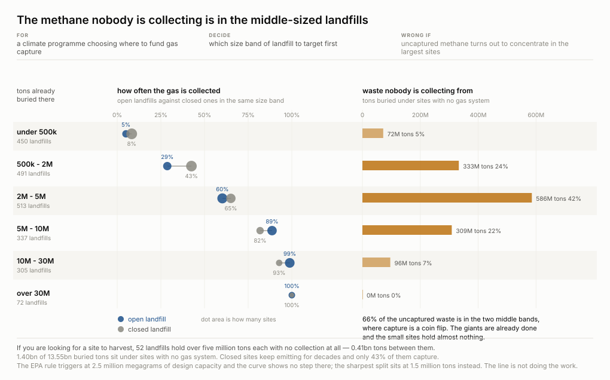

**Capture is near-universal above ten million tons and rare below half a million, and two
thirds of the uncaptured waste sits in the middle**, in the 500k-to-5M band where capture is a
coin flip.

A hypothesis that failed, kept because it was worth testing: the EPA's landfill rule triggers
at 2.5 million megagrams of design capacity, about 2.76 million short tons, so the S-curve
ought to show a step there. It does not. The bin just above the trigger captures *less* often
than the bin just below it, and the sharpest split anywhere in the range sits at 1.5 million
tons instead.

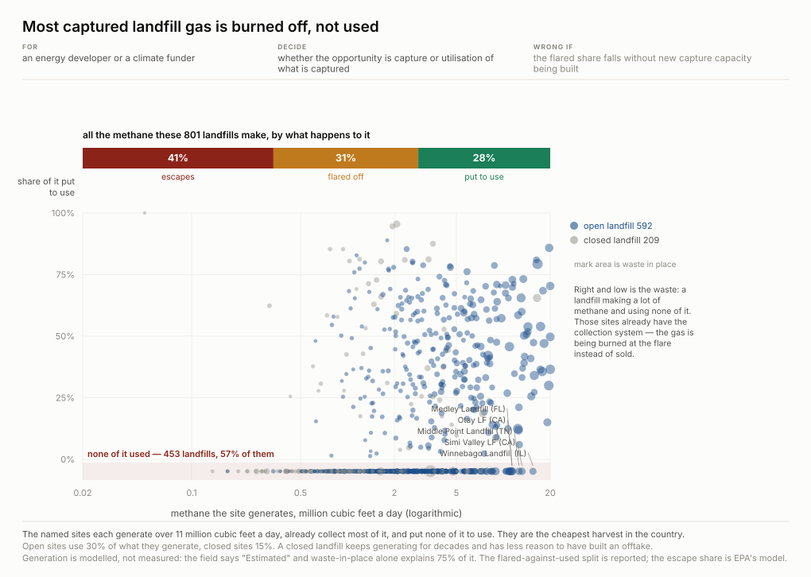

Figure 7 asks who collects gas at all; this asks what they do with it once collected, which is
the difference between controlling a pollutant and harvesting a resource. The register carries
gas generated, collected and flared, and the arithmetic between them is the whole answer.
**Two fifths escapes, a third is burned off, and under a third is actually used.** 57% of
these landfills put essentially none of their gas to work.

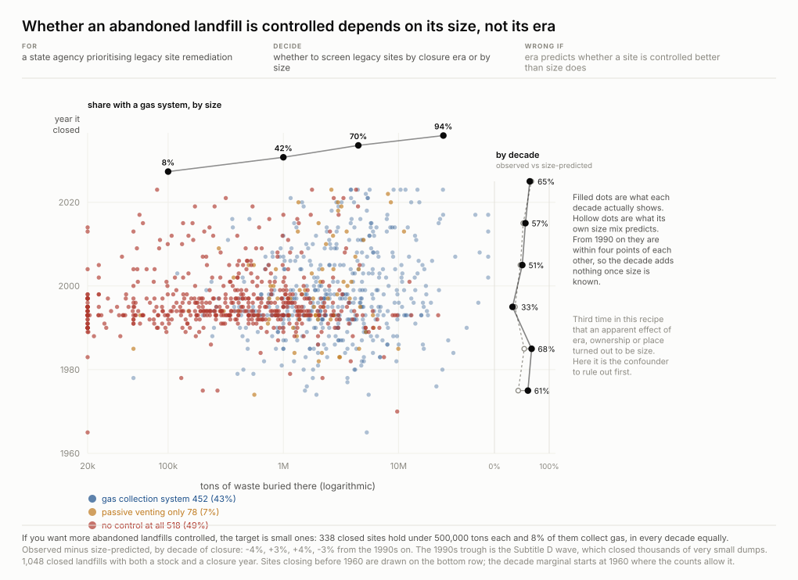

A closed landfill keeps making methane for decades, and the register records whether each has
a collection system, vents passively, or has nothing happening at all — answerable for
**1,260 closed sites** with a closure year. The control rate by decade swings hard — **33% for
the 1990s against 68% for the 1980s and 65% for the 2020s** — and the obvious reading is that
practice changed. It is not: the decade is standing in for size.

## Two things found while promoting it, both worth inheriting

**A dependency swap is only safe if you diff the output.** `openpyxl` was replaced with a
sixty-line standard-library xlsx reader so this recipe needs nothing installed. It was checked
cell by cell against openpyxl on both editions — **2,642 rows, no disagreement** — and then
every figure was rebuilt and compared byte for byte against the previous build. Ten of eleven
were identical.

**The eleventh had never been reproducible.** `chart-5-clock.py` iterated `set(a) & set(b)` to
place dots, and Python randomises string hashing per process, so two landfills at the same
coordinates swapped draw order between runs. The render was pixel-identical and the bytes were
not, which is exactly why nothing had ever caught it — it surfaced only because an unrelated
change was being diffed byte-for-byte. Anything unsorted that reaches output does this.

## What this cannot say

**Not a forecast.** The countdown divides remaining capacity by a current annual acceptance
rate. It assumes the rate holds, which it will not, and the recipe's own fourth figure shows
sites run out by filling rather than by accelerating — so the arithmetic is a statement about
today's rate, not a prediction.

**One interval, by accident.** Everything longitudinal here rests on a single three-year
comparison that exists because a copy survived. Two points cannot distinguish a trend from an
event, and the recipe says so wherever it uses them.

**Ownership, status and capacity are current-state fields with no history.** A site whose
owner changed between editions shows only its latest owner. Owner names are normalised before
any comparison: raw, the register reports 304 apparent ownership changes between its two
editions, of which only **49 are real** — **248 are one company renaming itself** (Waste
Management became WM in 2022) and 7 more are other spelling differences.

**Nothing here is about hazard or about what is in the hole.** The register records volume and
rate, not contents.

## What is still open

[`artifacts/research-questions/questions.md`](artifacts/research-questions/questions.md)
records what was asked and answered, and what is not answerable here with the reason. The
short version of the open list: the countdown cannot be tested as a *predictor* with two
editions three years apart; disposal cost is not in the register, so scarcity cannot be shown
to price; the register records a site's own intake and not shipments, so where the waste
actually comes from is invisible; and the operator's own closure-year estimate disagrees with
the arithmetic, which is a finding nobody has chased.

## Reproducing

    cd recipes/landfill-countdown
    python3 artifacts/scripts/fetch.py           # verifies the workbooks, pulls Census files
    python3 artifacts/scripts/measure.py         # countdown, owners, the three-year diff
    python3 artifacts/scripts/followup.py        # coverage bound and the closure test
    python3 artifacts/scripts/geo.py             # Census population and distance features
    python3 artifacts/scripts/features.py        # one table of every measurable attribute
    for f in artifacts/scripts/chart-*.py; do python3 "$f"; done
    python3 artifacts/scripts/verify.py         # recomputes every number above

`fetch.py --verify` hashes what is present against `provenance.json`. `verify.py` goes back to
the two workbooks rather than re-reading the derived JSON, prints the site-count threshold the
state headline depends on, and fails any figure whose SVG is older than the script that draws
it — it exists because four published numbers had drifted from the code that produced them. Nothing needs
installing — standard library only, verified by AST walk.
