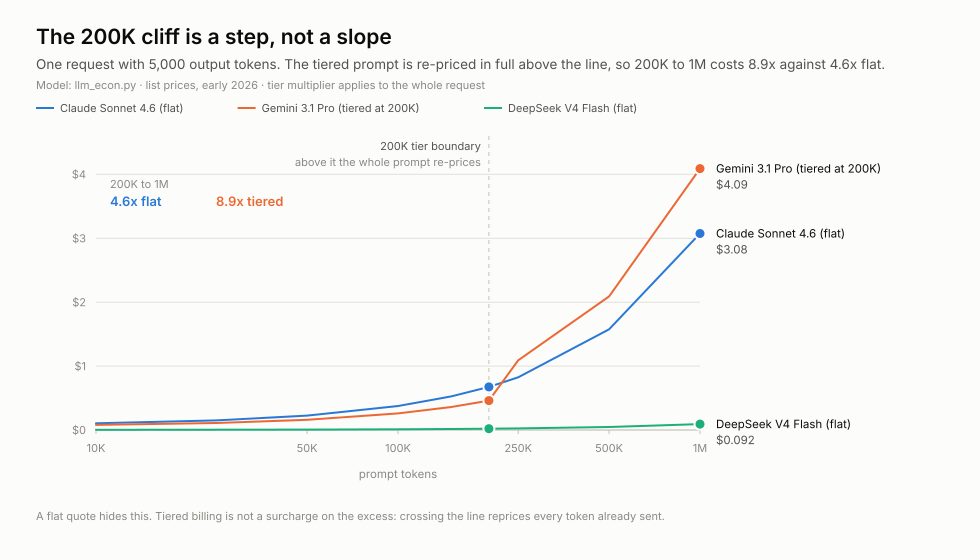
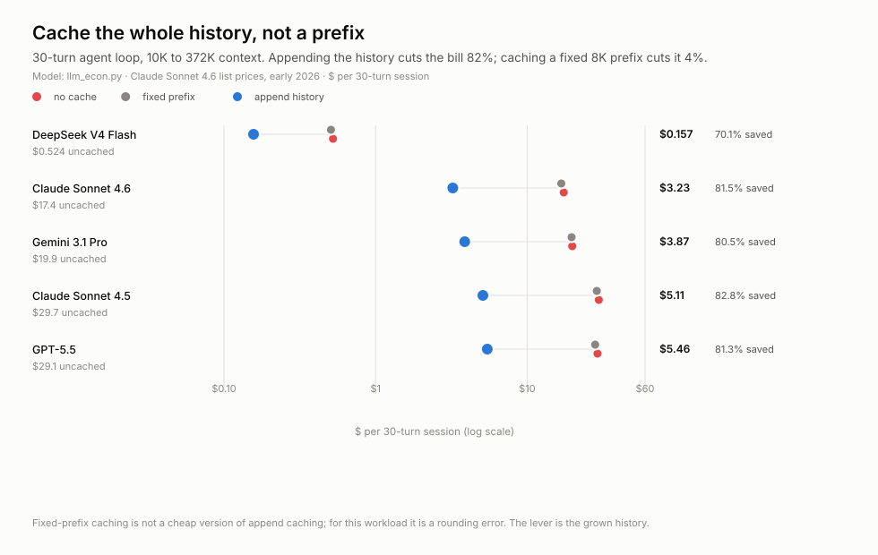
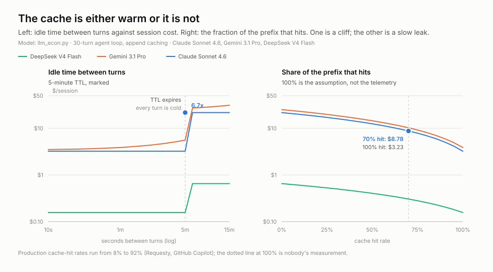
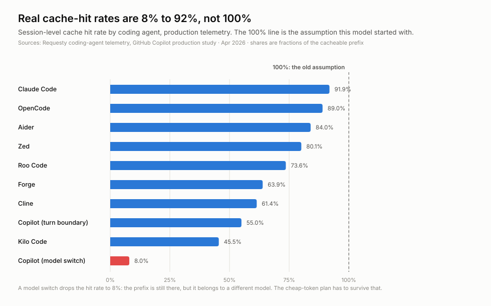
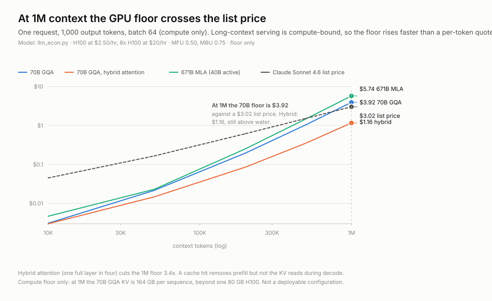
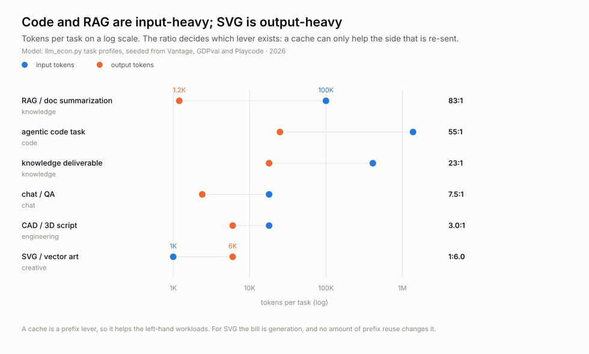
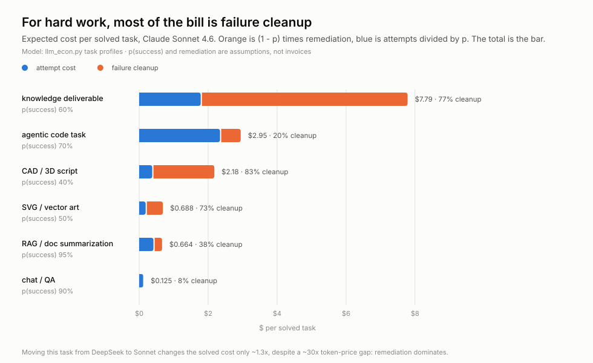
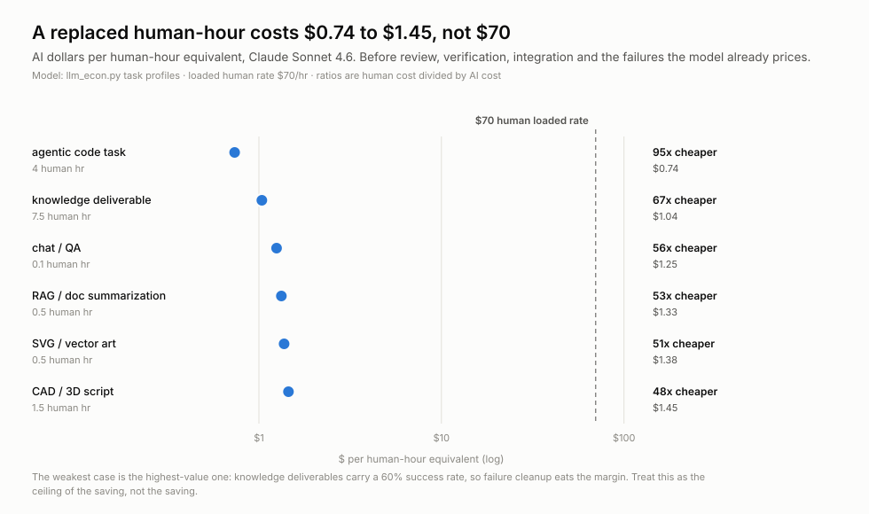
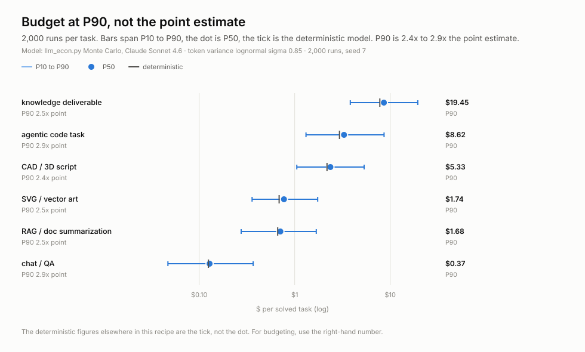
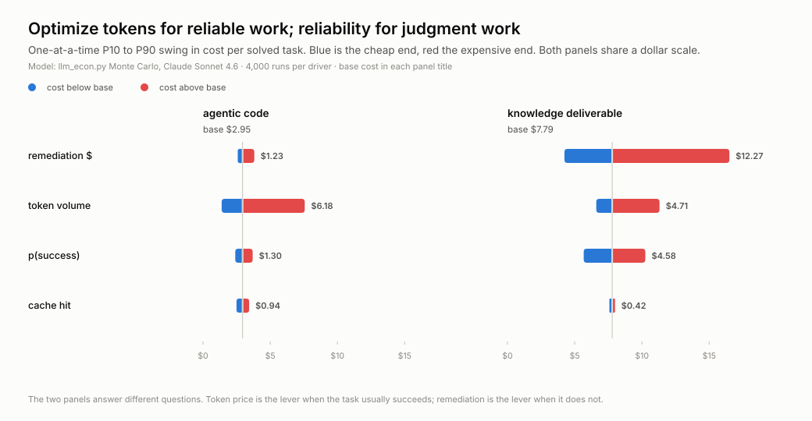

# A 30-turn agent loop costs $3.23, not $17.44

**Published 2026-10-26** · ten figures, thirteen scripts · a stdlib-only model of
the user bill, the provider floor and the task layer · no network, no corpus.

## What this is

This recipe prices the same request from three sides:

| layer | question | unit |
| --- | --- | --- |
| **user bill** | what the API charges for input, output, cached reads, cache writes and tier cliffs | $ per session |
| **provider floor** | what the GPU-seconds cost: prefill compute plus KV-cache reads during decode | $ per request |
| **task layer** | what a *solved task* costs once failures and cleanup are priced | $ per solved task |

The three do not move together. The model choice is the smallest of the three
numbers in most of what follows; cache residency, context length and task
reliability move the bill by more.

This is a model, not an invoice. Every dollar below is computed by
[`llm_econ.py`](artifacts/scripts/llm_econ.py) from list prices and cited priors.
The measured inputs — cache-hit rates, token profiles, task sizes — are named in
[`provenance.json`](provenance.json). The dollar outputs are assumptions with
arithmetic attached.

*Who has a stake:* a team budgeting an agent · a provider pricing a long-context
tier · anyone comparing models on "cost per token".

## The short version

- **Cache the grown history, not a prefix.** A 30-turn Sonnet loop falls from
  **$17.44 to $3.23** (82%). A fixed 8K prefix saves 3.6%.
- **The cache is binary.** Below the 5-minute TTL the bill is $3.23; let it
  expire and the same loop costs **$21.74** (6.7×). At a 70% hit rate it is
  $8.78, 2.7× the fully-warm bill.
- **Real hit rates are 8–92%, not 100%.** A model switch is 8%; below roughly a
  quarter hit rate, append caching costs more than not caching at all.
- **A 200K→1M prompt is 4.6× on a flat price sheet and 8.9× on a tiered one.**
  The tier re-prices the whole request, not just the excess.
- **At 1M the provider's GPU floor is $3.92 against a $3.02 list price.** Hybrid
  attention moves the floor to $1.16; the architecture matters more than the
  price sheet.
- **For hard work, 77% of the bill is failure cleanup.** Moving a knowledge
  deliverable from DeepSeek to Sonnet changes its solved cost only 1.3× despite
  a ~30× token-price gap.
- **A replaced human-hour costs $0.74–$1.45**, against a $70 loaded rate — before
  review, verification and integration.
- **Budget at P90.** It is 2.4–2.9× the deterministic estimate.

## The 200K cliff is a step, not a slope



One request, 5,000 output tokens. A flat price sheet scales linearly with prompt
length. A tiered one does not: above the threshold the **whole request** is
re-priced at 2× input and 1.5× output, so the line steps.

| prompt | Claude Sonnet 4.6 (flat) | Gemini 3.1 Pro (tiered at 200K) |
| ---: | ---: | ---: |
| 200K | $0.675 | $0.46 |
| 1M | **$3.075** | **$4.09** |
| ratio | **4.6×** | **8.9×** |

The flat model rises 4.6× for a 5× prompt; the tiered one rises 8.9×. "The
biggest window is free" is true only on the flat sheet. A per-token quote hides
this, because the surcharge is not on the extra tokens — it is on every token
already sent.

*Prices are early-2026 list prices. The tier rule is simplified to "the whole
request re-prices above the threshold", which is how the published sheets read,
not a contract.*

## Cache the whole history, not a prefix



An agent loop is append-only: last turn's entire context is this turn's prefix.
Caching a fixed 8K system prompt reuses almost nothing; caching the grown history
reuses almost everything.

| model | no cache | fixed 8K prefix | append history | saved |
| --- | ---: | ---: | ---: | ---: |
| Claude Sonnet 4.6 | $17.44 | $16.82 | **$3.23** | **81%** |
| Gemini 3.1 Pro | $19.85 | $19.67 | **$3.87** | 80% |
| DeepSeek V4 Flash | $0.524 | $0.508 | **$0.157** | 70% |
| GPT-5.5 | $29.14 | $28.10 | **$5.46** | 81% |
| Claude Sonnet 4.5 | $29.72 | $28.80 | **$5.11** | 83% |

**The gap between the middle and right columns is the finding.** Fixed-prefix
caching is not a cheap version of append caching; for this workload it is a
rounding error.

*An earlier version of this model charged the 25% cache-write premium even when
caching was off. That inflated the uncached bill to $21.74 and the append saving
to 85%. The corrected no-cache bill is $17.44 and the saving is 82%. The
cold-cache bill is still $21.74, because a cache that is configured but expired
does re-write every turn.*

## The cache is either warm or it is not



Two ways a warm cache stops paying. The left panel is a cliff: below the
provider's 5-minute TTL the session costs $3.23; one turn past it the cache is
cold on every turn and the bill is **$21.74** (6.7×). There is no slope between
them.

The right panel is the same loss arriving gradually. At a **70% hit rate** — well
inside the range production agents report — the bill is **$8.78**, 2.7× the
fully-warm cost. An estimate that assumes 100% is not a small optimism.

And a cache can be worse than no cache. At a 0% hit rate the append policy costs
$21.74 against **$17.44 with caching off**, because the write premium is paid on
everything and nothing is read back. The break-even is roughly a **23% hit
rate**; below that, turn caching off.

*Gemini also charges storage: $4.50 per million cached tokens per hour. At a
60-second turn gap that is 44% of its cached bill; at 5 minutes, 61%. The model
applies the fee only where the published sheet has one.*

## Real cache-hit rates are 8% to 92%, not 100%



The first version of this model assumed a 100% hit rate. Production coding
agents do not:

| agent | hit rate |
| --- | ---: |
| Claude Code | 91.9% |
| OpenCode | 89.0% |
| Aider | 84.0% |
| Zed | 80.1% |
| Roo Code | 73.6% |
| Forge | 63.9% |
| Cline | 61.4% |
| Copilot, turn boundary | 55.0% |
| Kilo Code | 45.5% |
| **Copilot, model switch** | **8.0%** |

The last row is the case that breaks the cheap-token plan outright. The prefix is
still there, but it belongs to a different model, so the cache misses. At 8% the
loop is below the ~23% break-even: the cache is a cost, not a saving.

*These are April 2026 telemetry from Requesty and a GitHub Copilot production
study, not universal constants. They are the best public priors this recipe
found; a different agent mix would move the curve.*

## At 1M the GPU floor crosses the list price



The user's bill is the dashed line. The provider's floor is the roofline cost of
GPU-seconds for the same request: prefill (compute-bound, quadratic in context)
plus decode (KV-read bound).

| context | 70B GQA | 70B GQA, hybrid | 671B MLA | list price |
| ---: | ---: | ---: | ---: | ---: |
| 10K | $0.003 | $0.003 | $0.005 | $0.045 |
| 200K | $0.196 | $0.085 | $0.252 | $0.615 |
| 1M | **$3.92** | **$1.16** | **$5.74** | **$3.02** |

At 1M the 70B GQA floor is **$0.90 above the list price**: the provider loses on
every request. Hybrid attention (one full layer in four) cuts the floor 3.4× to
$1.16, which is why the architecture matters more than the price sheet.

The KV cache is the other half of the story. At 1M, 70B GQA holds **164 GB per
sequence** in fp8, beyond a single 80 GB H100; 671B MLA holds **35 GB**, which is
the reason cheap long-context models exist. A cache hit removes the prefill term
but not the KV reads during decode, so caching does not flatten this line.

*This is a compute floor, not a P&L. It excludes power, idle capacity,
networking and margin, and it does not check whether the KV fits the device: at
1M the GQA configuration does not. Read the direction, not the third decimal.*

## Workload shape decides which lever exists



A cache is a prefix lever. It can only help the side of the workload that is
re-sent.

| task | tokens in | tokens out | in:out | lever |
| --- | ---: | ---: | ---: | --- |
| RAG / doc summarization | 100K | 1.2K | **83:1** | cache |
| agentic code | 1.38M | 25K | **55:1** | cache |
| knowledge deliverable | 411K | 18K | 23:1 | cache, weakly |
| chat / QA | 18K | 2.4K | 7.5:1 | cache |
| CAD / 3D script | 18K | 6K | 3:1 | neither dominates |
| SVG / vector art | 1K | 6K | **1:6** | generation |

For code and RAG the bill is mostly input, so caching is the first lever. For
SVG the bill is generation; no amount of prefix reuse changes it. That is why a
single "cache everything" rule cannot be the whole cost strategy.

*Token profiles are assumptions seeded from Vantage (a 50-turn coding session
≈ 1M in / 40K out), OpenAI GDPval (≈$400 and 7–9 expert hours per deliverable)
and Playcode (identical SVG tasks where one model emitted 8.8× the output of
another). They are not measured per task here.*

## For hard work, most of the bill is failure cleanup



Expected cost per solved task is `attempt / p(success) + (1 − p) · remediation`.
For a reliable task the first term is the whole bill. For a task that succeeds
60% of the time and costs $15 to clean up when it fails, **77% of the bill is the
second term**.

| task | p(success) | attempt | failure cleanup | solved | cleanup share |
| --- | ---: | ---: | ---: | ---: | ---: |
| knowledge deliverable | 60% | $1.79 | **$6.00** | **$7.79** | **77%** |
| CAD / 3D script | 40% | $0.38 | $1.80 | $2.18 | 83% |
| agentic code | 70% | $2.35 | $0.60 | $2.95 | 20% |
| SVG / vector art | 50% | $0.19 | $0.50 | $0.69 | 73% |
| RAG / doc summarization | 95% | $0.41 | $0.25 | $0.66 | 38% |
| chat / QA | 90% | $0.12 | $0.01 | $0.13 | 8% |

Moving the knowledge deliverable from DeepSeek to Sonnet changes its solved cost
only **1.3×** ($6.06 → $7.79) despite a ~30× token-price gap. Remediation
dominates. It takes a success rate above roughly **95%** before the attempt cost
is the larger half.

*`p(success)` and remediation are assumptions, not invoices. They are the two
numbers in this recipe most likely to be wrong for your task, and the tornado
below shows how much they move the answer.*

## A replaced human-hour costs $0.74 to $1.45, not $70



AI dollars per solved task divided by the human hours that task takes, against a
**$70 loaded hourly rate**:

| task | human hours | AI $/human-hour | vs human |
| --- | ---: | ---: | ---: |
| agentic code | 4.0 | **$0.74** | **95× cheaper** |
| knowledge deliverable | 7.5 | $1.04 | 67× |
| chat / QA | 0.1 | $1.25 | 56× |
| RAG / doc summarization | 0.5 | $1.33 | 53× |
| SVG / vector art | 0.5 | $1.38 | 51× |
| CAD / 3D script | 1.5 | **$1.45** | **48×** |

**The reference line is the whole point.** Without it the dots are just small
numbers; with it, the distance is the claim. The weakest of the high-value cases
is the knowledge deliverable: it carries a 60% success rate, so failure cleanup
eats the margin.

*This is not a claim that the work is equivalent. It excludes human-in-the-loop
review, verification, integration, and the cost of failures the `p(success)` term
does not capture. Treat it as the ceiling of the saving, not the saving.*

## Budget at P90, not the point estimate



Six tasks, 2,000 simulated runs each. The bar is P10–P90, the dot is P50, and the
small tick is the deterministic estimate.

| task | point | P50 | **P90** | P90 / point |
| --- | ---: | ---: | ---: | ---: |
| knowledge deliverable | $7.79 | $8.59 | **$19.45** | 2.5× |
| agentic code | $2.95 | $3.28 | **$8.62** | 2.9× |
| CAD / 3D script | $2.18 | $2.37 | **$5.33** | 2.4× |
| SVG / vector art | $0.69 | $0.77 | **$1.74** | 2.5× |
| RAG / doc summarization | $0.66 | $0.71 | **$1.68** | 2.5× |
| chat / QA | $0.13 | $0.13 | **$0.37** | 2.9× |

**Every task's P90 lands 2.4–2.9× above its deterministic tick.** The
distribution is right-skewed: the rare expensive run is the one that blows the
budget, and the point estimate is a median-shaped guess.

*The simulation samples four things at once: `p(success)` (Beta), cache-hit rate
(Beta), run-to-run token volume (lognormal, σ 0.85) and remediation (lognormal).
It is still a model; the dispersion is an assumption, not a measured variance.*

## Optimize tokens for reliable work; reliability for judgment work



Each bar swings one driver from its P10 to its P90 and re-prices the task,
holding the others at their base. Both panels share one dollar scale.

| task | biggest driver | swing | next |
| --- | --- | ---: | --- |
| agentic code | **token volume** | **$6.18** | p(success) $1.30 |
| knowledge deliverable | **remediation** | **$12.27** | token volume $4.71 |

For code, the lever is tokens: cache the history, shorten the context, route to a
cheaper model for the parts that tolerate it. For a knowledge deliverable, the
lever is **being wrong**: better verification, a narrower scope, or a higher
success rate. Token price barely moves it.

This is also why a single model-routing rule is not enough. The same 30× price
gap that dominates a reliable code task is a rounding error on an unreliable
judgment task.

## What not to trust

- **Every dollar here is modelled, not measured.** The measured inputs are
  external priors; the outputs are arithmetic on them. No invoice was reconciled.
- **The server numbers are single-request GPU-rental floors.** No power, idle
  capacity, networking, quantization, real batching or margin. At 1M the GQA KV
  does not fit the device; the floor is compute-only.
- **The cache model is one policy, not a provider's implementation.** Append-only,
  5-minute TTL, 1.25× write premium, partial hits as a fraction of the prefix,
  storage fees only where the published sheet has one.
- **The task layer is six profiles.** `p(success)`, remediation, human hours and
  value are assumptions. The replacement index excludes review, verification and
  integration, and the Monte Carlo dispersion is assumed rather than measured.
- **The prices are early-2026 list prices.** They move. The method is the
  durable part; the dollar figures are a snapshot.
- **This is not a forecast of provider profitability**, and not a claim that AI
  replaces a worker. It is a unit-economics model with the assumptions exposed.

## What would change the answer

- **If cache-hit rates were reliably above 90%**, the append saving would approach
  85% and the fragility section would matter less. The 8% model-switch case is
  what makes it matter.
- **If `p(success)` for knowledge work were above ~95%**, remediation would stop
  dominating and token price would become the lever.
- **If tiered pricing disappeared**, the 200K cliff would flatten to the 4.6×
  flat line.
- **If hybrid attention became standard**, the 1M floor would fall below list and
  the "provider loses" result would be a transition, not a steady state.
- **If real contracts priced below list**, every margin statement here would
  shrink; the direction of the floors would not.

## Run it

There is no fetch step and no `data/` directory: the model is the artifact.

```sh
cd recipes/llm-unit-economics
python artifacts/scripts/scenarios.py                 # headline JSON
python artifacts/scripts/chart-caching-modes.py       # one figure
python artifacts/scripts/chart-server-floor.py        # another
```

Every chart script imports `scenarios.py`, which imports `llm_econ.py` and
`svgkit.py` from the same folder. Python puts the script's directory on
`sys.path`, so the commands work from the recipe root. The SVGs are committed;
the scripts rewrite them in place.

`scenarios.py` is the single place the assumptions live, so a chart cannot
quietly re-invent a workload. `python artifacts/scripts/scenarios.py` prints the
headline figures as JSON; if a number in this prose disagrees with that output,
the script is authoritative and the prose is a bug.

The long-form working note, including the priors and the external references, is
[`artifacts/research-notes.md`](artifacts/research-notes.md). The questions this
recipe asked — and what is still open — are in
[`artifacts/research-questions/questions.md`](artifacts/research-questions/questions.md).

## Files

| file | what it is |
| --- | --- |
| `artifacts/scripts/llm_econ.py` | pricing, architectures, workloads, `user_cost`, `server_cost`, tasks, Monte Carlo |
| `artifacts/scripts/scenarios.py` | the scenarios put to the model; prints the headline JSON |
| `artifacts/scripts/svgkit.py` | palette, text and mark helpers, scales |
| `artifacts/scripts/chart-*.py` | one script per figure |
| `artifacts/charts/*.svg` | the ten figures |
| `artifacts/research-notes.md` | the working note, priors and references |
| `artifacts/research-questions/questions.md` | asked, answered, open — the work queue |

CC BY 4.0. Citation required wherever a figure from this is published:
**Source: llm-unit-economics, q3dresearch cookbook (2026).**
