# What a presence-only marine register can and cannot tell you

**Status: proven** · method 1.0.0 · computed 2026-09-19 from OBIS, the Ocean Biodiversity
Information System — **229,671,953 records, 168,352 species, 6,918 datasets** — plus the IUCN
Red List archives GBIF mirrors. Retrieved by
[`artifacts/scripts/fetch.py`](artifacts/scripts/fetch.py): no key, standard library only, no
data committed.

OBIS is the reference record of where sea life has been observed. Marine protected areas are
sited from it, extinction risk is assessed against it, and national biodiversity indicators are
computed on it. **It is an excellent register of where people have looked, and it is read as a
register of where life is.**

Fourteen figures, one dataset, five questions. The thread through all of them is sampling
effort: where it is, what it hides, what cancels it, what it costs, and what it means for the
one outside judgement anyone tries to join to this register.

## Contents

| | | |
| --- | --- | --- |
| **I** | [Where the records are](#i-where-the-records-are) | 27 cells hold a third of it; the median cell is 45% one dataset; 88% of everything is from the top 200 m |
| **II** | [Two fields that promise and fail](#ii-two-fields-that-promise-and-fail) | the invasion flag is species-level; the biomass field is 44 incommensurable strings |
| **III** | [What survives the effort](#iii-what-survives-the-effort) | **the method** — a within-bin ratio cancels effort, and light is the one provable cliff |
| **IV** | [What the next hundred species cost](#iv-what-the-next-hundred-species-cost) | species never run out; 100 sponge species cost 83k records and 100 seabird species 63.5M |
| **V** | [What it can say about a Red List listing](#v-what-it-can-say-about-a-red-list-listing) | four of five IUCN criteria unreachable; B2 ruled out for 81% of CR; farming invisible, fishing loud |

## The decision each part changes

**I.** A gap on the map is an unvisited sea, not an empty one. **II.** Check what a field's
values actually are before building on its name. **III.** Stop comparing units and compare
composition within a stratum — then check the stratum has many contributors. **IV.** If you
want new species, the price differs across groups by a factor of 765. **V.** Before joining a
conservation status to occurrence data, check which of the assessor's own criteria your data
could ever speak to.

*Who acts on this:* anyone computing a biodiversity indicator, siting a reserve, auditing a Red
List assessment, planning a survey — or doing the equivalent on any register built from
volunteered records rather than a designed survey.

---

# I. Where the records are

## The map is five monitoring programmes

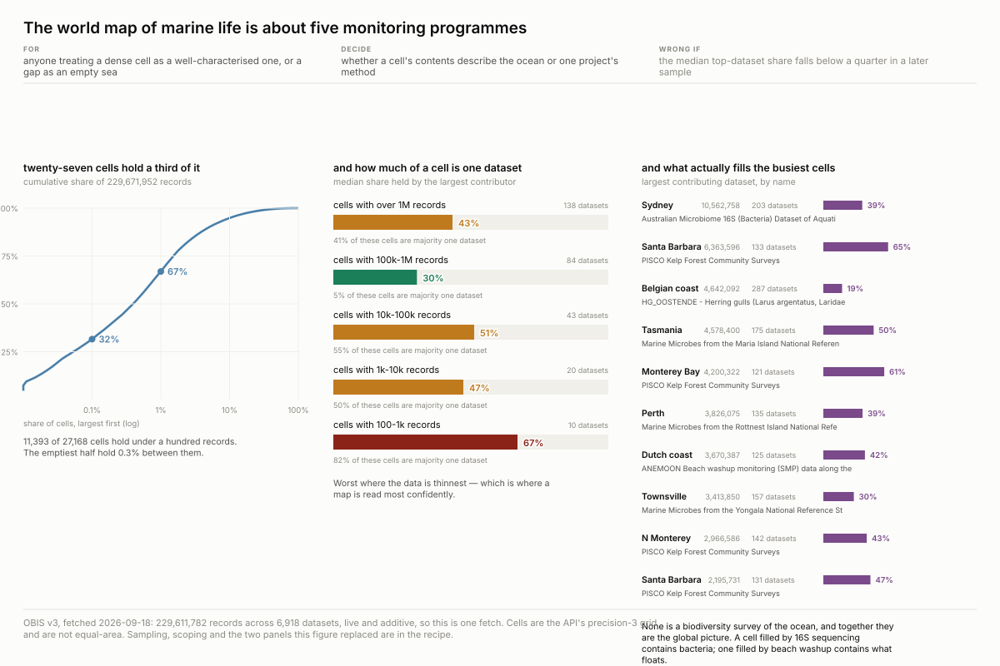

27,168 grid cells hold the register; **27 of them hold a third of it**, and 42% hold under a
hundred records. The hotspots are addresses, not ecosystems — every one within reach of a
marine laboratory.

The sharper finding is what is inside them. **The median cell takes 45% of its records from a
single dataset**, and it is worst where the data is thinnest: in cells holding 100–1,000
records the median top dataset is 67%. A remote cell is not thinly sampled by many people; it
is one survey that went there once.

The busiest cells carry 120–290 datasets each and still take 30–65% from one: 16S sequencing at
Sydney, kelp forest surveys at Santa Barbara, herring gull telemetry off Belgium, beach-washup
monitoring off the Netherlands. **A cell filled by 16S sequencing contains bacteria; a cell
filled by beach washup contains what floats.**

## And what is known is known about the top two hundred metres

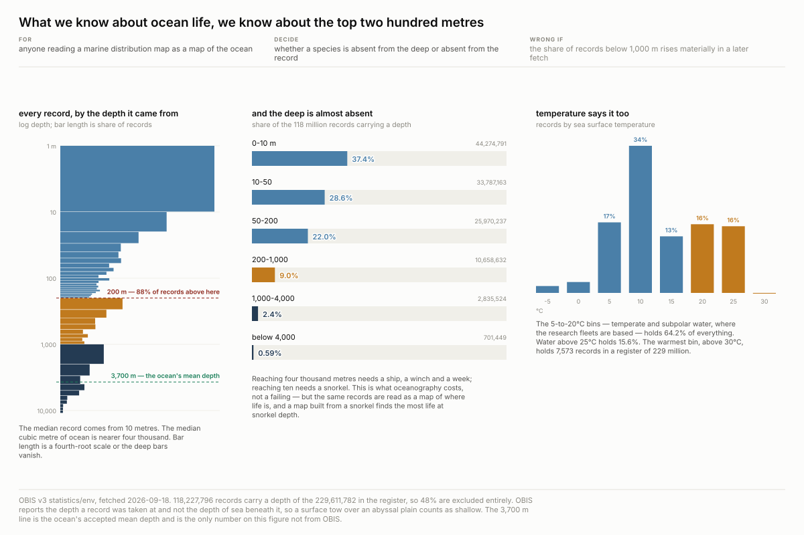

118,227,796 records carry a depth. **88.0% is from the top 200 metres.** The median record comes
from **10 m**; the mean depth of the ocean is about 3,700 m. Below four thousand metres — most
of the sea floor, and a majority of the habitable volume on this planet — there are 701,449
records.

The temperature bins say the same from another angle: 5–20 °C holds 64.2%, and the warmest bin
above 30 °C holds **7,573 records** in a register of 229 million. That is a signature of where
research vessels are based.

---

# II. Two fields that promise and fail

Both of these are the field you would reach for. Both fail for a structural reason rather than
an untidy one, which is why neither is fixable by cleaning.

## You cannot map invasion from this register

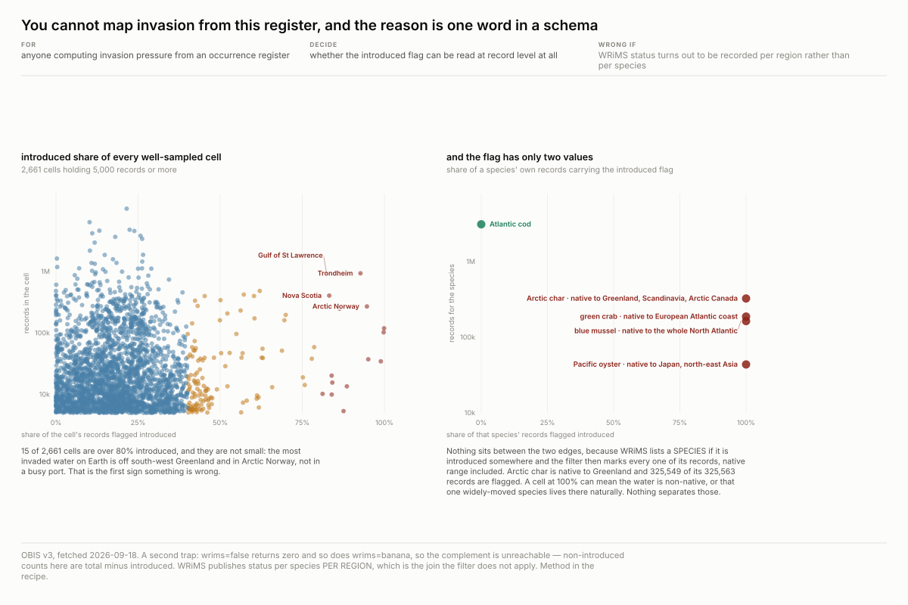

The introduced-species flag looks like an invasion map waiting to be drawn. Plot the introduced
share of every cell holding 5,000+ records and **15 of 2,661 cells are over 80% introduced** —
and the most invaded water on Earth turns out to be off south-west Greenland and in Arctic
Norway, not in a busy port. That is the first sign something is wrong.

The right-hand panel says what. **Every species sits at exactly 0% or exactly 100%, and nothing
lands between**, because WRiMS lists a *species* if it is introduced somewhere and the filter
then marks every one of its records, native range included. Arctic char is native to Greenland
and 325,549 of its 325,563 records are flagged. A cell at 100% can mean the water is non-native,
or that one widely-moved species lives there naturally. Nothing separates those.

## The field that would give you biomass cannot be added up

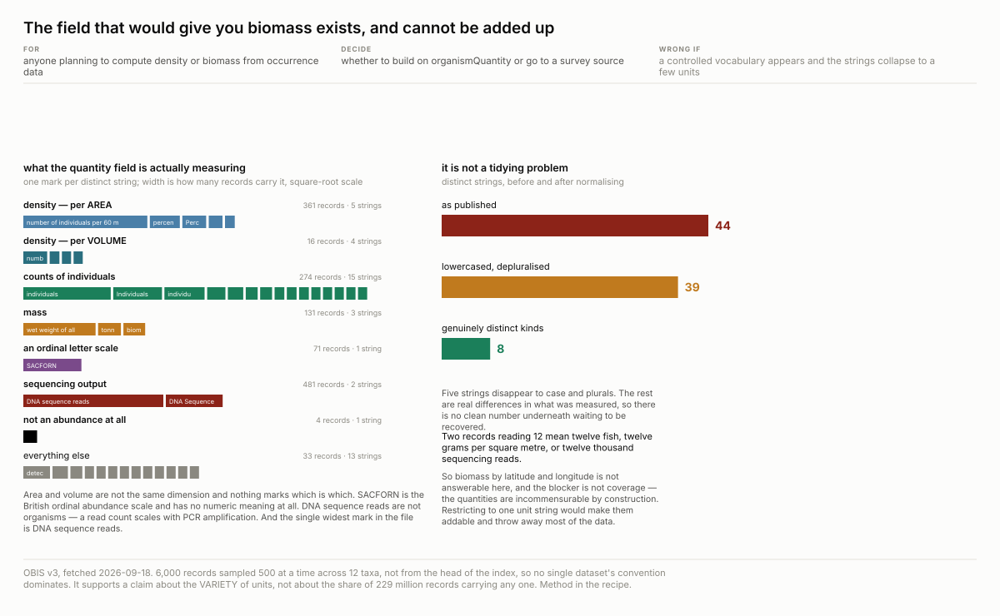

A 6,000-record sample across twelve classes returns **44 distinct strings** in
`organismQuantityType`. They are not variants of one measure. They are eight incompatible kinds
of thing: counts, densities on **area**, densities on **volume** — not the same dimension, and
nothing marks which is which — masses, an ordinal letter scale with no numeric meaning
(SACFORN), sequencing reads that scale with PCR amplification rather than with organisms, and
one morphometric measurement, *"Length of longest arm in millimeters"*, filed where a count
belongs because the field is free text.

Lowercasing and depluralising takes 44 strings to 39. **There is no clean number underneath
waiting to be recovered.** Two records reading "12" mean twelve fish, twelve grams per square
metre, or twelve thousand sequencing reads.

---

# III. What survives the effort

## For some groups the attribute *is* the instrument

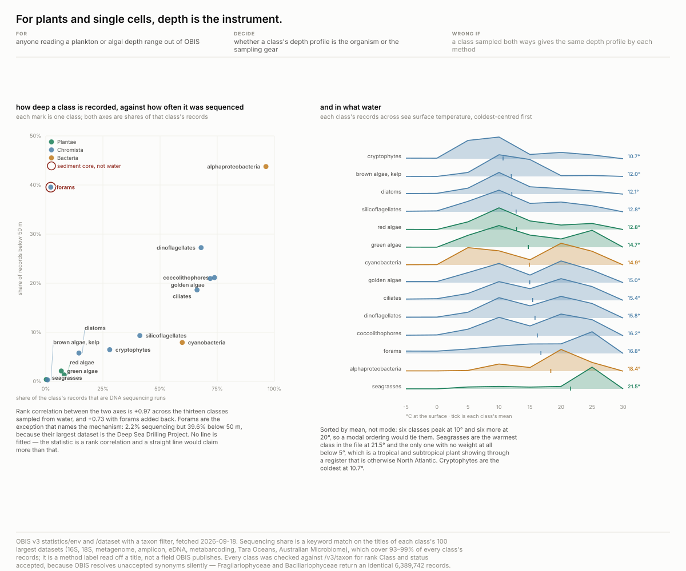

Pull recorded depth per taxonomic class and for animals you get biology — sea cucumbers really
are the deepest group. Do it for plants, algae and single cells and you get the sampling gear:
**rank correlation +0.97 between a class's DNA-sequencing share and the share of its records
below 50 m.** Alphaproteobacteria is 96% sequencing and 44% below 50 m; kelp is 0.8% and 0.3%.
A CTD rosette fires bottles down the water column and a diver does not.

**Forams are the control that names the mechanism.** They break the correlation — 2.2%
sequencing but 39.6% below 50 m — because their largest dataset is the Deep Sea Drilling
Project. A third instrument, a sediment core. Dropping them moves rho from +0.73 to +0.97. An
outlier that turns out to be another instrument confirms the mechanism instead of denting it.

**The generalisable move:** build a per-unit number for *how each unit was measured*, then
rank-correlate it against your finding. "This is biased" is a caveat nobody acts on. A number
for the bias is an axis, and if it ranks with your claim at 0.97 there is no claim left.

## What survives: light

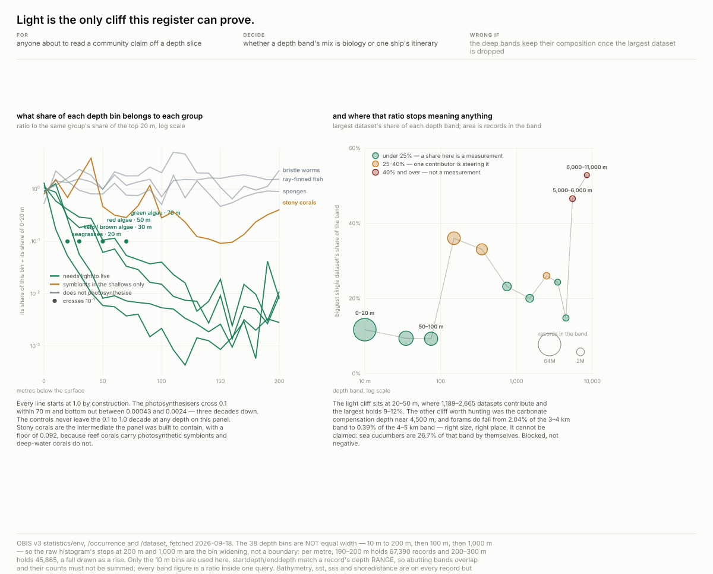

Now the method. "How deep does kelp go" is unanswerable — that is the gear. "What lives at
40 m" is answerable, because everything in that bin was reached by the same cruises.

Benthic photosynthesisers have to do two things at once: attach to the bottom and be lit. They
disappear within tens of metres, measured as a share of each bin scaled to their own share of
the top 20 m:

| group | falls under a tenth of its shallow share at |
| --- | --- |
| seagrasses | **20 m** |
| kelp | **30 m** |
| red algae | **50 m** |
| green algae | **70 m** |
| sponges, bristle worms, ray-finned fish | *never* |

Nothing that does not photosynthesise moves at all over the same range. The ordering is
mechanism, not ranking — seagrass is a flowering plant needing lit soft sediment; red and green
algae include low-light crustose corallines and run twice as deep.

**Stony corals were put in as a designed intermediate** — reef corals carry photosynthetic
symbionts, deep-water corals do not — and they behave like one: a floor of 9.2 × 10⁻², an order
of magnitude above every true photosynthesiser and an order below every control.

And this is not the cruises running out: 14.9M records sit in 50–100 m, from 1,189 datasets.

**Where the method stops.** The right-hand panel measures it directly. Shallow bands run to
2,665 datasets with the largest at 9–12%; 5,000–6,000 m is **46.6% one cruise**. So the other
cliff worth hunting — the carbonate compensation depth, where calcite dissolves — is **blocked,
not negative**. Forams do fall from 2.04% of the 3–4 km band to 0.39% of the 4–5 km band, the
right size in the right place, and sea cucumbers are 26.7% of that band on their own.

## The positive control: where it really is the animals

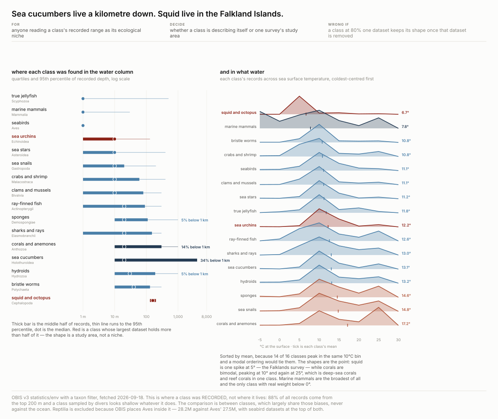

A method that only ever returns "it's the sampling" is not a method. Run the same pull over
animal classes and most of it is biology: sea cucumbers are genuinely the deepest group, corals
are bimodal on both axes because reef corals and deep-sea corals share a class, marine mammals
carry more sub-zero records than anything else because the ice edge is where the seals are.

The exception proves the test works. **Squid and octopus look like the strangest class in the
file** — a depth band of 130–200 m and 83% of records from 5 °C water — and **80% of all
cephalopod records come from one dataset**, three decades of Falkland Islands trawl surveys.
The niche is a study area. A class whose largest dataset holds 13–27% is describing itself; a
class at 80% is describing a project.

Both temperature panels are ordered by **mean, not mode**: 14 of 16 animal classes peak in the
same 10 °C bin, so a modal ordering ties almost everything.

## Do not clean this register first

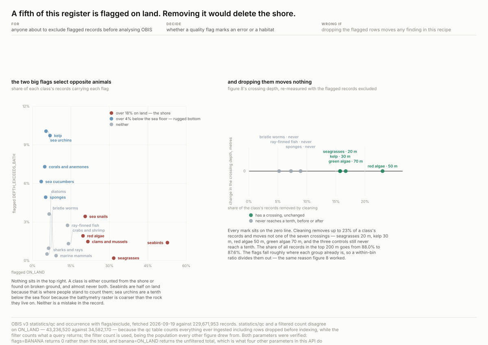

OBIS publishes its own error signature and it looks alarming: **43.2M records flagged ON_LAND**
out of 229.7M, 8.5M deeper than the sea floor beneath them, half a million impossible
coordinates. The routine first step is to drop them.

**Do not.** The flags are a habitat map:

| class | flagged ON_LAND | flagged deeper than the sea floor |
| --- | --- | --- |
| seabirds | **52.7%** | 1.4% |
| seagrasses | 31.7% | 0.2% |
| clams and mussels | 21.6% | 1.5% |
| sea urchins | 5.3% | **10.1%** |
| kelp | 6.8% | 9.7% |

Birds are counted from the shore. Seagrass grows in estuaries. Clams are dug out of a beach.
The second flag picks the opposite set — benthic animals on rugged bottom, where a coarse
bathymetry raster disagrees by a few metres. **Nothing sits high on both.** Excluding the
flagged rows would have deleted more than half of all seabird records from a recipe whose third
figure is about where seagrass lives.

**And dropping them changes nothing**: all seven light-cliff crossings identical, with up to 23%
of a class removed; 88.0% → 87.6% in the top 200 m. The flags land roughly where each group
already is, so the within-bin ratio divides them out — the same reason the method worked.

---

# IV. What the next hundred species cost

## Species do not run out; they get logarithmically more expensive

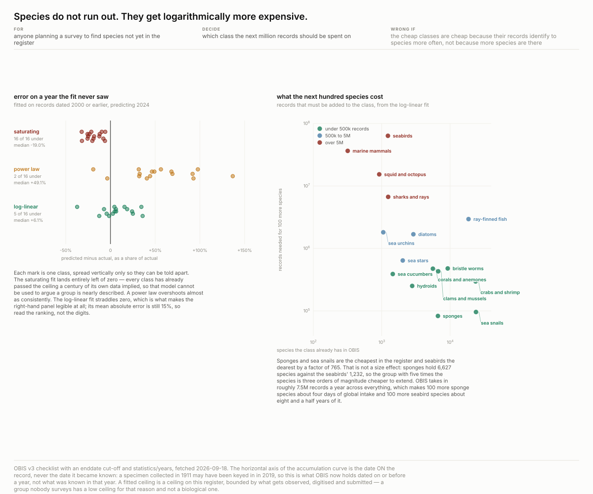

The only claim here about records that do not exist yet, so it is built around a holdout: fit on
everything dated 2000 or earlier, predict 2024, show the error.

**A saturating model fails, and fails the same way every time.** A Michaelis–Menten curve
under-predicts 2024 in **16 classes out of 16**, median −19%. Every class has already passed the
ceiling a century of its own data implied. The unanimity is what makes it a finding: 16/16 in
one direction is structural bias, not noise, and it means the functional form is wrong.

| model | median error | mean abs. error | under-predicts |
| --- | --- | --- | --- |
| saturating (Michaelis–Menten) | −19.0% | 18.5% | **16 of 16** |
| power law | +49.1% | 57.1% | 2 of 16 |
| **log-linear** | **+6.1%** | **15.1%** | 5 of 16 |

Returns do diminish — sponges bought 69,227 new species per million records in 1950–80 and 2,640
per million since 2000 — but the curve flattens **forever without arriving**. Anyone arguing
from an accumulation curve that a marine group is nearly fully described is making exactly this
error.

**No asymptote converts into a price.** Each tenfold increase in records returns a fixed number
of new species, and that number differs across classes by nearly three orders of magnitude:

| class | species held | records for 100 more |
| --- | --- | --- |
| sponges | 6,627 | **83,000** |
| sea snails | 23,853 | 96,000 |
| ray-finned fish | 18,556 | 3.0M |
| marine mammals | 318 | 36.5M |
| seabirds | 1,232 | **63.5M** |

**Not a size effect**: sponges hold five times the species seabirds do and are 765 times cheaper
to extend. OBIS takes in ~7.5M records a year, so 100 more sponge species is four days of global
intake and 100 more seabird species is eight and a half years of it.

## Taxonomy has two golden ages and two world wars in it

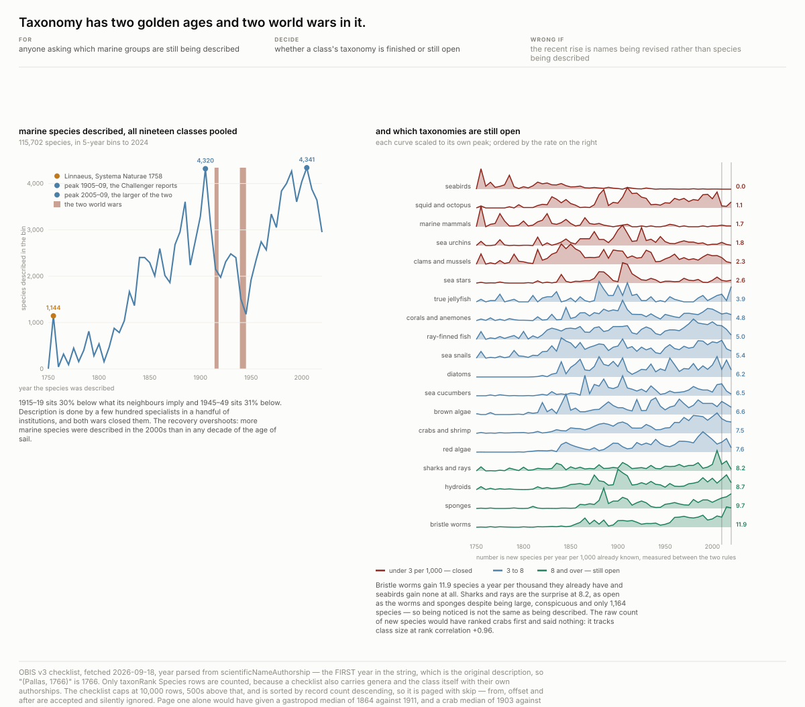

`scientificNameAuthorship` carries when a species became known to science, for **116,098
species**. Pooled, the curve is a history of expeditions and interruptions: near zero, then
1,144 species in the 1755–59 bin (Linnaeus, *Systema Naturae*), climbing through the century of
survey ships to **4,320 in 1905–09** — the tail of the Challenger era, whose reports appeared
1880–1895.

Then it breaks twice. **1915–19 sits 30% below what its neighbours imply; 1945–49 sits 31%
below.** Description is done by a few hundred specialists in a handful of institutions, and both
wars closed them. The recovery overshoots: **4,341 in 2005–09**, above the Challenger peak. More
marine species were described in the 2000s than in any decade of the age of sail.

**The classes are on completely different clocks.** Ranked by new species per year per 1,000
already known, over the last complete decade: bristle worms **11.9**, sponges 9.7, hydroids 8.7,
**sharks and rays 8.2**, seabirds **0.0**. Seabird taxonomy finished before photography. Sharks
are the surprise — as open as the worms despite being large, conspicuous and only 1,164 species.
**Being noticed is not the same as being described.**

*Two rejected statistics are recorded on the figure*: the median description year is a position
on the horizontal axis the curve already draws, and the raw count of new species tracks class
size at rank correlation **+0.96**.

---

# V. What it can say about a Red List listing

IUCN says a species is threatened. This register says where it has been seen. The obvious move
is to join them — to audit a listing, find neglected species, watch status change. **Three of
those turn out to be unanswerable, and the fourth answers backwards.**

## Concern follows attention — the obvious finding reverses

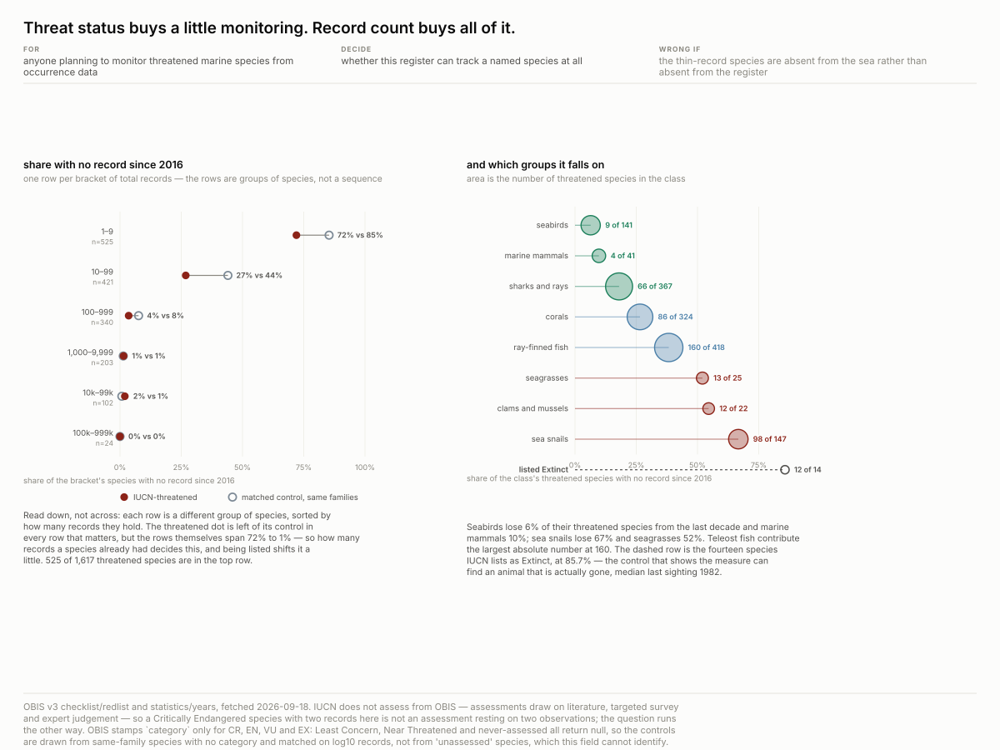

508 of 1,617 threatened marine species have **no record at all since 2016**. That reads as
neglect, and it would have been written up that way. Against non-threatened species **from the
same families, matched on log10(total records)**:

| records the species holds | threatened, unseen 10 yr | matched control |
| --- | --- | --- |
| 1–9 | 72% | 85% |
| 10–99 | 27% | 44% |
| 100–999 | 4% | 8% |
| **overall** | **31.4%** | **38.4%** |

The raw contrast was measuring rarity. And the matching sized the real driver: **record count
swings the outcome seventy-fold**; threat status moves it by a fifth. The fourteen species
listed Extinct are the positive control at 85.7% unseen — without them, "31% unseen" has no
scale.

**A field that cannot be read the obvious way.** OBIS stamps `category` only for CR, EN, VU and
EX. Least Concern, Near Threatened and never-assessed all return `null`, so the tempting
"heavily observed but never assessed" list is **not obtainable from this field**.

## Why the listing cannot be reconstructed

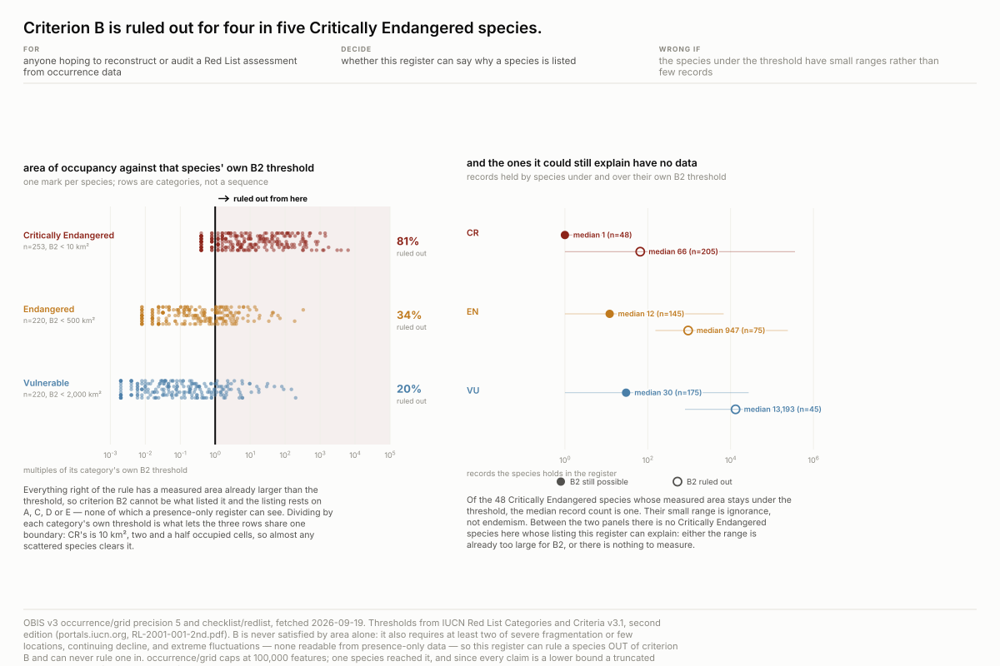

Of IUCN's five criteria, **A, C, D and E are all counts of mature individuals or their rate of
change**. A presence-only register supplies none. **B is the only spatial one**, and even B
never lists a species on area alone — it needs the threshold *plus at least two of* severe
fragmentation, continuing decline, extreme fluctuations. So this register can rule a listing
*out* of criterion B and can never rule one *in*.

Occupied geohash cells at precision 5 are ~23 km², larger than IUCN's recommended 2×2 km grid,
so `cells × 4 km²` is a **strict lower bound**. Above the threshold is decisive; below proves
nothing.

| | n | B2 ruled out | still possible | their median record count |
| --- | --- | --- | --- | --- |
| **CR** | 253 | **81%** | 48 | **1** |
| EN | 220 | 34% | 145 | 12 |
| VU | 220 | 20% | 175 | 30 |

**The remainder does not rescue it.** The 48 CR species still possible under B2 hold a median of
**one record** — their small measured range is ignorance, not endemism.

## It sees fishing fleets, not fish farms

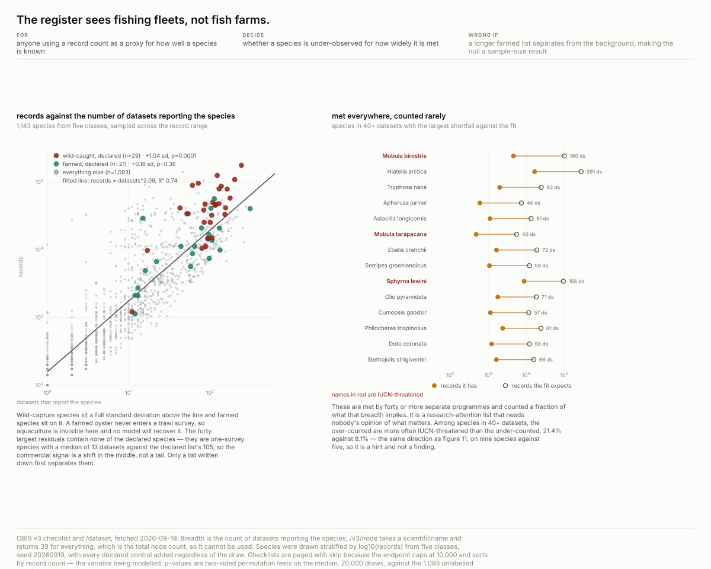

Records regressed on **number of datasets reporting the species** gives an expected attention;
the residual is a species counted more than its spread of sources warrants. **Two control lists
were written down before the fetch**, from the FAO production tables:

| group | n | vs background | p |
| --- | --- | --- | --- |
| **wild-caught, declared** | 29 | **+1.04 sd** | **0.0001** |
| farmed, declared | 21 | +0.18 sd | 0.36 |

*(two-sided permutation test on the median, 20,000 draws)*

**Farming cannot be predicted from this, and that is the answer rather than a failure.** A
farmed oyster never enters a trawl survey. What the residual detects is fishery survey effort.

**And the top of the ranking is not the finding.** The forty largest residuals contain **none**
of the declared commercial species — they are one-survey species with a median of 13 datasets
against the declared list's 105. The signal is a shift in the middle of the distribution, and
only a list written down first separates them.

## When the label moves, it is usually knowledge moving

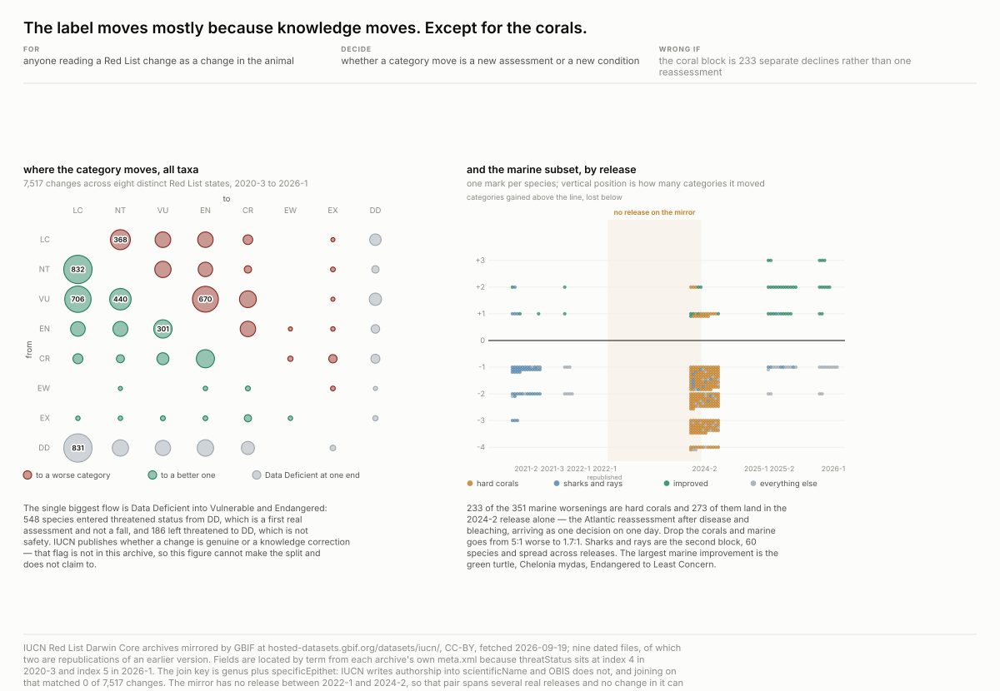

OBIS's redlist row carries 33 fields and **not one is temporal**. Transitions are invisible there
by construction — but not everywhere: GBIF mirrors the IUCN Red List as Darwin Core archives
under CC-BY, nine dated files covering **2020-3 to 2026-1**, carrying the full category set
including Least Concern and Data Deficient. **7,517 category changes across eight distinct
states.**

| movement | n |
| --- | --- |
| entered threatened **from Data Deficient** | **548** |
| left threatened to Least Concern / Near Threatened | 938 / 653 |
| left threatened **to** Data Deficient | 186 |
| left Extinct — rediscovered or reassessed | 38 |

DD → threatened is a first real assessment, not a fall. **IUCN publishes whether a change is
genuine or a knowledge correction, and that flag is not in the archive**, so this cannot make
the split.

**One order explains the marine direction.** Of 419 changes matching a name OBIS holds, 68
improved and 351 worsened — but **233 of the 351 are hard corals** and **273 landed in the
single 2024-2 release**, the Atlantic reassessment arriving as one decision on one day. Drop the
corals and it is 1.7:1, not 5:1.

---

## What this cannot support

**Not abundance, anywhere.** The register holds presences and never absences, so an empty cell
and an unvisited one are the same object.

**Not a trend.** Coverage has grown; whether it has *improved* needs the grid by year.

**Not one fetch twice.** The record count moved by 62,000 between two probes minutes apart.
Every figure is a statement about one fetch, and `provenance.json` records which.

**Not an audit of IUCN.** Assessments draw on literature, targeted survey and expert judgement,
almost none of it in OBIS. A Critically Endangered species with two records here is not an
assessment resting on two observations — the question runs the other way.

**Not a genuine-versus-knowledge split** on any category change. IUCN publishes that as the Red
List Index; the flag is not in the Darwin Core archive.

## Traps, each of which returned a plausible wrong answer

**A parameter that is not supported returns the unfiltered total.** `startbathymetry`,
`startshoredistance`, `startsst` and `startsss` all come back equal to no filter at all — and so
does `startbanana`, which is how that was established. **Send the nonsense parameter.** By
contrast `flags=BANANA` returns 0, which is what a working filter does with a value it does not
know.

**The checklist caps at 10,000 rows and is sorted by record count.** Taking the first page would
have put the gastropod median description year at 1864 instead of 1911 — half a century of bias,
pointing at the conclusion being written. The paging parameter is `skip`; `from`, `offset` and
`after` are accepted and ignored.

**Unaccepted taxonomic names resolve silently.** `Fragilariophyceae` and `Bacillariophyceae`
both return 6,389,742 records. Drawing a synonym pair on one axis plots the same records twice
under two names. Every class here is checked against `/v3/taxon` for rank Class and status
accepted.

**The depth bins are not equal width** — 10 m to 200 m, then 100 m, then 1,000 m. The raw
histogram steps up at 200 m and 1,000 m and both are the bin widening: per metre, 190–200 m
holds 67,390 records and 200–300 m holds 45,865, a fall drawn as a rise.

**A truncated download cached clean.** 124,685 bytes of a 14.1 MB IUCN archive passed a
`size > 1 MB` guard, and a truncated zip keeps a valid header. Atomic writes mean you never see
a *half-written* file, not that the content is *complete*. Every fetch checks bytes against
`Content-Length` and opens the archive before it enters the cache.

**The Darwin Core schema moved between versions.** `threatStatus` is index 4 in the 2020-3
archive and index 5 in 2026-1, with `locality` and `countryCode` swapped. A fixed position
yields zero categories for the old archives — and diffing against an empty version reports
**178,011 fabricated transitions**. Fields are located by term from each archive's `meta.xml`.

**A join key that made zero look like a finding.** IUCN writes authorship into `scientificName`
— *"Agrotis procellaris Meyrick 1900"* — and OBIS writes a bare binomial. Joining on it matched
**0 of 7,517** changes to a marine species, which reads as a fact about the ocean and is a fact
about string formatting. The key is `genus` + `specificEpithet`.

## Reproducing

    cd recipes/ocean-sampling-effort
    python3 artifacts/scripts/fetch.py       # ~1 hour and 155 MB on a cold cache; prints drift
    python3 artifacts/scripts/sampling.py    # or any of the fourteen figure scripts
    python3 artifacts/scripts/verify.py      # recomputes every number in this file

Standard library only. `verify.py` is authoritative: if a number here disagrees with it, the
prose is the bug. It has already caught one — correcting a join key moved a pair of IUCN
archives from zero changes to one, and this file still said "seven distinct states" when it had
become eight.

[`artifacts/research-questions/questions.md`](artifacts/research-questions/questions.md) records
what was asked, what died and why, and what is still open.
