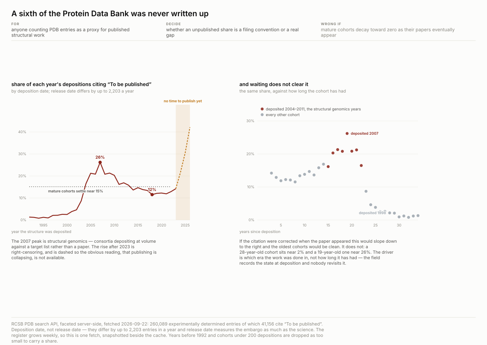
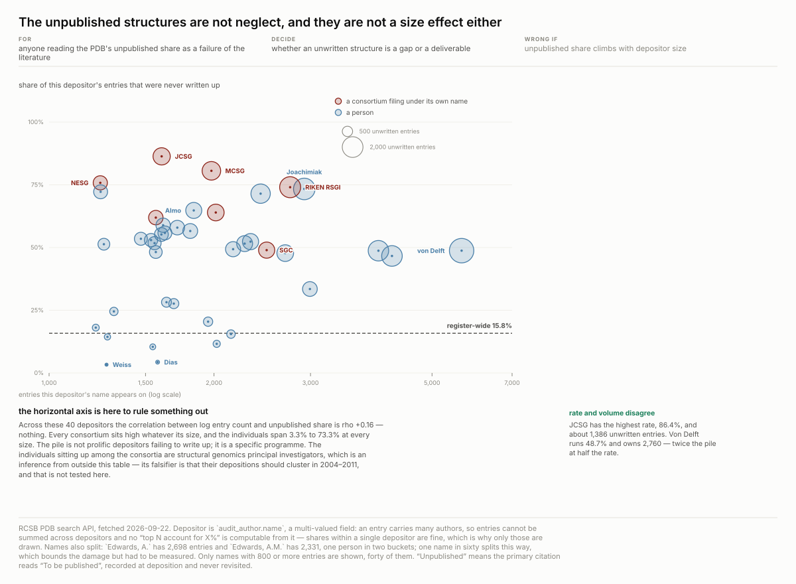
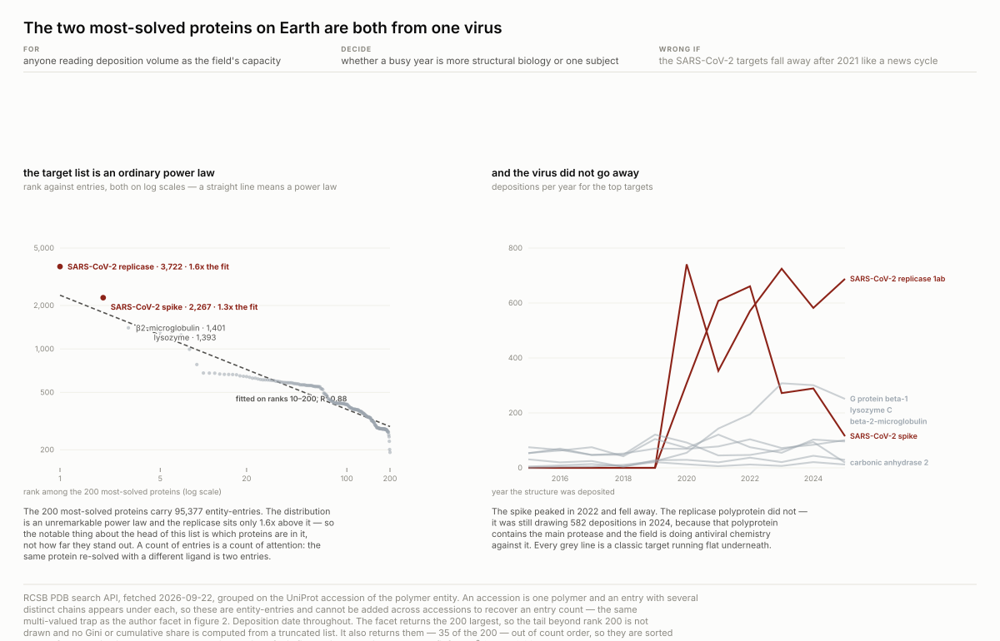
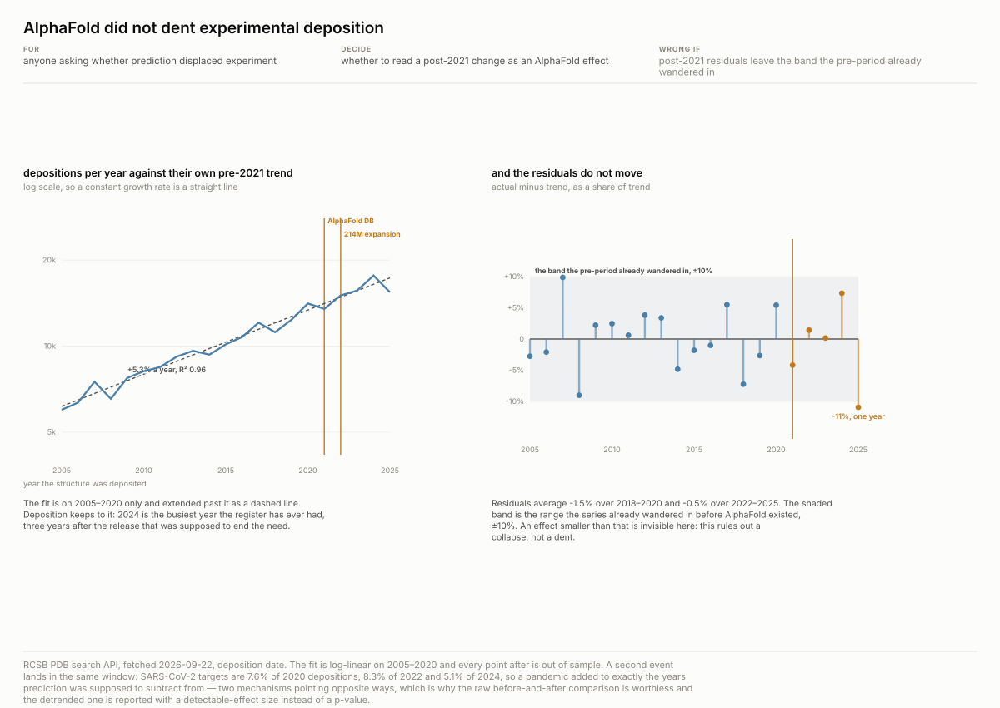
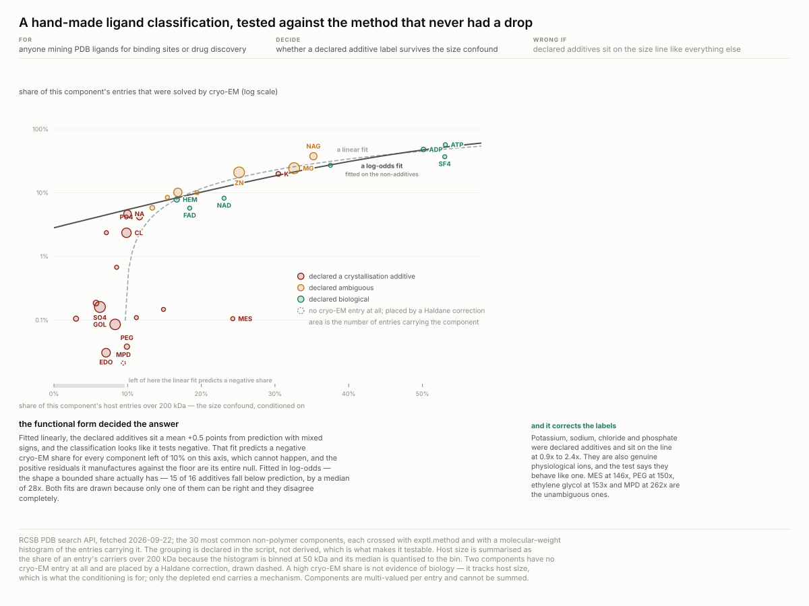
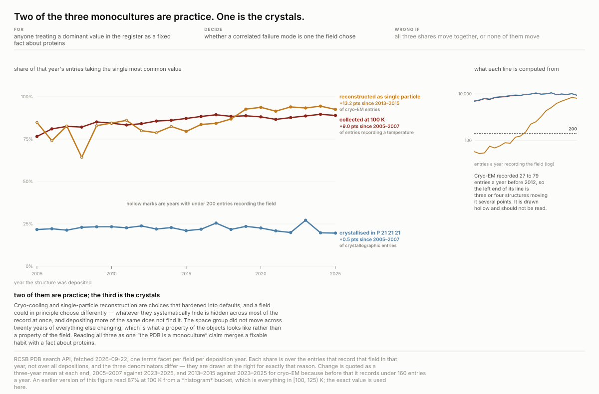
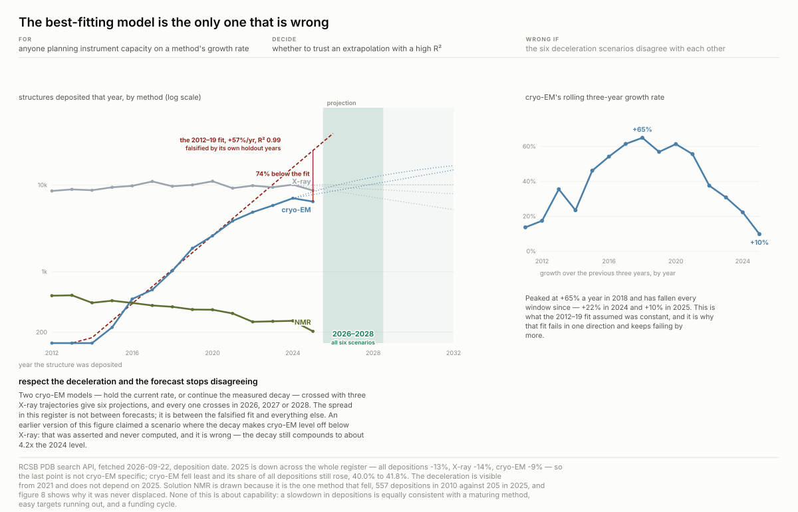
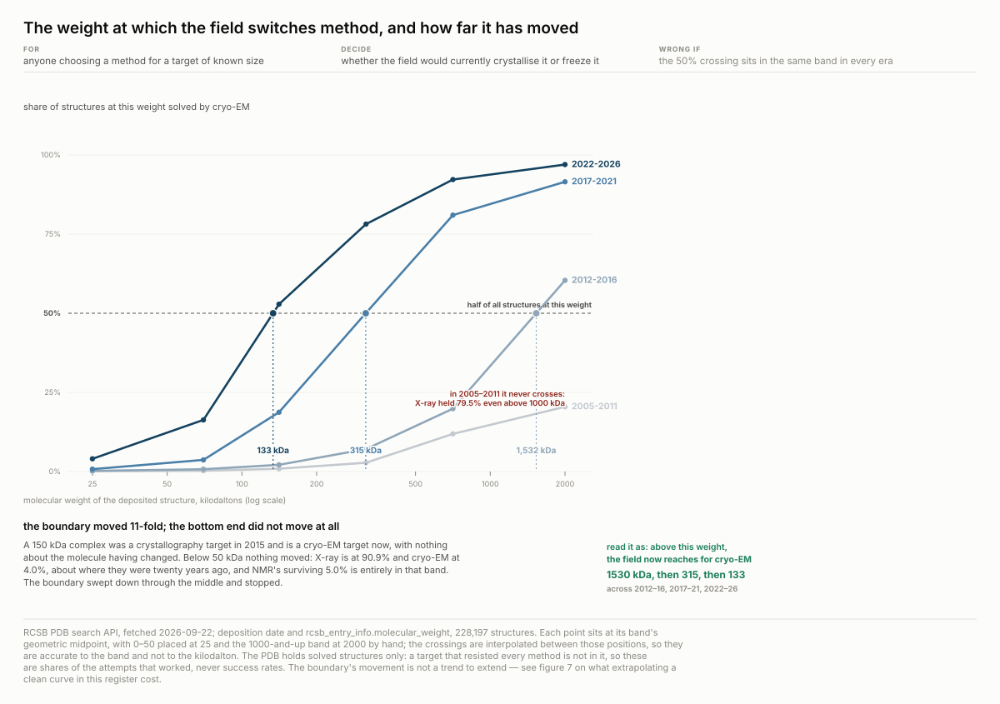
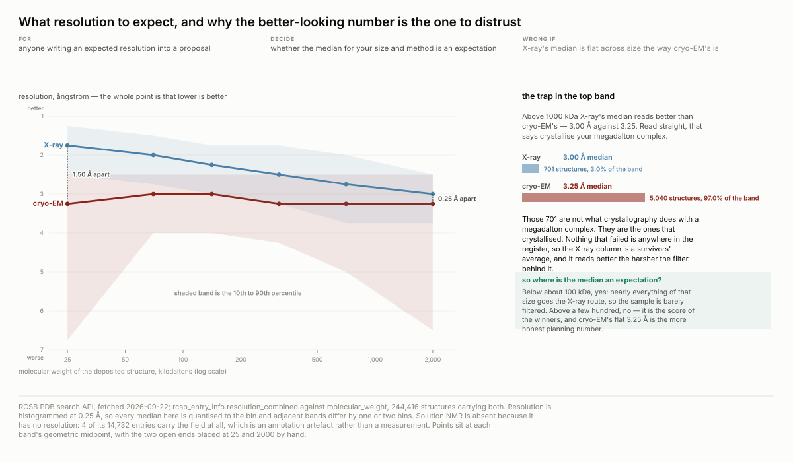

# The Protein Data Bank is a record of what people chose to solve

**Status: proven** · method 1.0.0 · computed 2026-09-22 from the RCSB PDB search API,
`search.rcsb.org/rcsbsearch/v2/query` — **260,089 experimentally determined structures**.
Retrieved by [`artifacts/scripts/pdb.py`](artifacts/scripts/pdb.py) and four further phases:
no key, standard library only, no data committed.

Every protein structure anyone has solved is in here, and it is read as a map of what is known
about protein shape. It is first a record of **what was worth someone's time**, and the
interesting questions are where those two come apart.

**Why this source is cheap.** The search API does server-side faceting — terms, date histograms
and numeric histograms — so counts by method, year, organism, journal, author, accession and
resolution each come back in one request. A recipe that would otherwise need 260,089 rows needs
about two hundred queries and clones in a few hundred kilobytes.

Nine figures in two halves. Figures 1 to 6 ask what the register *is* — who fills it, with
what, and what that record systematically leaves out. Figures 7 to 9 ask what it can tell
someone to **do**, which runs into a boundary worth stating early: the PDB contains only
successes, so "will this work on my target" is not a question it can answer at all.

## Contents

| | | |
| --- | --- | --- |
| **I** | [A sixth was never written up](#a-sixth-of-it-was-never-written-up) | 15.8% cite "To be published", and waiting does not clear it |
| **II** | [Which is not neglect](#which-is-not-neglect-it-is-what-the-programmes-were-for) | consortia run 74–86%; size is ruled out at rho +0.16 |
| **III** | [Both most-solved proteins are one virus](#the-two-most-solved-proteins-on-earth-are-both-from-one-virus) | an ordinary power law, and a facet that is not sorted |
| **IV** | [AlphaFold did not dent it](#alphafold-did-not-dent-it-and-here-is-the-dent-it-could-have-seen) | no detectable effect, bounded at ±9.9% |
| **V** | [A hand-made classification, tested](#the-most-common-ligands-are-mostly-what-was-in-the-drop-and-now-that-is-tested) | 15 of 16 additives confirmed — but only in the right model |
| **VI** | [Two monocultures are practice, one is crystals](#two-of-the-three-monocultures-are-practice-one-is-the-crystals) | two shares tightened, the space group never moved |
| **VII** | [The best-fitting model is the only wrong one](#the-best-fitting-model-is-the-only-one-that-is-wrong) | R² 0.99 over-predicts by 74%; six honest scenarios agree |
| **VIII** | [Where the field switches method](#the-weight-at-which-the-field-switches-method-has-moved-eleven-fold) | 1,530 → 315 → 133 kDa in ten years |
| **IX** | [What resolution to expect](#what-resolution-to-expect-and-why-the-better-looking-number-is-the-one-to-distrust) | the better-looking number is the survivors' average |

**Every number below is recomputed by
[`artifacts/scripts/verify.py`](artifacts/scripts/verify.py).** If it disagrees with this page,
the script is right and the prose is a bug.

## Screens, run before anything was built

| screen | result |
| --- | --- |
| the same query twice | 260,089 both times — stable within a session |
| a nonsense **attribute** | HTTP 400 — fails loudly |
| a nonsense **value** | HTTP 204, zero results — not the unfiltered total |
| deposit date vs release date | **differ by up to 2,203 entries a year** |

The last one governs everything: release date measures the embargo as much as the science, so
every figure here uses **deposition date** and says so.

The second is worth noting against the previous recipe in this workspace, where four parameters
silently returned the unfiltered total. This API refuses instead — but the habit of sending a
nonsense parameter is what established that, not trust.

## A sixth of it was never written up

`rcsb_primary_citation.rcsb_journal_abbrev` reads **"To be published"** for 41,156 of 260,089
entries — **15.8%**. By deposition year it makes a U, and both arms have a mechanism.

**The left arm is real:** 1.2% in 1995, **26.2% in 2007**, 11.5% by 2018.

**The right arm is not a finding.** 21.7% in 2024, 30.6% in 2025, 42.1% in 2026 — a structure
deposited in 2026 cannot have a 2026 paper. That is right-censoring, and the boundary is not
guessed: `rcsb_primary_citation.year` gives the lag directly, and **the median paper appears one
year after deposition with 97–100% of those that ever appear landing within three.** So cohorts
from 2023 on are incomplete, which is exactly where the figure draws the line.

**And waiting does not clear it.** If the citation were corrected when the paper appeared, the
share would decay with cohort age. It does not — a 28-year-old cohort sits near 2% and a
19-year-old one near 26%. **The field records the state at deposition and nobody revisits it**,
so no share computed from this is a statement about today's literature.

## Which is not neglect — it is what the programmes were for

The unpublished entries are not spread thin. Against a register-wide 15.8%:

| depositor | entries | never written up |
| --- | --- | --- |
| Joint Center for Structural Genomics | 1,605 | **86.4%** |
| Midwest Center for Structural Genomics | 1,978 | 80.6% |
| Northeast Structural Genomics Consortium | 1,240 | 75.8% |
| RIKEN Structural Genomics Initiative | 2,754 | 74.0% |
| Structural Genomics Consortium | 2,495 | 49.0% |

**All eight consortia in the top sixty sit high.** These programmes were funded to populate
fold space against a target list; the coordinate file was the deliverable and a paper was not.
So 15.8% is two populations averaged, and reading it as a failure of the literature mistakes a
deliberate output for a gap.

**Size is ruled out, which is what the horizontal axis is for.** Across the 40 most prolific
depositors the correlation between log entry count and unpublished share is **rho +0.16** —
nothing. Consortia sit high whatever their size and individuals span 3.3% to 73.3% at every
size. The pile is not "prolific depositors don't write up"; it is one programme.

**Rate and volume pick different leaders**, which is why bubble area is the absolute count.
JCSG has the highest rate at 86.4% and owns about 1,386 unwritten entries; von Delft runs
**48.7% and owns 2,760** — twice the pile at half the rate. A plan to close the gap starts
somewhere different from a plan to explain it.

*The individuals sitting up among the consortia are structural genomics PIs. That is an
inference from outside this table; its falsifier is that their depositions should cluster in
2004–2011, and it is not tested here.*

### Three traps in one field, each of which changes the answer

- **It cannot be summed.** The top 60 author entries total 103,276 against 260,089 — that reads
  as "the top sixty depositors are 40% of the register" and it is **author-entry pairs**, since
  an entry carries many authors. This is the one that would have shipped. It is also why the
  figure plots only within-depositor shares and draws no cumulative curve.
- **Names split.** `Edwards, A.` 2,698 and `Edwards, A.M.` 2,331 are one person; collapsing
  them moves him eighth → second. One name in sixty, which bounds the damage — but the bound
  was measured rather than assumed.
- **People and institutions are mixed.** Eight of the top sixty are consortia filing under
  their own name, so a ranking of "who does structural biology" ranks two kinds of thing.

## Cryo-EM did not replace crystallography

Electron microscopy went from **53 depositions in 2010 to 7,067 in 2024** and now takes 42% of
the annual total. That looks like displacement, and X-ray's own count is the control that kills
it: **7,544 in 2010 and 10,130 in 2024** — more, throughout. A share rose and displaced
nothing. NMR is the one method that actually fell, 557 to 205.

**This section used to carry its own figure and no longer does.** The claim — cryo-EM is
solving *different objects* — is made far better by figures 7, 8 and 9 below, which measure
the decision boundary rather than printing two medians side by side. The retired plate and the
reason are in [`artifacts/superseded/`](artifacts/superseded/README.md).

## The two most-solved proteins on Earth are both from one virus

Grouped by UniProt accession, the field's actual target list is led by **`P0DTD1`, the SARS-CoV-2
replicase polyprotein, at 3,722 entries** and **`P0DTC2`, its spike, at 2,267**. Third is
beta-2-microglobulin at 1,401 and fourth is lysozyme at 1,393 — the classics are still there,
and a virus first sequenced in January 2020 is ahead of both.

**It is not a 2020 spike.** The spike protein peaked in 2022 and fell away; the replicase was
still drawing **582 depositions in 2024**, because that polyprotein contains the main protease
and the field is doing antiviral chemistry against it.

So deposition volume over 2020–2024 is a statement about **subject**, not capacity. And a count
of PDB entries is a count of attention: the same protein re-solved with a different ligand is
two entries, so "260,089 structures" and "260,089 proteins known" are not the same claim.

**The list itself is not unusually steep.** Ranked against entry count on log scales it is an
ordinary power law — R² 0.88 fitted on ranks 10–200 — and the replicase sits only **1.6× above
that line**. What is notable about the head is *which* proteins are in it, not how far they
stand out, which is the opposite of what the sorted bar this panel used to be implied.

**A defect found while rebuilding it.** The terms facet returns the top 200 accessions by count
but **not in count order** — 35 of the 200 arrive out of sequence. The earlier version plotted
facet order on an axis labelled "rank". Sorting first moves the fit from R² 0.77 to 0.88, so
part of the shape being described was the API's ordering.

## AlphaFold did not dent it, and here is the dent it could have seen

AlphaFold DB released July 2021 and expanded to 214M predictions July 2022. The obvious method —
compare before and after — answers yes-or-no whichever is true, because the series has grown for
thirty years. **So the trend comes out first:** depositions fit log-linear **+5.3% a year over
2005–2020 with R² 0.96**, and every point after is out of sample.

| 2021 | 2022 | 2023 | 2024 | 2025 |
| --- | --- | --- | --- | --- |
| −4.2% | +1.4% | +0.2% | +7.3% | −10.9% |

Residuals average −1.5% over 2018–2020 and **−0.5% over 2022–2025**. There is no step.

**The null is only worth something with a size on it.** The pre-AlphaFold series already
wandered **±9.9%** around its own trend, so an effect smaller than about a tenth of annual
deposition is invisible here. **This rules out a collapse. It does not rule out a dent.**

**And a second event lands in the same window.** SARS-CoV-2 targets are 7.6% of 2020
depositions, 8.3% of 2022 and 5.1% of 2024 — a pandemic added to exactly the years prediction
was supposed to subtract from. Two mechanisms pointing opposite ways, which is why the raw
comparison is worthless.

## The most common ligands are mostly what was in the drop — and now that is tested

Grouped by bound chemical component, the top four are `MG` 28,821, `SO4` 28,264, `ZN` 27,910
and `GOL` 26,231. **Sulfate is a buffer component and glycerol is a cryoprotectant.** So is
`EDO`, ethylene glycol, at 17,821. `NI` at 2,431 is nickel left on the protein from His-tag
purification. None of them is something the protein does.

The top sixty are sorted into declared groups — ADDITIVE, AMBIGUOUS, BIOLOGICAL — written into
the script so they can be argued with. **This section used to stop there.** Declaring a
classification and printing its three totals is not a finding; it is an opinion with counts
attached. There is a test available and it is nearly free.

**A crystallisation additive is an artefact of growing a crystal.** No drop, no buffer, no
cryoprotectant — so a declared additive should be scarce in cryo-EM entries while a genuine
cofactor should not care how the structure was determined.

**Except that cryo-EM does big things and additives sit in small proteins.** Across 30
components, the correlation between a component's cryo-EM share and the share of its host
entries over 200 kDa is **rho +0.94**. Size has to be conditioned on or it explains everything.

**Conditioned on size, the labels hold — and the model decides whether you can see it:**

| fit on the 14 non-additive components | verdict on the declared additives |
| --- | --- |
| linear | mean residual **+0.5 points**, mixed signs — no effect |
| log-odds | **15 of 16 below prediction, median 27.7× fewer** cryo-EM entries |

The linear fit predicts a *negative* cryo-EM share for eight components, which cannot happen,
and the positive residuals it manufactures against that floor are its entire null. **The
functional form decided the answer**, and the plate draws both fits so the failure is visible.

**The test also corrects the classification.** Potassium, sodium, chloride and phosphate were
declared additives and sit on the line at 0.9× to 2.4× — they are also genuine physiological
ions and the data says they behave like ones. MES buffer at 146×, PEG at 150×, ethylene glycol
at 153× and MPD at **262×** are the unambiguous ones.

**What it still cannot do.** A high cryo-EM share is not evidence of biology — it tracks host
size, which is what the conditioning is for. Only the depleted end carries a mechanism.

**And 63,155 entries — 24% — bind nothing at all.** An apo structure is a legitimate result,
but any "share of proteins with a known binding partner" from this register has to state that
denominator.

## Two of the three monocultures are practice. One is the crystals.

Three fields are each dominated by a single value, and none of it is visible from one entry.
Measured once, that is three numbers with no way to tell what they mean. **Q18 named the
falsifier:** if the concentration is a property of what is *solvable* it should sit flat over
time; if it is a property of *practice* it should move. Faceting each field by deposition year
separates them, and they do not give the same answer.

| single most common value | 2005–2007 | 2023–2025 | change |
| --- | --- | --- | --- |
| collected at **100 K** | 80.1% | 89.1% | **+9.0 pts** |
| cryo-EM by **single particle** | 80.3% *(2013–15)* | 93.5% | **+13.2 pts** |
| crystallised in **`P 21 21 21`** | 21.7% | 22.2% | **+0.5 pts** |

**The two that moved are practice.** Cryo-cooling and single-particle reconstruction are
choices that hardened into defaults. Cryo-cooling reduces radiation damage and also freezes out
conformational states — a protein at 100 K is not doing what a protein at 310 K is doing — and
whatever that systematically hides is hidden across most of the record at once. Subtomogram
averaging, the only cryo-EM mode that looks at molecules *inside a cell*, is 341 entries.

**The space group did not move at all**, wandering between 19.6% and 27.2% across two decades
of everything else changing. A protein crystallises in the space group it crystallises in.
That is what a property of the objects looks like, and no amount of depositing differently
touches it.

Reading all three as one "the PDB is a monoculture" claim merges a fixable habit with a fact
about proteins. **Q18 is answered, and the answer is that the question had three subjects.**

*An earlier version read 87% at 100 K off a **histogram** bucket — everything in [100, 125) K,
173,631 entries. The exact terms value is 166,568. The figure now uses exact values throughout.*

## Three things it can tell you to do, and one it cannot

Figures 1 and 3 to 7 describe. These three end in an action, so the boundary has to be stated first.

**The PDB contains only successes.** There is no record of a protein someone failed to
crystallise. *Success rate by method* is therefore not computable here at any quality, and
"will this work on my target" is not a question this register can answer — not badly, not at
all. What it can answer is **what the field currently does with a target like yours**, and how
far that has moved, which is enough to decide where to apply for instrument time.

### The best-fitting model is the only one that is wrong

Cryo-EM's growth fitted over 2012–2019 is **+57.2% a year at R² 0.99**. Extrapolated, it passes
X-ray in 2023. It did not. Held out against years the fit never saw:

| | 2022 | 2023 | 2024 | 2025 |
| --- | --- | --- | --- | --- |
| over-predicted by | 25% | 43% | 56% | **74%** |

25,147 forecast against 6,453 actual. **An R² of 0.99 on the fit window said nothing about the
forecast**, because the growth rate is itself collapsing. The rolling three-year rate peaked at
**+65% a year in 2018** and has fallen every window since — +55.6% in 2021, +22.3% in 2024,
**+9.8% in 2025**. A constant-rate model cannot represent a rate that decays, and fails in the
same direction every time.

**Once the deceleration is respected, the forecasts stop disagreeing.** Two cryo-EM models —
hold the current rate, or continue the measured decay — crossed with three X-ray trajectories
(flat, −3%/yr, −8%/yr) give six projections, and **every one crosses in 2026, 2027 or 2028.**
The spread in this register is not between forecasts; it is between the falsified fit and
everything else.

> **A correction, kept visible.** An earlier version of this section listed a third scenario in
> which the deceleration continues and cryo-EM "levels off below X-ray", and gave that as
> evidence that the forecast was wide. **It was asserted and never computed, and it is wrong.**
> The decay model still compounds to about **4.2× the 2024 level** and crosses in 2027 like the
> others. Computing it narrowed the answer instead of widening it.

**One confound separated rather than assumed.** 2025 is down across the whole register — all
depositions −13%, X-ray −14%, cryo-EM −9% — so the last point is not cryo-EM-specific. Cryo-EM
fell *least* and its share of all depositions still rose, **40.0% to 41.8%**. The deceleration
is visible from 2021 and does not depend on 2025.

### The weight at which the field switches method has moved eleven-fold

Cross size against method and a decision boundary appears: below some weight the field
crystallises, above it it freezes, and the share crosses 50% at a weight you can read off.

| era | cryo-EM passes 50% at | above 1000 kDa |
| --- | --- | --- |
| 2005–2011 | never — X-ray held everything | X-ray **79.5%** |
| 2012–2016 | **1,530 kDa** | cryo-EM 60.4% |
| 2017–2021 | **315 kDa** | cryo-EM 91.5% |
| 2022–2026 | **133 kDa** | cryo-EM **97.0%** |

**A 150 kDa complex was a crystallography target in 2015 and is a cryo-EM target now**, with
nothing about the molecule having changed.

**The bottom end did not move at all.** Below 50 kDa, X-ray is at 90.9% and cryo-EM at 4.0%,
about where they were twenty years ago, and NMR's surviving 5.0% is entirely inside that band.
The boundary swept down through the middle and stopped — which is most of an answer to Q21.

*Crossings are interpolated between band midpoints, so they are accurate to the band and not to
the kilodalton.*

### What resolution to expect, and why the better-looking number is the one to distrust

| median resolution | under 50 | 50–100 | 100–200 | 200–500 | 500–1000 | over 1000 kDa |
| --- | --- | --- | --- | --- | --- | --- |
| X-ray | **1.75 Å** | 2.00 | 2.25 | 2.50 | 2.75 | **3.00 Å** |
| cryo-EM | 3.25 Å | 3.00 | 3.00 | 3.25 | 3.25 | **3.25 Å** |

**Crystallography pays a resolution penalty that scales with size. Cryo-EM does not pay one at
all** — it is flat across a fifty-fold range of mass. The gap closes from 1.50 Å to 0.25 Å.

**On the median X-ray is ahead in every band, including the largest, and that is a trap.** Above
1000 kDa the register holds **701** X-ray structures against **5,040** cryo-EM ones, and the
field picks cryo-EM there 97% of the time. Those 701 are not what crystallography does with a
megadalton complex — they are the ones that crystallised. Everything that failed is absent from
the register entirely, so **the X-ray column is a survivors' average, and it reads better the
harsher the filter behind it.**

Which makes the prescription narrower than the table looks: below about 100 kDa the X-ray median
is a fair expectation, because nearly everything that size goes that route and the sample is
barely filtered. Above a few hundred it is the score of the winners, and cryo-EM's flat 3.25 Å
is the more honest planning number. This is the closest the register comes to showing its own
survivorship, with a count on each side of it.

*Resolution is histogrammed at 0.25 Å, so every median is quantised to the bin. Solution NMR is
absent because it has no resolution: 4 of its 14,732 entries carry the field at all.*

## What this cannot support

**Not a count of proteins.** Entries, not distinct structures solved. The same protein re-solved
is two entries, and the accession facet is entity-entries which cannot be summed back.

**Not "who does structural biology".** The author field mixes people and institutions, splits
names, and cannot be totalled.

**Not what was attempted.** A structure's size and method are properties of what succeeded.
Nothing here says what anyone tried and failed to crystallise.

**Not one fetch twice.** The register grows weekly. Every figure is one fetch, snapshotted in
`artifacts/data/snapshots/`.

## What is open

[`artifacts/research-questions/questions.md`](artifacts/research-questions/questions.md) holds
twenty-one questions, which of them died and why. Still open:

**Q13 — how concentrated is the target list really?** The facet returns the 200 largest, so no
Gini or cumulative share can honestly be computed. It needs the full distribution.

**Q15 — are ensemble entries a different object?** 7,839 entries carry 20 deposited models,
which is NMR producing an ensemble rather than a structure. If model count separates by method,
"one entry" means two things and every count here mixes them.

**Q9 — where did the work happen?** No institution or country field has been found
(`rcsb_primary_citation.country` does not exist). Until one is, every geography claim is
blocked and should be recorded as blocked rather than approximated from author surnames.

**Q18 is answered** — see the monoculture section. The falsifier was run: two of the three
shares tightened (+9.0 and +13.2 points) and the space group did not move (+0.5 points across
twenty years). The question had three subjects and they separate.

**Q19 — partly answered, and the remainder is sharper.** Figure 9 shows resolution
against *size*, not against time: X-ray degrades with mass and cryo-EM does not. The time
version is still open and is now the more interesting half — whether median resolution *at a
fixed size* improved, which is the only version that separates better instruments from harder
targets.

**Q20 — how long is the embargo?** Deposit and release dates are both available; the per-entry
gap is a hold period someone chose. If it varies by depositor type, "open data" means different
things to different filers.

**Q21 — mostly answered.** NMR's surviving share is **entirely** below 50 kDa (5.0% of that
band; 57 entries in the whole 50–100 band and 4 above 200). Cryo-EM never took that niche —
figure 8 shows the sub-50 kDa split barely moved in twenty years. So NMR did not lose ground to
cryo-EM; it held a band nothing else entered and that band stopped growing. What is still open
is *why* the band stopped growing.

## Reproducing

    cd recipes/pdb-deposition-choices
    python3 artifacts/scripts/fetch.py        # all five phases, then the drift report
    for f in artifacts/scripts/chart-*.py; do python3 "$f"; done
    python3 artifacts/scripts/verify.py       # recomputes every number on this page

Standard library only, no key, no data committed. `fetch.py` runs the phases in order and each
skips work already cached, so re-running is cheap and interrupting is safe:

| phase | what it adds |
| --- | --- |
| `pdb.py` | totals, method × year, resolution, authors, organisms, journals |
| `pdb2.py` | targets, publication lag per deposition cohort, depositor unpublished shares |
| `pdb3.py` | size × method and size × method × era, with resolution inside each cell |
| `pdb4.py` | concentration by deposition year; ligand × method |
| `pdb5.py` | the molecular-weight distribution of entries carrying each ligand |

`pdb3.py` and `pdb4.py` are the slow ones, a few minutes each behind the API's rate limit.

**Expect drift.** The register grows weekly, so a refetch will not reproduce these numbers
exactly; `fetch.py` prints the comparison against `provenance.json` and `verify.py` then says
which sentences on this page no longer hold.

Two tools from the wider project, which do not live in this repo, also pass on this recipe:
`plateaudit.py` (nine figures, clean) and `determinism.py` (byte-identical across two builds).
