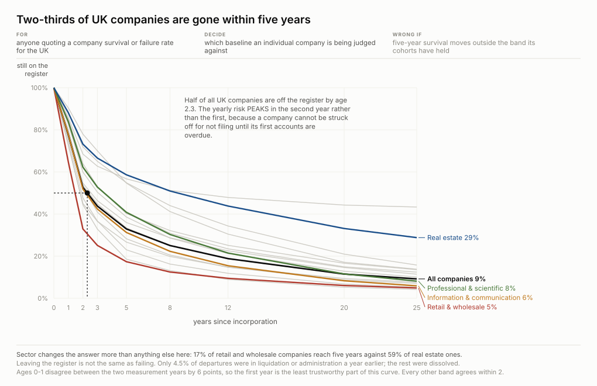
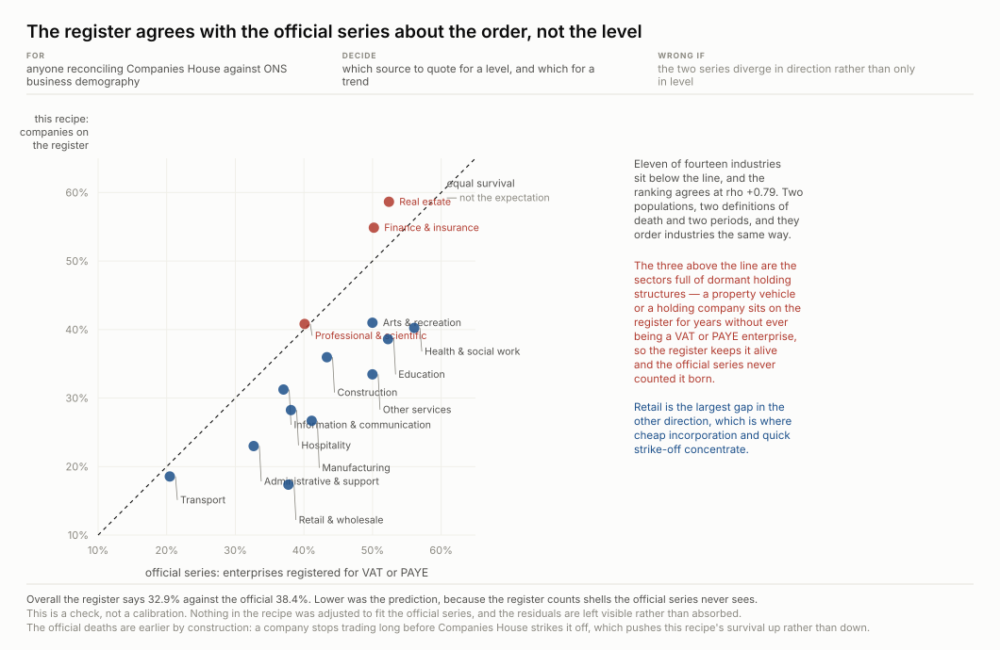
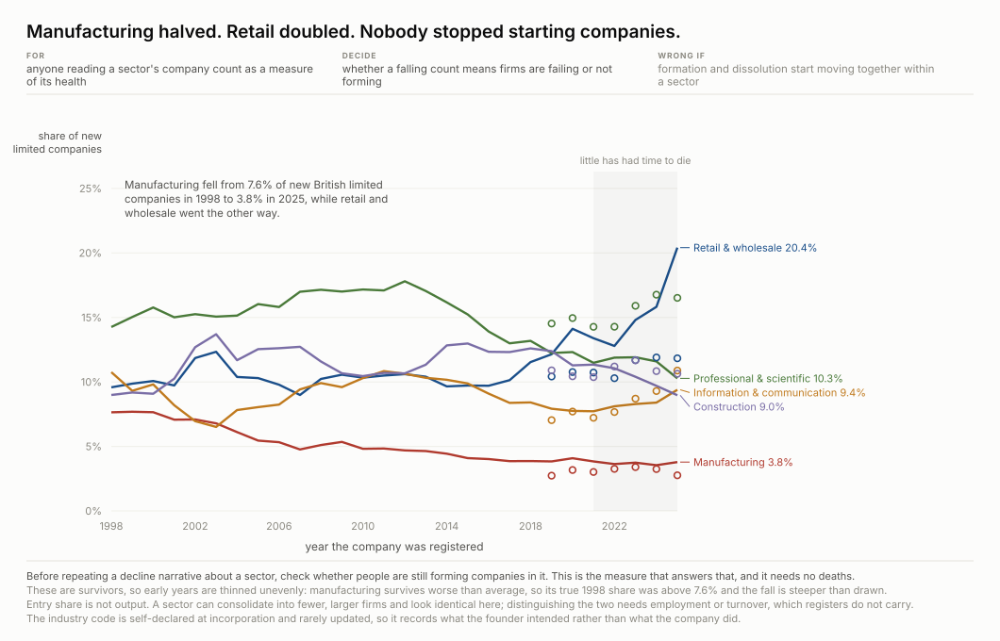
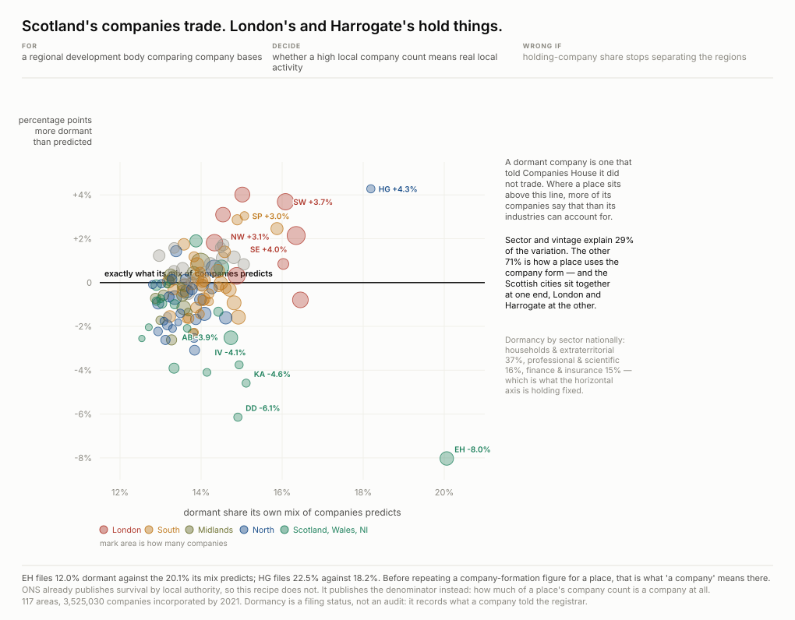
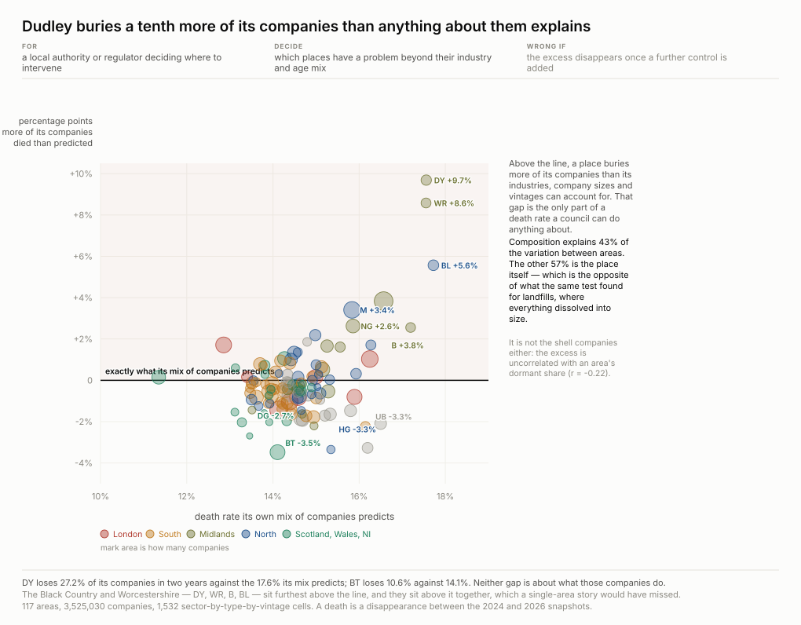
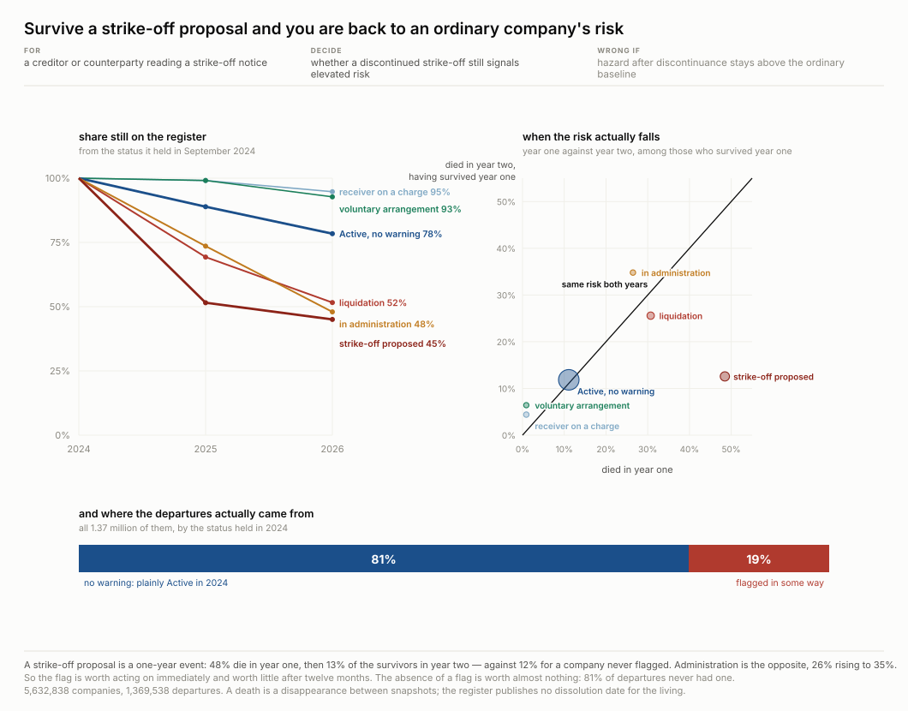
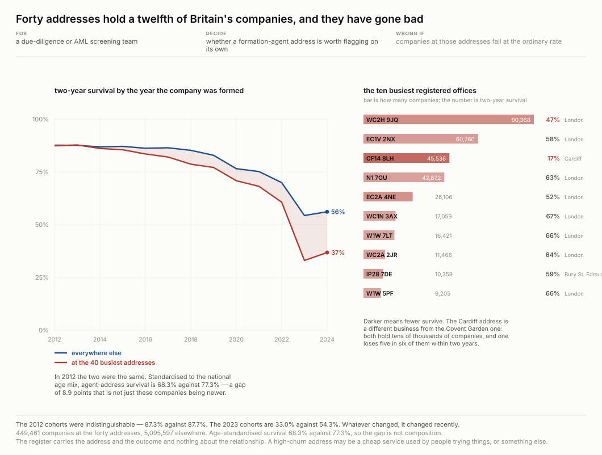

# The register publishes its survivors and drops its dead. That is measurable anyway.

**Status: proven** · method 1.0.0 · computed 2026-09-17 from three Companies House bulk
snapshots a year apart, checked against ONS business demography and against the Colorado and
Norwegian registers. No data is committed — 1.5 GB, retrieved by
[`artifacts/scripts/fetch.py`](artifacts/scripts/fetch.py).

**Two-thirds of UK companies are gone within five years.** Whether that is alarming depends
entirely on what you thought a company was, and the recipe's first result is that the register
cannot tell you directly.

## The premise was wrong, and the correction is the method

This was built on an explicit argument: *these are legal records with dates attached, so the
history is in the data*. **It is not.** In the first 73,146 rows of the bulk file:

| | |
| --- | --- |
| rows carrying a `DissolutionDate` | **0** |
| statuses present | Active · Proposal to Strike off · Liquidation · In Administration · Receiver · Voluntary Arrangement |

Every one of those is a status a company holds **while still on the register**. The
dissolution column exists and is never populated. The register publishes its survivors and
drops its dead — the same shape as the drug registers elsewhere in this repo, arrived at from
the opposite direction.

**What rescued it is that the publisher keeps a back-catalogue nobody links to.** The monthly
file lives at a dated URL and old months keep resolving. Three snapshots a year apart give a
death definition the register does not provide: **a company is dead when it stops appearing.**

## The decision it changes

**If you are comparing a company against a survival benchmark, check which death the benchmark
counts.** The register and the ONS series disagree on level in 11 of 14 sectors and agree on
ordering at rho = +0.79. They are measuring different populations with different definitions
of death over different periods. Ordering is the thing that should agree; level is not.

*Who acts on this:* anyone publishing a business-survival statistic; a lender or insurer
scoring company age; a development agency comparing regions; a due-diligence team reading a
registered address.

## The measurement, and its second opinion

One line per sector, four named because sixteen labels is a legend nobody reads. The axis is
**age, not calendar time**, and that is the whole design: the register publishes only
survivors, so a death is a company missing from a later snapshot, and the estimate is a
discrete-time hazard by age over a two-year observation window.

The external check, run before anything was built on the numbers. One dot per industry, ONS
on one axis and this recipe on the other.

**The diagonal is not the expectation**, and drawing it without saying so would assert a claim
this recipe does not make. The two count different populations: the register holds every
company including dormant shells that never traded, while the official series counts
enterprises registered for VAT or PAYE. Points *should* fall below it. They disagree on level
in **11 of 14 sectors** and agree on ordering at **rho = +0.79** — and ordering is the thing
that should agree.

## What people start companies to do

Share of newly registered limited companies by sector, by year of registration. Entry rather
than survival, because survival levels are set by each country's filing law and entry is not:
a registration is a registration.

**The survivor correction is drawn rather than applied silently.** Both registers show the
living, so a company born in 2005 appears only if it is still here, and sectors die at
different rates — the observed line is therefore biased, and biased differently in each
register. Showing the correction beside the raw line lets the reader see how much of the shift
is the shift and how much is who survived to be counted.

## Place, once you subtract what the place is made of

ONS publishes company survival by local authority, so this recipe does not draw that. What
nobody publishes is the **denominator**: ONS counts enterprises, meaning things that trade or
employ, while Companies House counts companies, including those that exist only to hold
something. The share of a place's mature companies filing as DORMANT measures that gap from
one side.

A raw dormancy share confounds the place with what the place is made of — professional
services file dormant at **15.7%** and extraterritorial households at **36.9%**, so an area
thick with consultancies looks different without anything about the area differing.
**Composition explains 29% and leaves 71%.** Edinburgh files 12.0% dormant where its mix
predicts 20.1%, and it is not alone: Dundee, Kilmarnock and Inverness sit with it.

The first version of this figure put dormancy against survival on zoomed axes and was wrong
twice. The two are nearly independent (**r = +0.12**), so the vertical axis carried no
information, and the frame — 8 to 24% by 78 to 92% — made a modest spread look dramatic.

Excess mortality after industry, age and size are held constant. **Composition explains 43%
of the variance in area death rates and leaves 57%.**

Getting here took two wrong frames. Observed against expected on matched axes from zero was
worse than the zoomed version: 117 areas occupied a fifth of the plot, and the claim — a gap
of a few points — sat a hair either side of a diagonal. **When two axes carry the same
quantity and the difference is the claim, draw the difference.**

## Is a death visible before it happens?

Companies House publishes a status on every live company, and one value — *Active — Proposal
to Strike off* — is the registrar saying out loud that it intends to remove the company. Three
snapshots a year apart make it testable.

**The strike-off flag is a one-year event.** 48.5% of flagged companies are gone within a
year. Of those that survive it, **12.6% die in the following year — against 11.8% for a
plainly Active company.** Survive the warning and you are back to baseline; the signal is
entirely spent. **Administration runs the other way**: 26.4% in year one, then **34.8%** among
the survivors — a status that means more the longer it lasts.

Neither half stands alone. Flagged companies are 8.6% of the register, so **81% of all
departures carry no warning at all.**

A first version drew this as stacked bars — died in year one, died in year two, still there.
The counts were right and the shape was invisible.

## The forty addresses every other figure holds out

Every other figure here excludes formation-agent addresses, because a registered office is not
a place of business and averaging 90,368 companies into Covent Garden would wreck any
geography. **Held out is not the same as uninteresting:** the forty busiest postcodes carry
**8.1% of the whole register** — 449,461 companies — and nobody has looked at them.

**They used to be ordinary and now they are not.** Companies incorporated in 2012 at an agent
address survived two years at **87.3% against 87.7%** everywhere else: no difference at all.
The 2023 cohort survives at **33.0% against 54.3%**. Standardised to the national age mix, so
the comparison is not merely "these are newer", **8.9 points of the gap survive**.

They are also not one thing. One Cardiff postcode holds 45,536 companies of which **83% are
gone within two years**, which is a different business from the Covent Garden address holding
90,368 at 47%.

## What this cannot say

**Not a lifespan.** Disappearing between two annual snapshots is the only death this register
admits, so everything here is an interval-censored survival measured at one-year resolution. A
company that incorporated and dissolved between snapshots was never observed at all.

**Not a cause, anywhere.** The agent-address finding is the sharpest case: the register carries
the address and the outcome and **nothing about the relationship**. A high-churn address may be
a cheap service used by people trying things, or something else. The figure says so on its face.

**Three points, and the third is the newest.** Any trend here rests on 2024, 2025 and 2026
snapshots. Cohort recency is a confound that could not be removed for the entry-mix figure, and
that figure says so rather than adjusting it away.

**The controls are controls, not comparisons.** Colorado records six kinds of death and still
cannot measure lifespan, because nothing compels a dead company to say so. Norway is the
closest matched register and its own definitions differ. Both are in the recipe to bound the
UK claim, not to extend it.

## What is still open

[`artifacts/research-questions/questions.md`](artifacts/research-questions/questions.md)
records what was asked and answered, and what is blocked with the reason. The short version:
what happens to a company *after* it disappears is unknown here, because dissolution,
strike-off and never-traded all look identical; whether the agent-address effect is selection
or treatment is not answerable with a register that carries the address and the outcome and
nothing about the relationship; the entry-mix shift is not established against cohort
recency, which could not be removed; and Norway's different shape is measured rather than
explained.

## Reproducing

    cd recipes/uk-company-survival
    python3 artifacts/scripts/fetch.py            # 1.5 GB across four sources, resumable
    python3 artifacts/scripts/extract.py          # compact each snapshot to what is used
    python3 artifacts/scripts/survive.py          # the survival curves
    python3 artifacts/scripts/compare_ons.py      # the external check
    python3 artifacts/scripts/extract_geo.py      # addresses, for the place and agent figures
    python3 artifacts/scripts/location.py
    for f in artifacts/scripts/chart-*.py; do python3 "$f"; done
    python3 artifacts/scripts/verify.py           # recomputes every number above

`verify.py` reloads the three snapshots rather than re-reading the JSON `survive.py` wrote, and
refuses to run on a partial corpus rather than reporting a smaller answer — a survival rate
computed on a missing snapshot is a wrong number, not a smaller one. On its first run it found
no drift: every number in this write-up reproduces.

`fetch.py --verify` hashes what is present against `provenance.json`; `fetch.py ch ons` takes
named sources only. `FSB_DATA` points the scripts at an existing corpus. Standard library
only — verified by AST walk, with the ONS workbook read by a sixty-line xlsx reader that was
checked cell for cell against openpyxl.
