# What America's hazardous waste register counts, and what it hides

**Status: proven** · method 1.0.0 · computed 2026-09-18 from the EPA RCRA Biennial Report,
twelve cycles 2001–2023, **8.0M records** fetched by
[`artifacts/scripts/fetch.py`](artifacts/scripts/fetch.py). No data is committed; the cache
directory is an argument and every figure regenerates from a clean fetch.

America's hazardous waste register names every facility, every route it uses and every ton it
handles. It is exactly the file you would reach for to ask who is concentrated, what gets
buried that should not, and whether there is a business in it.

**Eighteen figures, one dataset, four questions.** The first is about the instrument, because
four reasonable ways of counting this register return four wrong answers. The rest are the
questions the register can actually carry once you know that.

## Contents

| | | |
| --- | --- | --- |
| **I** | [How the register miscounts](#i-how-the-register-miscounts) | a route filed 24× the rows on half the waste; a priority flag fell 94% → 13% without the chemistry changing |
| **II** | [Who handles it, and how concentrated](#ii-who-handles-it-and-how-concentrated) | the route with the fewest firms has the lowest Gini; pin the count and seven of eight routes concentrate |
| **III** | [What the waste actually is](#iii-what-the-waste-actually-is) | 95–97% of managed tonnage is liquid, and 97% of it never leaves the plant |
| **IV** | [Is there a business in it](#iv-is-there-a-business-in-it) | three false leads and one real one — price is not the lever, procurement is |

## The decision it changes

**If you are about to quote a concentration figure from a register that people file
into, pin the denominator before you trend it and count owners rather than gates.**
On the obvious measure, American hazardous waste management has not concentrated at all
since 2001 — Gini across every firm is 0.96 then 0.96 for wastewater treatment, 0.66 then
0.63 for deep-well injection. Holding each route's firm count fixed at its largest thirty,
**seven of eight routes concentrated**, one of them from 0.38 to 0.60. The flat answer is
the sum of two real movements that cancel.

*Who acts on this:* a competition authority or regulator assessing market structure; an
entrant or acquirer sizing a route; anyone publishing an inequality trend computed over a
filing population rather than a fixed universe.

---

# I. How the register miscounts

Four reasonable ways of counting this file return four wrong answers. Each generalises past
this register, which is why they come first.

### 1. A record count measures how finely activity was written down

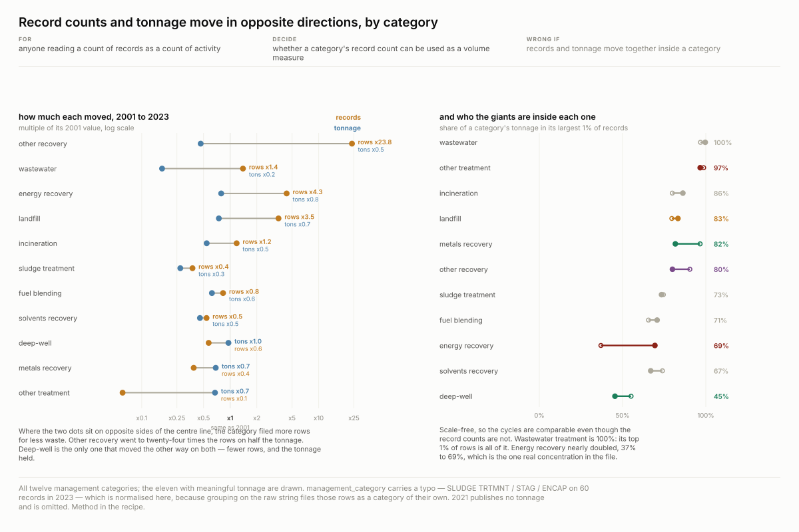

Rows are the first thing a register offers and the easiest thing to count. Per route,
records and tonnage move in **opposite** directions almost everywhere:

| route | records 2001 → 2023 | tonnage |
| --- | --- | --- |
| other recovery | ×23.8 | ×0.5 |
| landfill | ×3.5 | ×0.7 |
| wastewater treatment | ×1.4 | ×0.2 |
| other treatment | ×0.1 | ×0.7 |

Nobody made twenty-four times more waste. The filing granularity changed. **Plot the row
count against the quantity it supposedly tracks, one category at a time** — pooled, the
opposite movements average into a reassuring flat line.

The exception is the finding: **deep-well injection holds its tonnage (21.6M to 20.6M)
while its rows halve**, the only genuine consolidation in the file, and invisible in the
pooled view.

### A flagged field decayed while the chemistry did not

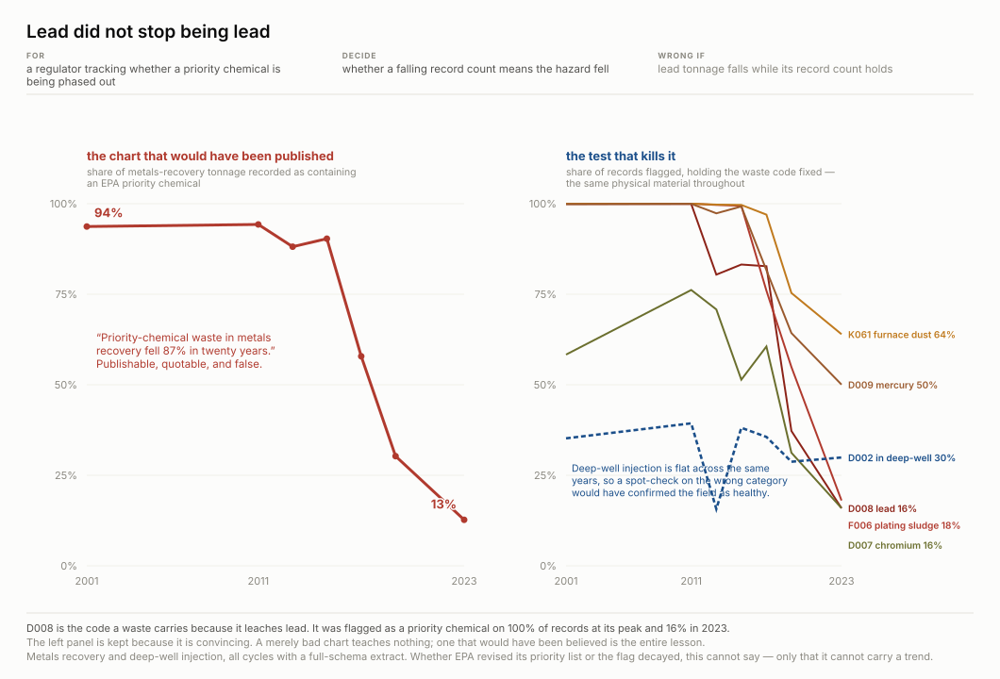

`priority_chemical` is EPA's own marker for the substances that matter most. Trended, it shows
priority-chemical waste in metals recovery falling from **94% in 2001 to 13% in 2023** —
publishable, quotable, false.

**The test that kills it is to hold something fixed that cannot change by definition.** A waste
code *is* the material: `D008` is carried by a waste precisely because it leaches lead, and it
went from **100% flagged to 16%**. Lead did not stop being lead.

The trap inside the trap: it is not a blanket failure. Deep-well injection is flat over the
same years, so a spot-check on the wrong stratum confirms the field as healthy. The decay hit
only the metal-bearing codes — the exact ones the story was about.

### The tonnage series cannot be read across cycles at all

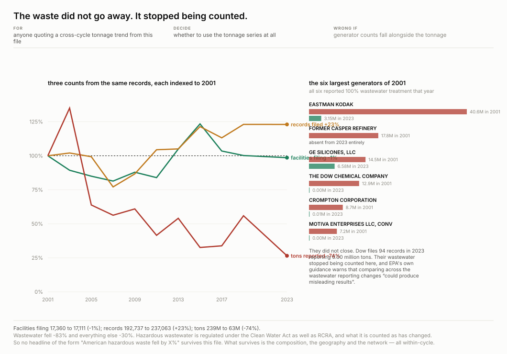

National reported tonnage moves **+23%** and **−74%** across adjacent cycles. That is not
industry; it is the form changing. Counts survive the cycle boundaries and tonnage does not, so
every trend in this recipe that needs a magnitude is either a count or restricted to a stratum
where the definition held.

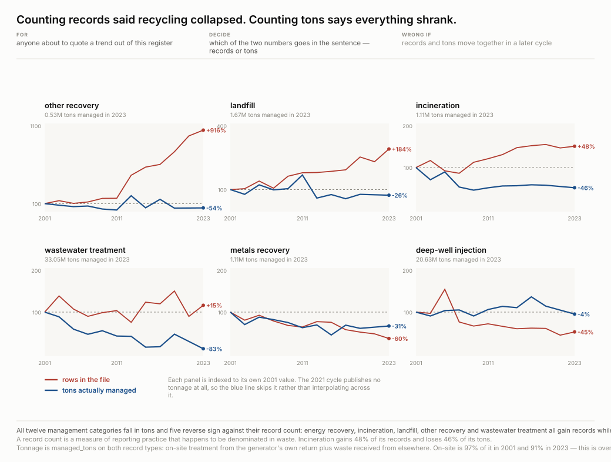

---

# II. Who handles it, and how concentrated

### 2. Few participants is not concentration, and can invert it

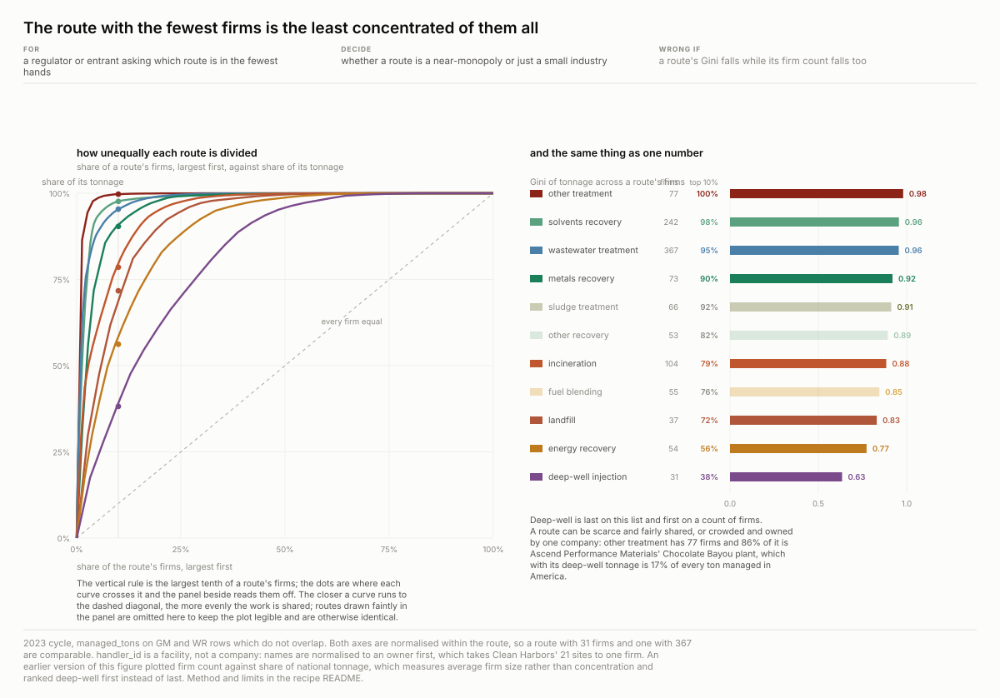

The route with the **fewest** firms in the register — deep-well injection, 31 companies —
has the **lowest** Gini, 0.63. Its plants are comparable in size. Other treatment has 77
companies and a Gini of 0.98, because one of them is 86% of it.

A first version of this figure plotted firm count against share of *national* tonnage and
read off "tons per firm": 31 companies, 666,000 tons each, therefore the most concentrated
route in America. **That statistic is average firm size.** It divides a national numerator
by a category denominator and says nothing about how evenly the route is divided. It
ranked the most equal route first.

**Draw one Lorenz curve per category with both axes normalised inside it**, so a route with
31 members and one with 367 overlay honestly. Scarcity of participants and inequality among
them are separate facts, and here they point opposite ways.

The curve also shows what neither summary does: **one plant — Ascend Performance Materials
at Chocolate Bayou, Texas — is 86% of "other treatment" and 18% of deep-well injection,
so 11.96M tons, 17.0% of every ton of hazardous waste managed in America, is one address.**

### 3. An inequality trend over a shrinking population measures two things

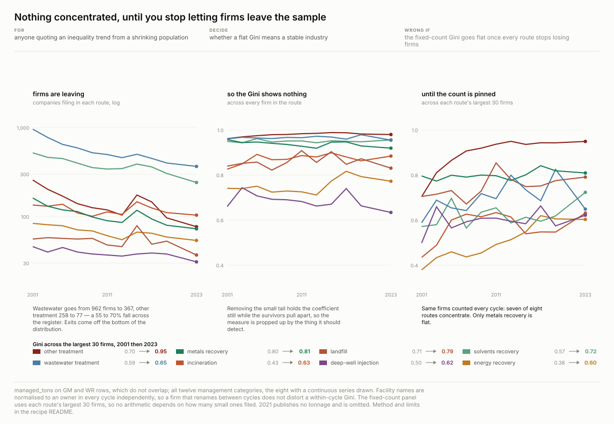

| route | firms 2001 → 2023 | Gini, all firms | Gini, largest 30 |
| --- | --- | --- | --- |
| other treatment | 258 → 77 | 0.96 → 0.98 | **0.70 → 0.95** |
| energy recovery | 84 → 54 | 0.74 → 0.77 | **0.38 → 0.60** |
| incineration | 135 → 104 | 0.83 → 0.88 | **0.43 → 0.63** |
| solvents recovery | 521 → 242 | 0.95 → 0.96 | **0.57 → 0.72** |
| wastewater treatment | 962 → 367 | 0.96 → 0.96 | 0.59 → 0.65 |
| metals recovery | 162 → 73 | 0.96 → 0.92 | 0.80 → 0.81 |

Firm counts fall 34% to 70% in every route. **Exits come off the bottom of the
distribution**, so losing small members *reduces* measured inequality at exactly the moment
the survivors pull apart. The two effects cancel almost exactly and produce a confident
flat line.

**Draw the member count as its own panel beside the statistic.** If it trends, the raw
series is uninterpretable. The same applies to a top-N share or an HHI.

### 4. A facility identifier is a gate, not an owner

`handler_id` names a site. Clean Harbors runs 21 of them, Safety-Kleen 18, Veolia 11.
Counting sites instead of owners moves landfill from 51 to 37 and fuel blending from 77 to
55. It changed no rank here — but it is a different question, and the register only labels
the gate. Names are normalised to an owner in every cycle independently, so a firm that
renames between cycles cannot distort a within-cycle Gini.

---

# III. What the waste actually is

### American hazardous waste is water

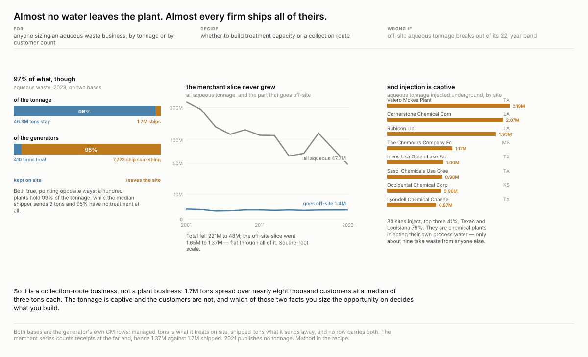

**97.5% of managed tonnage in 2001 and 94.9% in 2023 is liquid.** Everything anyone pictures
when they hear "hazardous waste" — drums, contaminated soil, incinerator ash — is the remaining
few per cent.

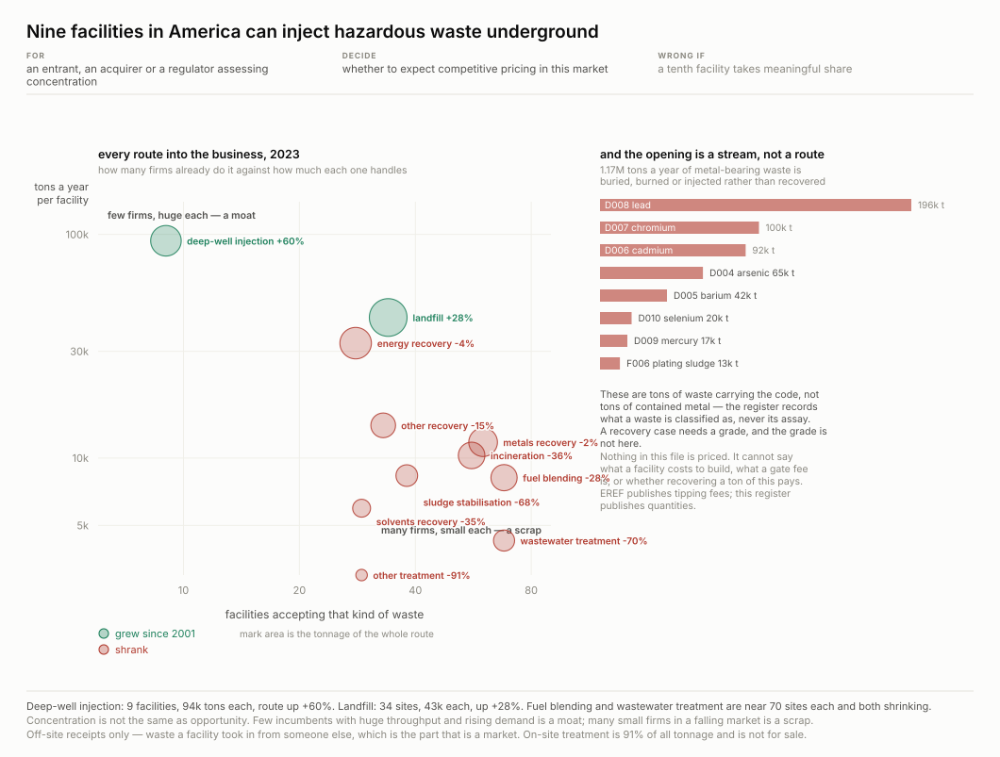

And the market is not where it looks. **96% of aqueous tonnage never leaves the site that made
it**, while **95% of generators ship everything they produce.** The two bases support opposite
conclusions, so the figure states which it is using: the captive share is a fact about tonnage,
not about firms.

### Solid, liquid and gas are three subjects, and only one keeps a series

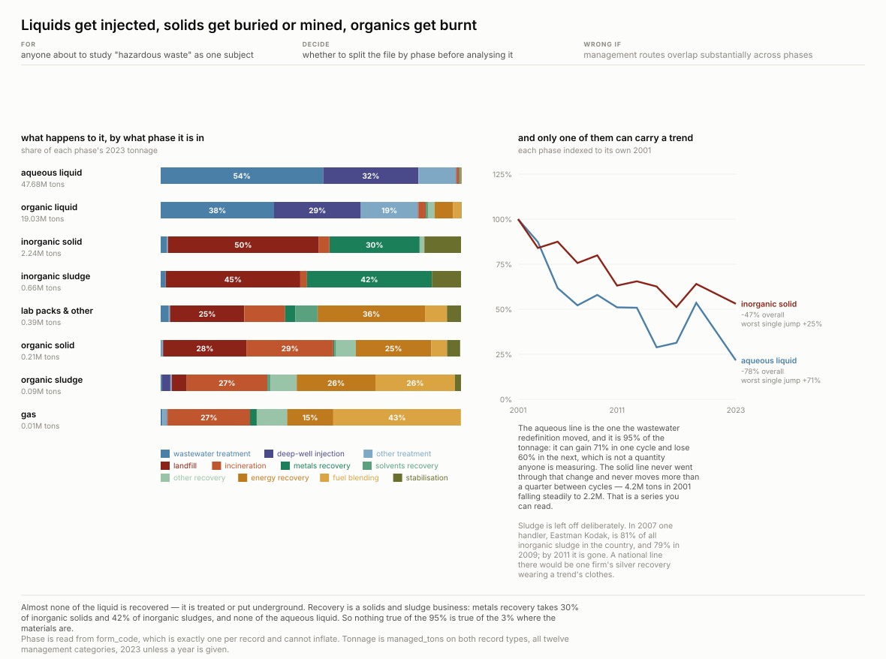

Splitting by phase rescues the trend the tonnage break destroyed. Within solids the management
mix moves from **landfill 50%, metals recovery 30%** to **landfill 45%, metals recovery 42%** —
a real, readable, twenty-two-year series, which the national aggregate cannot show because the
liquid fraction swamps and redefines it.

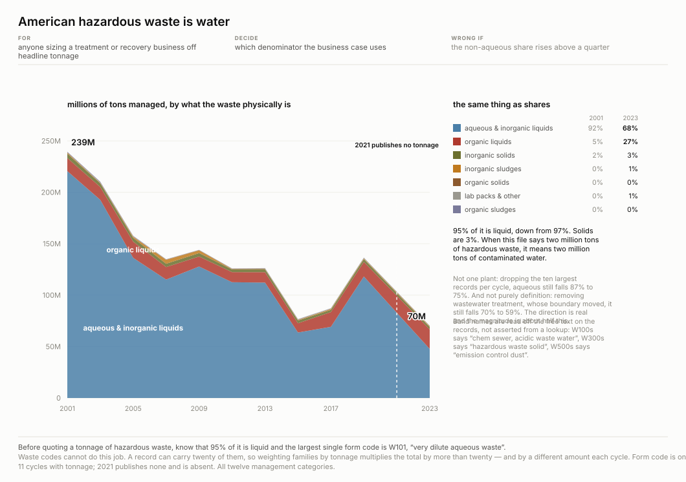

### Where it is made, and where it goes

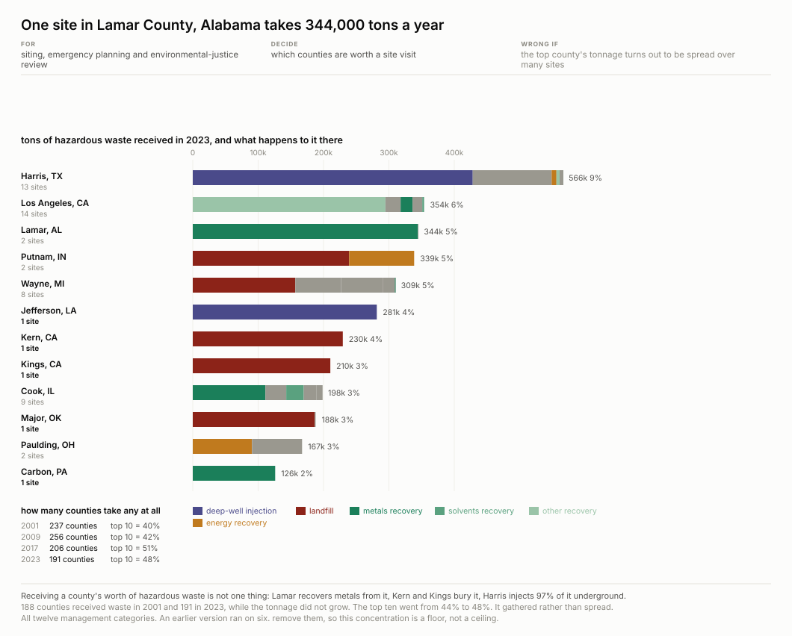

Generation is chemicals. **Receipt is 191 counties, ten of which take 48%.**

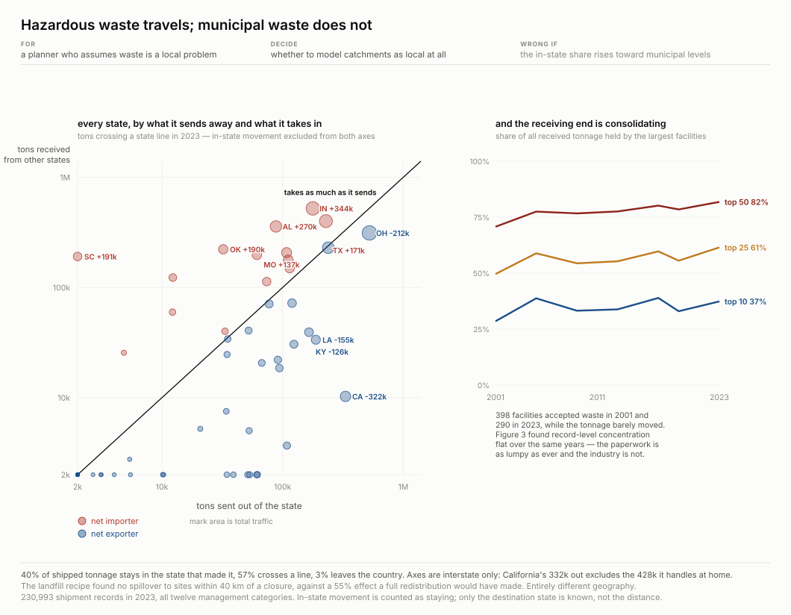

**57% of shipped tonnage crosses a state line** — hazardous waste travels in a way municipal
waste does not, because the treatment capacity is not where the generation is.

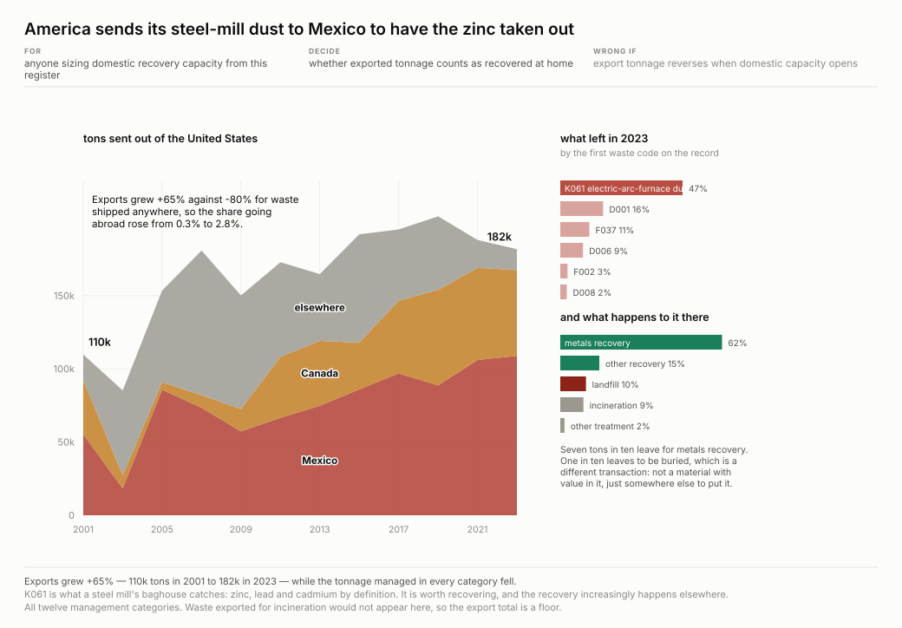

**Exports grew 65%**, and **47% of that is one waste code.** A national export line is one
material.

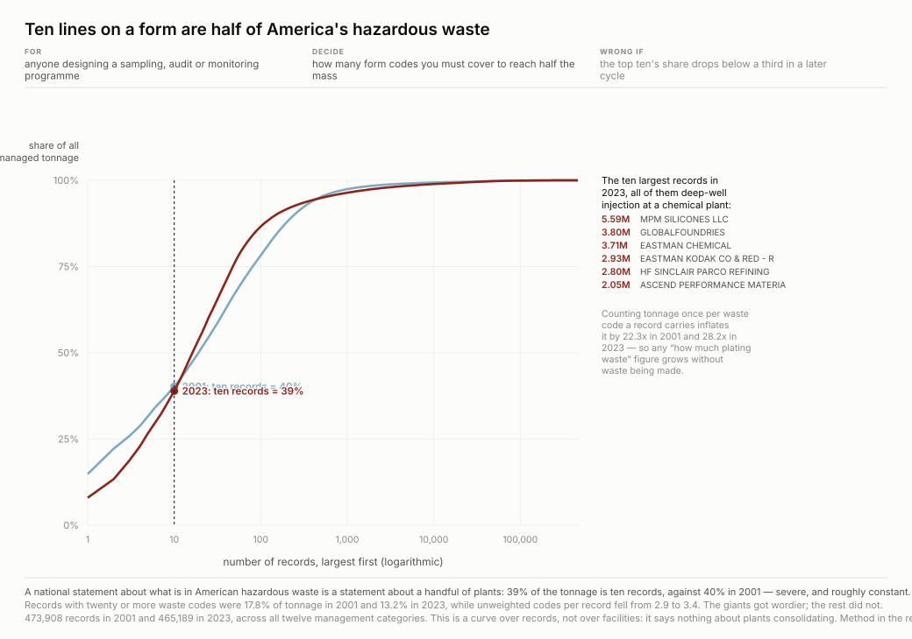

---

# IV. Is there a business in it

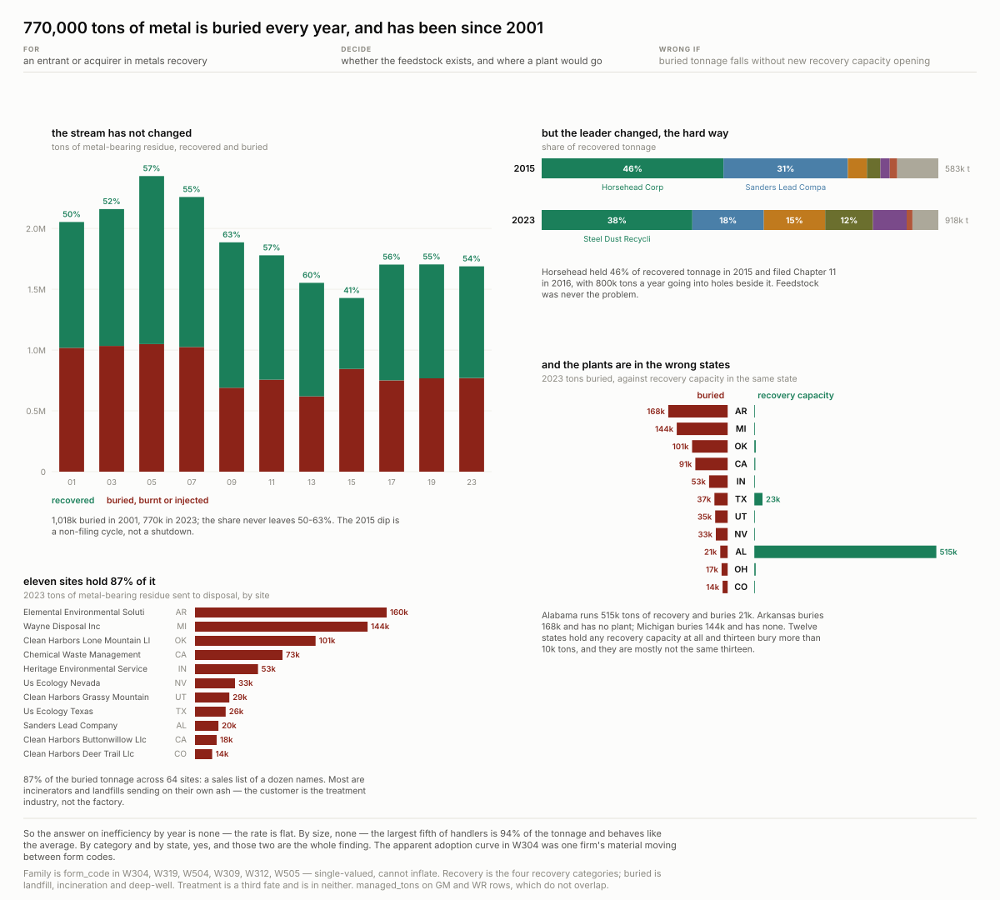

Three false leads are recorded here because each is the obvious first move.

**False lead one: rank streams by tons buried.** Returns landfills, whose recovery rate is 0%
by construction.

**False lead two: name the facilities burying proven-recoverable waste.** Returns the disposal
industry again — the decision is not made by the burier. `shipper_id` carries it.

**False lead three: follow the price.** Metal prices and recovery rates are both trending, so a
level regression gives rho −0.24 at p 0.009 and first differences give **−0.07 at p 0.49.** And
the first version tested eight *lead* smelters against the *zinc* price; lead against lead is
rho −0.002.

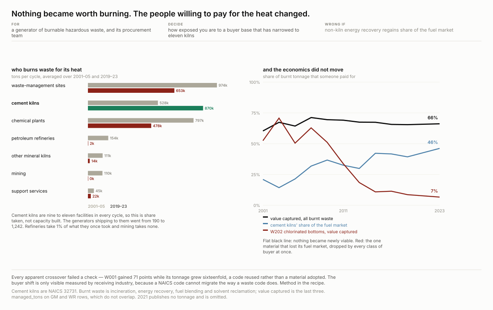
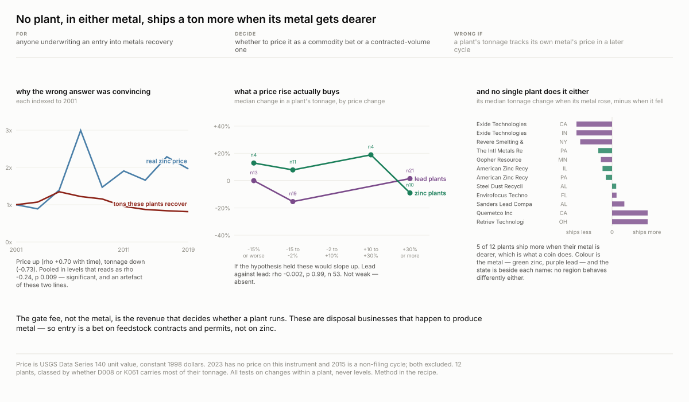
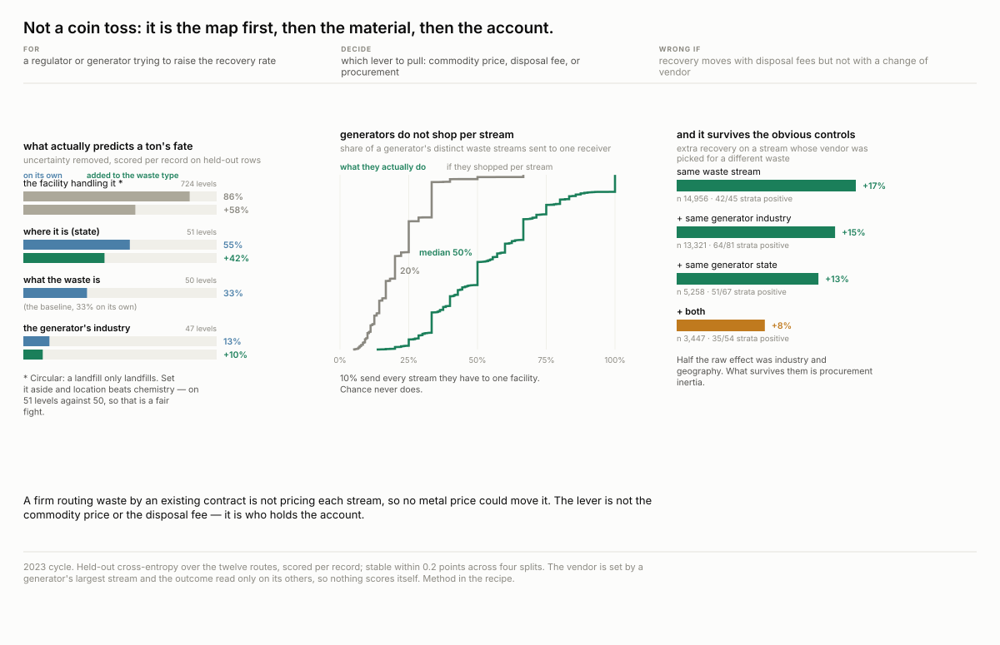

**The one real lead is procurement, not price.** After controlling for stream, industry and
state, a generator whose vendor was chosen for a *different* waste is worth **+8 points of
recovery rate**. Incineration and energy recovery are the same physical operation at two
different prices, which makes the split economics with no technology confound.

## What this cannot support

**Not a market-share analysis.** A route's tonnage is what a facility *handled*, not what
it was *paid for*. 97% of aqueous tonnage never leaves the site that made it, so a large
share of this register is captive volume that was never contestable. The concentration
measured here is of handling, not of trade.

**Not a causal account of why anything concentrated.** The register prices nothing — no
gate fee, no commodity price, no cost per ton. A companion analysis joined USGS metal
prices to the recovery series and found no relationship at all (rho −0.002 for lead plants
against the lead price, n=53, powered to detect 0.20), which rules a price story out as an
explanation of *throughput* but does not supply the real one.

**Not a statement about hazard.** A ton of contaminated soil and a ton of mercury are the
same number here.

**The 2021 cycle publishes no tonnage** and is omitted from every series. **`management_
category` contains a typo** — `SLUDGE TRTMNT / STAG / ENCAP` on 60 records in 2023 — which
any group-by on the raw string files as a thirteenth category. It is normalised, and the
figures say so.

## Reproducing

**Set `BR_CACHE` to reuse a pull.** The scripts here read `$BR_CACHE` or `artifacts/data/br-cache`.
The workspace recipe these came from uses `HWF_CACHE` for the same directory — the names differ,
and pointing the wrong one at a full cache produces "cycle 2001 is missing 12 slices" rather
than a silent wrong answer, which is the behaviour you want.

    cd recipes/waste-route-concentration
    python3 artifacts/scripts/fetch.py --all      # ~35 min, 8.0M rows, resumable
    python3 artifacts/scripts/records.py
    python3 artifacts/scripts/hands.py
    python3 artifacts/scripts/ginitrend.py
    python3 artifacts/scripts/verify.py           # recomputes every number above

`BR_CACHE` points the scripts at an existing pull if you have one. `verify.py` also fails
any figure whose SVG is older than the script that draws it — which is how a stale caption
survived in the workspace this came from, claiming a figure covered six management
categories long after the code had been loading twelve.
